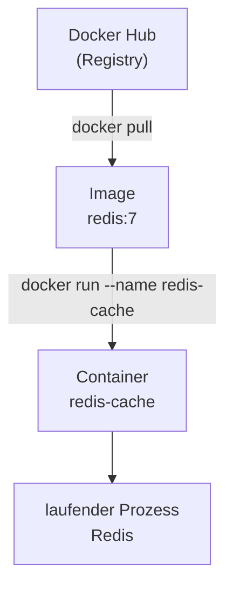
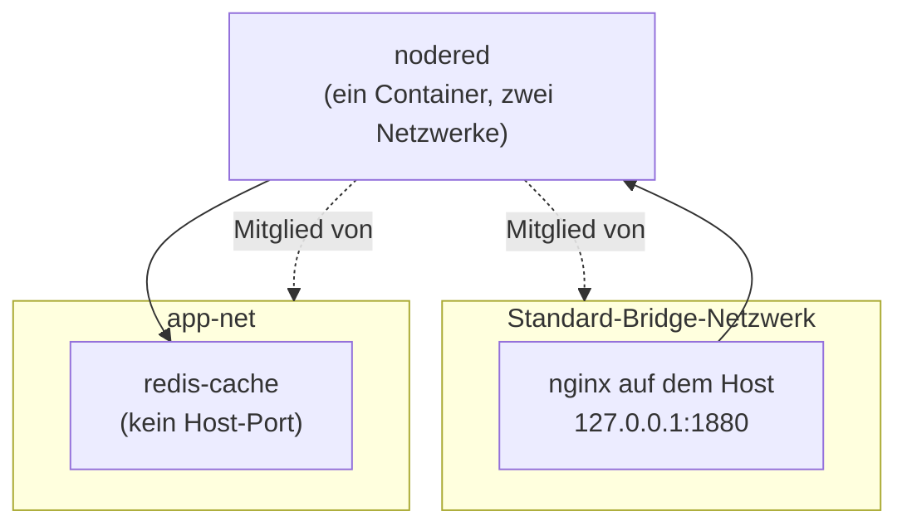
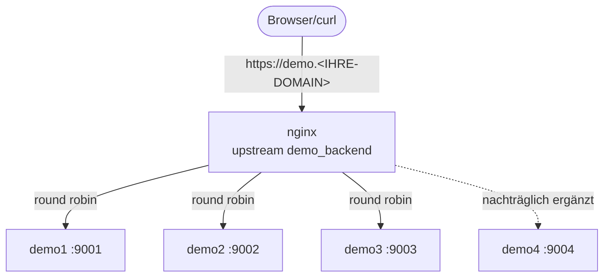

# Lab 06: Reverse Proxy ablösen und Docker-Netzwerke segmentieren für die ISO-27001-Zertifizierung


## Berufliche Aufgabenstellung

Das Unternehmen bereitet sich auf die Zertifizierung nach ISO/IEC 27001 vor. Im Rahmen der Auditvorbereitung hat ein externer Pentest die bestehende Infrastruktur überprüft und zwei Feststellungen dokumentiert, die vor dem eigentlichen Zertifizierungsaudit behoben werden müssen.

Erstens: Die TLS-Zertifikate werden vollständig automatisiert über Caddy bezogen. Welcher Zertifikatsanbieter dabei genutzt wird und über welches Protokoll, ist zwar in Caddys allgemeiner Dokumentation nachzulesen – aber an keiner Stelle im tatsächlich eingesetzten Caddyfile selbst erkennbar. Für Control **A.8.24 (Use of Cryptography)** der ISO 27001:2022 verlangt der Auditor, dass eine solche Entscheidung im eigenen, geprüften Konfigurationsbestand nachvollziehbar dokumentiert ist – ein impliziter Software-Standard, der sich mit einem künftigen Update jederzeit ändern könnte, ohne dass sich an der Konfiguration etwas ändert, reicht dafür nicht aus.

Zweitens: Sämtliche Docker-Container laufen im selben, nicht weiter unterteilten Standardnetzwerk; mehrere Backend-Dienste sind zudem über Host-Ports erreichbar, obwohl das nicht erforderlich wäre. Für Control **A.8.22 (Segregation of Networks)**, in Verbindung mit **A.8.20 (Networks Security)**, verlangt der Auditor eine erkennbare, begründete Trennung zusammengehöriger Dienste in eigene Netzwerksegmente.

Im Rahmen des Risikobehandlungsplans gibt die Leitungsebene die Umsetzung frei; das Betriebsteam wird als Maßnahmenverantwortlicher (Risk Owner) für beide Feststellungen benannt, mit dem Ziel, sie vor dem Zertifizierungsaudit zu beheben: Caddy wird durch nginx mit dem nativen ACME-Modul abgelöst, wodurch Zertifikatsanbieter und -protokoll explizit konfiguriert und damit auditierbar dokumentiert werden. Gleichzeitig werden zusammengehörige Container-Dienste bewusst in eigenen Docker-Netzwerken gebündelt, statt unkontrolliert im Default-Netz zu laufen.

---

## Einführung

In Lab 04 und Lab 05 hat Caddy die Zertifikatsverwaltung vollständig automatisch übernommen – komfortabel, aber für ein Audit ein Problem: *Welcher* Anbieter und *welches* Protokoll verwendet werden, steht nirgends im Caddyfile selbst, sondern ergibt sich stillschweigend aus Caddys eingebautem Standardverhalten. In diesem Lab lösen Sie Caddy durch **nginx** ab und konfigurieren die Zertifikatsausstellung mit dem seit 2025 verfügbaren, nativen `ngx_http_acme_module` explizit selbst – dessen Konfigurationsmodell verlangt zwingend einen benannten Issuer, ein Zertifikat „ohne jede Angabe" gibt es hier nicht. Anschließend bündeln Sie zusammengehörige Docker-Container gezielt in einem eigenen Netzwerk, statt sie unkontrolliert im Default-Netz laufen zu lassen. Zum Abschluss richten Sie eine einfache, manuell gepflegte Lastverteilung über mehrere Container-Instanzen ein.

## Lernziele

- ACME als offenes Protokoll verstehen und einen Zertifikatsanbieter (Issuer) bewusst und explizit konfigurieren
- nginx aus dem offiziellen Repository inklusive des nativen ACME-Moduls installieren und einrichten
- Mehrere virtuelle Hosts manuell als nginx-Server-Blöcke konfigurieren und den Unterschied zur automatisierten Caddy-Lösung nachvollziehen
- Ein eigenes Docker-Netzwerk anlegen, um zusammenhängende Container-Dienste gezielt zu bündeln und von anderen Diensten zu trennen
- Mehrere Container-Instanzen eines Dienstes manuell als nginx-Upstream-Gruppe für die Lastverteilung konfigurieren
- Die ISO-27001-Controls A.8.20, A.8.22 und A.8.24 mit konkreten technischen Maßnahmen in Verbindung bringen

## Voraussetzungen

| Anforderung | Details |
|---|---|
| **Server** | Debian stable (aktuell Trixie), öffentliche IPv4-Adresse (aus Lab 03) |
| **Caddy** | Aktuell noch aktiv – wird in diesem Lab abgelöst |
| **Dienst A / Dienst B** | Python-Testserver auf 127.0.0.1:8001/8002 aktiv (aus Lab 04) – nach einem Server-Neustart neu starten: `cd /srv/dienst-a && python3 -m http.server 8001 &` (analog 8002) |
| **Docker** | Installiert und betriebsbereit (aus Lab 05), inklusive der Container `nginx-web` und `nodered` |
| **SSH-Zugriff** | Key-Authentifizierung |
| **DNS** | Bestehende A-Records aus Lab 03–05 (`cockpit`, `dienst-a`, `dienst-b`, `www`, `dashboard`), zusätzlich ein neuer A-Record `demo.<IHRE-DOMAIN>` |

---

## Inhalt

- [Hintergrundwissen](#hintergrundwissen)
  - [Warum nginx statt Traefik?](#warum-nginx-statt-traefik)
  - [ACME als offenes Protokoll](#acme-als-offenes-protokoll)
  - [Das native ACME-Modul von nginx](#das-native-acme-modul-von-nginx)
  - [Docker-Netzwerke als Bündelungskonzept](#docker-netzwerke-als-bündelungskonzept)
  - [Ein kurzer Rückblick: automatische vs. bewusste Konfiguration](#ein-kurzer-rückblick-automatische-vs-bewusste-konfiguration)
- [Aufgaben](#aufgaben)
  - [Schritt 1: Caddy ablösen](#schritt-1-caddy-ablösen)
  - [Schritt 2: nginx aus dem offiziellen Repository installieren](#schritt-2-nginx-aus-dem-offiziellen-repository-installieren)
  - [Schritt 3: ACME-Modul aktivieren und Issuer konfigurieren](#schritt-3-acme-modul-aktivieren-und-issuer-konfigurieren)
  - [Schritt 4: Cockpit als nginx-Server-Block migrieren](#schritt-4-cockpit-als-nginx-server-block-migrieren)
  - [Schritt 5: Die übrigen Dienste analog migrieren](#schritt-5-die-übrigen-dienste-analog-migrieren)
  - [Schritt 6: Ergebnis im Browser prüfen](#schritt-6-ergebnis-im-browser-prüfen)
  - [Schritt 7: Eigenes Docker-Netzwerk anlegen und Dienste bewusst bündeln](#schritt-7-eigenes-docker-netzwerk-anlegen-und-dienste-bewusst-bündeln)
    - [7.1 Eigenes Netzwerk anlegen](#71-eigenes-netzwerk-anlegen)
    - [7.2 Bestehenden Container zusätzlich anbinden](#72-bestehenden-container-zusätzlich-anbinden)
    - [7.3 Neuen, rein internen Dienst starten](#73-neuen-rein-internen-dienst-starten)
    - [7.4 Namensauflösung innerhalb des Netzwerks prüfen](#74-namensauflösung-innerhalb-des-netzwerks-prüfen)
    - [7.5 Gegenprobe: Auflösung außerhalb von app-net](#75-gegenprobe-auflösung-außerhalb-von-app-net)
    - [7.6 Port-Check auf dem Host](#76-port-check-auf-dem-host)
    - [7.7 Hintergrund: IP-Vergabe und Routing in Docker-Netzwerken](#77-hintergrund-ip-vergabe-und-routing-in-docker-netzwerken)
  - [Schritt 8: Lastverteilung einrichten und Last erzeugen](#schritt-8-lastverteilung-einrichten-und-last-erzeugen)
- [Reflexion und weiterführende Fragen](#reflexion-und-weiterführende-fragen)
- [Rückblick und Zusammenfassung](#rückblick-und-zusammenfassung)
- [Aufräumarbeiten](#aufräumarbeiten)
- [Autoren und Urheberrecht](#autoren-und-urheberrecht)

---

## Hintergrundwissen

### ACME als offenes Protokoll

ACME (*Automated Certificate Management Environment*) ist ein offenes, standardisiertes Protokoll zur automatisierten Ausstellung und Erneuerung von TLS-Zertifikaten – ursprünglich von Let's Encrypt entwickelt, heute von zahlreichen Zertifizierungsstellen unterstützt. Caddy, Traefik, Certbot und nginx sind allesamt nur unterschiedliche **ACME-Clients**, die mit einem austauschbaren **Issuer** (der Zertifizierungsstelle) sprechen. Diese Trennung von Werkzeug und Anbieter existiert bei Caddy zwar genauso – nur eben unsichtbar: Automatisches HTTPS funktioniert dort komplett ohne jede Angabe von CA oder Protokoll, weshalb in der Praxis oft nie jemand eine explizite Entscheidung trifft oder festhält. Das nginx-ACME-Modul erzwingt diese Angabe strukturell, weil ohne einen benannten `acme_issuer` gar kein Zertifikat ausgestellt wird – genau das machen Sie sich in diesem Lab zunutze.

### Das native ACME-Modul von nginx

Seit August 2025 bietet nginx mit `ngx_http_acme_module` ein offizielles, in Rust implementiertes Modul, das ACMEv2 direkt in der nginx-Konfiguration abbildet – sowohl für nginx Open Source als auch für NGINX Plus. Statt eines impliziten Automatismus definieren Sie einen benannten `acme_issuer`-Block mit der Server-URI der Zertifizierungsstelle, ordnen ihn explizit einem virtuellen Host über `acme_certificate` zu und richten einen eigenen Listener für die HTTP-01-Challenge ein. Aktuell wird ausschließlich die HTTP-01-Challenge unterstützt; DNS-01 ist für künftige Versionen angekündigt.

### Docker-Netzwerke als Bündelungskonzept

Im Default-Bridge-Netzwerk von Docker können sich grundsätzlich alle Container gegenseitig erreichen – unabhängig davon, ob sie inhaltlich zusammengehören. Ein eigenes, benutzerdefiniertes Netzwerk dient nicht primär der Automatisierung, sondern der bewussten **Bündelung zusammengehöriger Dienste** und der **Abgrenzung** gegenüber allem, was nicht dazugehört – genau das, was Control A.8.22 verlangt. In einer späteren Übung werden Sie dieses Prinzip in größerem Maßstab wiederverwenden: eine zeitbasierte Datenbank (z. B. InfluxDB), ein Connector-Dienst und eine Visualisierung (z. B. Grafana) werden dann gemeinsam in einem eigenen Netzwerk laufen, ohne dass die Datenbank selbst von außen erreichbar sein muss. In diesem Lab üben Sie das Prinzip bereits an einem kleinen Beispiel.

[↑ Zum Inhaltsverzeichnis](#inhalt)

---

## Aufgaben

### Schritt 1: Caddy ablösen

Stoppen und deaktivieren Sie Caddy. Das Caddyfile bleibt als Referenz erhalten, wird aber nicht mehr verwendet.

```bash
systemctl stop caddy
systemctl disable caddy
```

Prüfen Sie, dass die Ports 80 und 443 frei sind:

```bash
ss -tlnp | grep -E ':80 |:443 '   # Erzeugen: aktive Listener anzeigen | Filtern: nur Port 80/443
```

Die Ausgabe sollte leer sein.

[↑ Zum Inhaltsverzeichnis](#inhalt)

---

### Schritt 2: nginx aus dem offiziellen Repository installieren

Wie schon bei Caddy (Lab 04) und Docker (Lab 05) installieren Sie nginx nicht aus den Debian-Standardquellen, sondern aus dem offiziellen nginx-Repository – nur dort ist das aktuelle ACME-Modul verfügbar.

```bash
apt install -y curl gnupg2 ca-certificates lsb-release

curl -fsSL https://nginx.org/keys/nginx_signing.key \    # Erzeugen: Schlüssel-Datei laden
  | gpg --dearmor | tee /usr/share/keyrings/nginx-archive-keyring.gpg > /dev/null
    # Filtern/Umwandeln: in Binärformat wandeln | Ablegen: in Datei schreiben (Bildschirmausgabe unterdrückt)

echo "deb [signed-by=/usr/share/keyrings/nginx-archive-keyring.gpg] http://nginx.org/packages/mainline/debian $(lsb_release -cs) nginx" \
  | tee /etc/apt/sources.list.d/nginx.list
    # Erzeugen: Repository-Zeile (inkl. Command Substitution $(lsb_release -cs)) | Ablegen: in Datei schreiben + anzeigen
```

> Dieselbe Grundstruktur **[Text erzeugen] → (filtern/umwandeln) → [ablegen]** wie im Exkurs zu Lab 02 – nur mit anderen Befehlen (`curl`/`echo` statt `echo`, `gpg --dearmor` statt `grep`, `tee` statt `logger`).

> **Tipp zur Fehlerbehebung:** Bricht `apt update` anschließend mit einer Meldung wie „The repository ... does not have a Release file" ab, prüfen Sie zunächst den tatsächlichen Codenamen Ihres Systems:
> ```bash
> cat /etc/os-release
> ```
> `VERSION_CODENAME` sollte für Debian stable aktuell `trixie` liefern. Weicht der von `lsb_release -cs` gelieferte Wert davon ab (z. B. auf einem Debian-Derivat mit eigenem Codenamen), tragen Sie den korrekten Debian-Codenamen händisch in die Repository-Zeile ein:
> ```bash
> rm /etc/apt/sources.list.d/nginx.list
> echo "deb [signed-by=/usr/share/keyrings/nginx-archive-keyring.gpg] http://nginx.org/packages/mainline/debian trixie nginx" \
>   | tee /etc/apt/sources.list.d/nginx.list
> apt update
> ```
> (gleiche Befehlsstruktur wie oben – nur der Codename fest statt per Command Substitution eingetragen)

Damit apt bei künftigen Updates konsequent das offizielle nginx-Paket statt der älteren Distributionsvariante bevorzugt, legen Sie eine Pinning-Regel an:

```bash
printf 'Package: *\nPin: origin nginx.org\nPin-Priority: 900\n' \    # Erzeugen: drei Zeilen Pinning-Konfiguration
  | tee /etc/apt/preferences.d/99nginx                                # Ablegen: in neue Datei schreiben
```

Paketliste aktualisieren und nginx mitsamt ACME-Modul installieren:

```bash
apt update
apt install -y nginx nginx-module-acme
```

Prüfen Sie die Installation:

```bash
nginx -v
systemctl enable --now nginx
curl http://localhost
```

Die letzte Zeile sollte die Standard-Begrüßungsseite von nginx liefern.

[↑ Zum Inhaltsverzeichnis](#inhalt)

---

### Schritt 3: ACME-Modul aktivieren und Issuer konfigurieren

Das Modul muss als Erstes im Hauptkontext von nginx geladen werden:

```bash
nano /etc/nginx/nginx.conf
```

Fügen Sie als erste Zeile der Datei ein:

```nginx
load_module modules/ngx_http_acme_module.so;
```

> **Warum ganz oben?**  
> `load_module` muss im Hauptkontext stehen, bevor `events {}` oder `http {}` beginnen – nginx lädt dynamische Module beim Start, nicht zur Laufzeit.

Legen Sie ein Verzeichnis für die Zertifikatsdaten an und übergeben Sie es dem nginx-Benutzer (das offizielle nginx-Paket führt Worker-Prozesse unter dem Benutzer `nginx`, nicht `www-data`- das wäre der Benutzer bei der Debian-eigenen nginx-Variante):

```bash
mkdir -p /var/lib/nginx/acme-letsencrypt
chown -R nginx:nginx /var/lib/nginx/acme-letsencrypt
```

Erstellen Sie die ACME-Konfiguration:

```bash
nano /etc/nginx/conf.d/acme.conf
```

```nginx
resolver 8.8.8.8 valid=300s;

acme_shared_zone zone=acme_shared:1M;

acme_issuer letsencrypt {
    uri https://acme-v02.api.letsencrypt.org/directory;
    contact mailto:admin@<IHRE-DOMAIN>;
    state_path /var/lib/nginx/acme-letsencrypt;
    accept_terms_of_service;
}
```

> **Was passiert hier?**  
> `resolver` wird benötigt, damit das Modul die Adresse der Zertifizierungsstelle außerhalb der normalen Anfragebearbeitung selbst auflösen kann. `acme_issuer` definiert explizit, welcher Anbieter über welches Protokoll angesprochen wird – genau die Nachvollziehbarkeit, die im Audit gefordert ist. `accept_terms_of_service` ist eine bewusste, im Klartext sichtbare Zustimmung zu den Nutzungsbedingungen von Let's Encrypt.

Richten Sie zusätzlich einen Listener für die HTTP-01-Challenge ein, der gleichzeitig unverschlüsselte Anfragen auf HTTPS umleitet:

```bash
nano /etc/nginx/conf.d/challenge.conf
```

```nginx
# Virtueller Host für unverschlüsselte HTTP-Anfragen (Port 80)
server {
    # Lauscht auf Port 80. "default_server" macht diesen Block zum
    # Auffangbecken für ALLE Anfragen auf Port 80, die keinem anderen
    # Server-Block (z. B. cockpit.conf, dienst-a.conf) über server_name
    # zugeordnet werden können.
    listen 80 default_server;

    # Gilt für jeden angefragten Pfad - "/" fängt alles ab, was nicht
    # durch eine spezifischere location-Regel abgedeckt ist.
    location / {
        # Antwortet mit HTTP-Statuscode 301 (dauerhafte Weiterleitung)
        # und leitet auf dieselbe Adresse, aber über HTTPS, um.
        # $host        = der angefragte Hostname, z. B. cockpit.<IHRE-DOMAIN>
        # $request_uri = der vollständige ursprüngliche Pfad inkl. Query-String
        # Beispiel: http://dienst-a.<IHRE-DOMAIN>/seite?x=1
        #        -> https://dienst-a.<IHRE-DOMAIN>/seite?x=1
        return 301 https://$host$request_uri;
    }
}
```

Da `load_module` nur beim vollständigen Start eingelesen wird, genügt hier kein einfaches Reload:

```bash
nginx -t
systemctl restart nginx
```

> **Tipp zur Fehlerbehebung:** Falls die spätere Zertifikatsausstellung fehlschlägt, prüfen Sie zunächst, ob der Redirect in `challenge.conf` die Challenge-Anfrage blockiert. Ersetzen Sie ihn zum Testen vorübergehend durch `return 404;` und prüfen Sie erneut.

[↑ Zum Inhaltsverzeichnis](#inhalt)

---

### Schritt 4: Cockpit als nginx-Server-Block migrieren

Erstellen Sie die Konfiguration für Cockpit:

```bash
nano /etc/nginx/conf.d/cockpit.conf
```

```nginx
server {
    listen 443 ssl;
    server_name cockpit.<IHRE-DOMAIN>;

    acme_certificate letsencrypt;
    ssl_certificate $acme_certificate;
    ssl_certificate_key $acme_certificate_key;
    ssl_certificate_cache max=2;

    location / {
        proxy_pass https://127.0.0.1:9090;
        proxy_ssl_verify off;
        proxy_set_header Host $host;
        proxy_set_header X-Real-IP $remote_addr;
        proxy_http_version 1.1;
        proxy_set_header Upgrade $http_upgrade;
        proxy_set_header Connection "upgrade";
    }
}
```
#### Diese Konfiguration im Detail

`listen 443 ssl;` lässt diesen Server-Block verschlüsselte Verbindungen auf Port 443 annehmen – das `ssl` weist nginx an, hier einen TLS-Handshake durchzuführen, bevor irgendein Inhalt ausgeliefert wird. 

`server_name cockpit.<IHRE-DOMAIN>;` legt fest, dass dieser Block nur für Anfragen mit genau diesem Hostnamen zuständig ist – anhand des SNI beim TLS-Handshake entscheidet nginx, welcher von mehreren Server-Blöcken auf Port 443 eine konkrete Anfrage bearbeitet.

`acme_certificate letsencrypt;` ist die zentrale Anweisung: Sie teilt dem ACME-Modul mit, für `cockpit.<IHRE-DOMAIN>` (der Name wird automatisch aus `server_name` übernommen) jederzeit ein gültiges Zertifikat über den zuvor definierten Issuer `letsencrypt` bereitzuhalten. Das Modul überwacht die Restlaufzeit selbst und stößt die Erneuerung rechtzeitig vor **Ablauf der 90 Tage** an, ohne dass Sie eingreifen müssen.

`ssl_certificate $acme_certificate;` und `ssl_certificate_key $acme_certificate_key;` verweisen – im Unterschied zu sonst üblichen, statischen Dateipfaden – auf **Variablen**, die das ACME-Modul bereitstellt. Bei einer Erneuerung tauscht das Modul den Inhalt dieser Variablen aus; neue Verbindungen erhalten sofort das aktuelle Zertifikat, ohne dass ein `nginx -t` oder `systemctl reload` nötig wäre. Das unterscheidet diese Lösung von einer klassischen, statischen Konfiguration mit Certbot (alter Lösungsansatz für ACME), bei der nach jeder Erneuerung ein Reload erforderlich ist. 

`ssl_certificate_cache max=2;` ist eine reine Performance-Einstellung: nginx hält bis zu zwei geparste Zertifikate im Cache vor, unter anderem für die kurze Übergangsphase zwischen altem und neu ausgestelltem Zertifikat.

Damit diese Automatik dauerhaft funktioniert, müssen drei Voraussetzungen erhalten bleiben: Port 80 muss über `ufw` weiterhin für die HTTP-01-Challenge erreichbar sein, die DNS-A-Records müssen weiterhin auf diesen Server zeigen, und das Verzeichnis `/var/lib/nginx/acme-letsencrypt` darf nicht gelöscht werden, da dort Konto-Schlüssel und Status liegen.

Im `location`-Block regelt `proxy_pass https://127.0.0.1:9090;` die Weiterleitung an Cockpit. 
`proxy_ssl_verify off;` ist das nginx-Äquivalent zu Caddys `tls_insecure_skip_verify` aus Lab 04 – Cockpit betreibt intern weiterhin ein selbst signiertes Zertifikat auf Port 9090, das nur für diese lokale Verbindung akzeptiert werden muss; unkritisch, da diese Verbindung nie den Server verlässt. 
`proxy_set_header X-Real-IP $remote_addr;` gibt die tatsächliche Client-IP an Cockpit weiter – ohne diese Zeile würde Cockpit in seinen eigenen Logs nur die IP von nginx selbst sehen, was der im Audit geforderten Nachvollziehbarkeit widerspräche. Das wäre bei einem Zugriff aus einem Heimnetz über den Heimrouter die öffentliche IP des Heimrouters.
Die drei Zeilen `proxy_http_version 1.1;`, `proxy_set_header Upgrade $http_upgrade;` und `proxy_set_header Connection "upgrade";` ermöglichen WebSocket-Verbindungen durch den Proxy hindurch, die Cockpit für Live-Updates (z. B. Terminal, Ressourcen-Graphen) benötigt.


Validieren und laden Sie die Konfiguration:

```bash
nginx -t
systemctl reload nginx
```

Beobachten Sie die Ausstellung des Zertifikats:

```bash
journalctl -u nginx -f
```

Rufen Sie anschließend `https://cockpit.<IHRE-DOMAIN>` im Browser auf und prüfen Sie im Zertifikat: Aussteller Let's Encrypt, keine Sicherheitswarnung.

[↑ Zum Inhaltsverzeichnis](#inhalt)

---

### Schritt 5: Die übrigen Dienste analog migrieren

Wiederholen Sie das Muster für die restlichen vier Dienste.

**Dienst A** (`/etc/nginx/conf.d/dienst-a.conf`):

```nginx
server {
    listen 443 ssl;
    server_name dienst-a.<IHRE-DOMAIN>;

    acme_certificate letsencrypt;
    ssl_certificate $acme_certificate;
    ssl_certificate_key $acme_certificate_key;
    ssl_certificate_cache max=2;

    location / {
        proxy_pass http://127.0.0.1:8001;
        proxy_set_header Host $host;
        proxy_set_header X-Real-IP $remote_addr;
    }
}
```

**Dienst B** benötigt zusätzlich Basic Authentication. Erzeugen Sie zunächst eine Passwortdatei:

```bash
apt install -y apache2-utils
htpasswd -B -c /etc/nginx/.htpasswd admin   # -B: bcrypt-Hash, -c: Datei neu anlegen, admin: Benutzername
```

> **Vergleich mit Caddy:** Caddy hat den bcrypt-Hash mit `caddy hash-password` direkt ins Caddyfile geschrieben. nginx benötigt dafür eine separate Datei und das Werkzeug `htpasswd` aus den Apache-Hilfsprogrammen – derselbe Hash-Algorithmus (bcrypt, Option `-B`), aber ein anderer Aufbewahrungsort.

`/etc/nginx/conf.d/dienst-b.conf`:

```nginx
server {
    listen 443 ssl;
    server_name dienst-b.<IHRE-DOMAIN>;

    acme_certificate letsencrypt;
    ssl_certificate $acme_certificate;
    ssl_certificate_key $acme_certificate_key;
    ssl_certificate_cache max=2;

    auth_basic "Geschützter Bereich";
    auth_basic_user_file /etc/nginx/.htpasswd;

    location / {
        proxy_pass http://127.0.0.1:8002;
        proxy_set_header Host $host;
        proxy_set_header X-Real-IP $remote_addr;
    }
}
```

**Unternehmenswebseite** (`/etc/nginx/conf.d/www.conf`), Container aus Lab 05 auf Host-Port 8080 (nur lokal gebunden, siehe Lab 05):

```nginx
server {
    listen 443 ssl;
    server_name www.<IHRE-DOMAIN>;

    acme_certificate letsencrypt;
    ssl_certificate $acme_certificate;
    ssl_certificate_key $acme_certificate_key;
    ssl_certificate_cache max=2;

    location / {
        proxy_pass http://127.0.0.1:8080;
        proxy_set_header Host $host;
        proxy_set_header X-Real-IP $remote_addr;
    }
}
```

**Node-RED Dashboard** (`/etc/nginx/conf.d/dashboard.conf`), Container aus Lab 05 auf Host-Port 1880 (nur lokal gebunden, mit aktivierter `adminAuth`, siehe Lab 05):

```nginx
server {
    listen 443 ssl;
    server_name dashboard.<IHRE-DOMAIN>;

    acme_certificate letsencrypt;
    ssl_certificate $acme_certificate;
    ssl_certificate_key $acme_certificate_key;
    ssl_certificate_cache max=2;

    location / {
        proxy_pass http://127.0.0.1:1880;
        proxy_set_header Host $host;
        proxy_set_header X-Real-IP $remote_addr;
        proxy_http_version 1.1;
        proxy_set_header Upgrade $http_upgrade;
        proxy_set_header Connection "upgrade";
    }
}
```

Validieren und laden Sie nach jeder Datei neu:

```bash
nginx -t
systemctl reload nginx
```

Verschaffen Sie sich am Ende einen Überblick über alle angelegten Konfigurationsdateien:

```bash
ls -la /etc/nginx/conf.d/
```

| Datei | Zuständigkeit |
|---|---|
| `acme.conf` | ACME-Issuer und Shared Zone |
| `challenge.conf` | HTTP-01-Challenge und Redirect auf HTTPS |
| `cockpit.conf` | Cockpit-Weboberfläche |
| `dienst-a.conf` | Öffentlich erreichbarer Demo-Dienst |
| `dienst-b.conf` | Demo-Dienst mit Basic Authentication |
| `www.conf` | Unternehmenswebseite (Docker-Container) |
| `dashboard.conf` | Node-RED-Dashboard (Docker-Container) |

[↑ Zum Inhaltsverzeichnis](#inhalt)

---

### Schritt 6: Ergebnis im Browser prüfen

Rufen Sie alle fünf Domains auf und prüfen Sie jeweils das Zertifikat (Aussteller: Let's Encrypt, keine Browserwarnung):

```
https://cockpit.<IHRE-DOMAIN>
https://dienst-a.<IHRE-DOMAIN>
https://dienst-b.<IHRE-DOMAIN>
https://www.<IHRE-DOMAIN>
https://dashboard.<IHRE-DOMAIN>
```

Vergewissern Sie sich, dass Caddy nicht mehr läuft:

```bash
systemctl status caddy
```

Der Dienst muss als `inactive (dead)` gemeldet sein.

[↑ Zum Inhaltsverzeichnis](#inhalt)

---

### Schritt 7: Eigenes Docker-Netzwerk anlegen und Dienste bewusst bündeln

Bisher waren alle Container über `-p <host-port>:<container-port>` für den Host (und damit für nginx) erreichbar. In diesem Schritt lernen Sie das Gegenteil: einen Dienst, der **ausschließlich für andere Container** erreichbar sein soll – nicht für den Host, nicht für das Internet.

#### 7.1 Eigenes Netzwerk anlegen

```bash
docker network create app-net
```

Damit legen Sie ein eigenes, benutzerdefiniertes Docker-Netzwerk namens `app-net` an. Container, die diesem Netzwerk beitreten, können sich gegenseitig über ihren Containernamen erreichen – Docker betreibt dafür intern einen eigenen DNS-Server pro Netzwerk.

#### 7.2 Bestehenden Container zusätzlich anbinden

```bash
docker network connect app-net nodered
```

`nodered` läuft bereits (aus Lab 05) mit `-p 127.0.0.1:1880:1880` im Standard-Netzwerk – darüber bleibt er für nginx auf dem Host erreichbar, aber weiterhin nicht direkt aus dem Internet. Mit diesem Befehl bekommt `nodered` ein zweites Standbein: Er gehört jetzt **gleichzeitig** zwei Netzwerken an. Ein Container kann beliebig vielen Netzwerken angehören, ohne neu erstellt werden zu müssen.

#### 7.3 Neuen, rein internen Dienst starten

```bash
docker run -d \
  --name redis-cache \
  --restart unless-stopped \
  --network app-net \
  redis:7
```

| Element | Bedeutung |
|---|---|
| `redis:7` | Das **Image** – der Bauplan für die Redis-Software, Version 7. Wird von Docker Hub geladen. |
| `--name redis-cache` | Der Name, den der daraus erstellte **Container** bekommt. Innerhalb von `app-net` ist das zugleich der Hostname, unter dem dieser Container per DNS auffindbar ist. |
| `--network app-net` | Der Container wird direkt bei seiner Erstellung diesem Netzwerk zugewiesen – im Unterschied zu `nodered`, der nachträglich per `network connect` hinzugefügt wurde. |
| (kein `-p`) | Bewusst weggelassen: Es gibt keinen Host-Port. Der Container ist außerhalb von `app-net` nicht erreichbar – nicht vom Host, nicht aus dem Internet. |

> **Image, Container, Software – was ist hier eigentlich was?**
> Diese drei Begriffe werden leicht vermischt:
> - **Image** (`redis:7`): ein unveränderlicher Bauplan, der auf Docker Hub liegt.
> - **Container** (`redis-cache`): die laufende, konkrete Instanz, die aus diesem Bauplan erzeugt wurde – mit eigenem Namen und eigenem Lebenszyklus.
> - **Software** (Redis): das Programm, das innerhalb dieses Containers tatsächlich läuft – eine In-Memory-Datenbank, die in der Praxis meist als schneller Zwischenspeicher (Cache) vor einer langsameren Hauptdatenbank eingesetzt wird.
>
> Es gibt in diesem Abschnitt also nur **einen** Container: `redis-cache`. „Redis" und „redis-cache" meinen praktisch dasselbe Ding – einmal als Produktname, einmal als der konkrete Name, den dieser eine Container in Ihrer Umgebung trägt.



> **Vorgriff:** In einer späteren Übung übernehmen eine Zeitreihendatenbank (z. B. InfluxDB), ein Connector-Dienst und eine Visualisierung (z. B. Grafana) genau dieses Muster – mehrere zusammenspielende Container in einem eigenen Netzwerk, von denen nur die Visualisierung nach außen erreichbar sein muss. `redis-cache` steht hier stellvertretend für diesen späteren Datenhaltungsdienst – nicht als sinnvoller Produktiv-Cache für `nodered`, sondern als einfaches Beispiel-Image für das Bündelungsprinzip.

#### 7.4 Namensauflösung innerhalb des Netzwerks prüfen

```bash
docker run --rm --network app-net debian:trixie-slim getent hosts redis-cache
```

| Element | Bedeutung |
|---|---|
| `debian:trixie-slim` | Das **Image** – dieselbe schlanke Debian-Basis wie in Lab 07. Hier nicht als Basis für ein eigenes Image, sondern nur als schnell startendes Test-Werkzeug, das die nötigen Bordmittel (`getent`) bereits mitbringt. |
| (kein `--name`) | Der daraus gestartete Container bekommt einen von Docker zufällig vergebenen Namen – unwichtig, da er sich gleich wieder selbst löscht. |
| `--rm` | Der Container wird sofort nach Beendigung des Befehls automatisch gelöscht. Er existiert nur für die Dauer dieses einen Aufrufs. |
| `getent hosts redis-cache` | Der Befehl, der **innerhalb** des Test-Containers ausgeführt wird. `getent hosts <name>` fragt: „Welche IP-Adresse gehört zu diesem Namen?" – gefragt wird hier nach dem Namen des **Redis-Containers**. |

> **Achtung bei der Eingabe:** Die Datenbank heißt `hosts` (mit „s" am Ende). `getent host redis-cache` (ohne „s") führt zu einer Fehlermeldung, weil `host` keine gültige Datenbank ist – das ist ein Tippfehler, kein Problem der Namensauflösung selbst.

Die Ausgabe zeigt die interne IP-Adresse von `redis-cache`, z. B.:

```
172.18.0.3      redis-cache
```

#### 7.5 Gegenprobe: Auflösung außerhalb von `app-net`

```bash
docker run --rm debian:trixie-slim getent hosts redis-cache
```

Dieser Befehl liefert **keine** Auflösung. Der einzige, aber entscheidende Unterschied zum vorherigen Befehl: Hier fehlt `--network app-net`. Ohne diese Angabe verwendet Docker automatisch das Standard-Bridge-Netzwerk – ein komplett anderes Netzwerk als `app-net`, mit einem eigenen, separaten internen DNS. `redis-cache` ist dort nicht bekannt, weil er ausschließlich Mitglied von `app-net` ist.

> **Bildlich:** `app-net` ist ein Konferenzraum mit eigenem internen Telefonbuch. `redis-cache` (und zeitweise `nodered`) sitzen in diesem Raum und stehen im Telefonbuch. Ein Test-Container ohne `--network app-net` betritt diesen Raum gar nicht – er bleibt im Foyer (Standard-Bridge-Netz) mit einem eigenen, anderen Telefonbuch, in dem `redis-cache` schlicht nicht eingetragen ist.

#### 7.6 Port-Check auf dem Host

```bash
ss -tlnp | grep 6379
```
>**Hinweis:** 6379 ist der Standard-Port für Redis

Die Ausgabe sollte **leer** sein. Im Unterschied zu den Containern aus Lab 05 (die bewusst über `-p 127.0.0.1:<port>:<port>` veröffentlicht wurden) ist hier gar kein Host-Port nötig – `redis-cache` muss ausschließlich für `nodered` erreichbar sein, und das funktioniert vollständig innerhalb von `app-net`, ohne dass der Host überhaupt einen offenen Port dafür braucht.

> **Warum trotzdem mindestens ein Dienst sichtbar bleiben muss:** `app-net` selbst macht nach außen gar nichts sichtbar. Die einzige Verbindung zur Außenwelt bleibt `nodered` – er gehört weiterhin zusätzlich dem Standard-Netzwerk an und ist dort über `-p 127.0.0.1:1880:1880` für nginx erreichbar (aus Lab 05). `nodered` fungiert damit als Brücke zwischen beiden Welten: lokal erreichbar über sein Host-Port-Mapping (für den Reverse Proxy), nach innen verbunden mit `redis-cache` über `app-net`. `redis-cache` selbst braucht diese Brücke nicht – er muss nur von `nodered` aus erreichbar sein, nicht von irgendwo sonst.

Die Netzwerk-Zugehörigkeiten aus diesem Schritt im Überblick – `nodered` ist Mitglied beider Netzwerke und damit die einzige Brücke zwischen ihnen, `redis-cache` ausschließlich Mitglied von `app-net`:



#### 7.7 Hintergrund: IP-Vergabe und Routing in Docker-Netzwerken

Die IP-Adresse `172.18.0.3`, die in Schritt 7.4 für `redis-cache` aufgetaucht ist, kam nicht von irgendwoher – sie wurde Docker beim Anlegen von `app-net` automatisch aus einem eigenen Adresspool zugewiesen. Jedes Docker-Netzwerk bekommt dabei ein eigenes Subnetz; das Standard-Netzwerk `bridge` belegt meist `172.17.0.0/16`, eigene Netzwerke wie `app-net` erhalten automatisch das nächste freie Subnetz (z. B. `172.18.0.0/16`).

Innerhalb eines solchen Netzwerks ist das, was wie „Routing" wirkt, eigentlich **Switching auf Layer 2**: Alle Container eines Netzwerks hängen an derselben virtuellen Linux-Bridge und liegen im selben Subnetz – es muss also nichts zwischen unterschiedlichen Netzbereichen vermittelt werden. Die Namensauflösung (Containername → IP), die Sie in 7.4 mit `getent hosts` genutzt haben, übernimmt dabei der eingebaute Docker-DNS-Server.

Zwischen zwei eigenständigen, unterschiedlichen Netzwerken gibt es dagegen **kein automatisches Routing** – sie sind grundsätzlich voneinander isoliert. Genau das war in 7.5 zu sehen: Ohne `--network app-net` landet ein Container im Standard-Netzwerk, einem komplett anderen Adressbereich mit eigenem, separaten DNS. Nur ein Container, der – wie `nodered` – Mitglied in beiden Netzwerken ist, kann zwischen ihnen vermitteln.

Folgende Befehle helfen, sich jederzeit einen Überblick über die vorhandenen Docker-Netzwerke und ihre IP-Vergabe zu verschaffen:

| Befehl | Bedeutung |
|---|---|
| `docker network ls` | Alle Netzwerke anzeigen, inkl. der Standardnetze `bridge`, `host` und `none` |
| `docker network create <name>` | Eigenes Netzwerk anlegen |
| `docker network rm <name>` | Netzwerk löschen (nur möglich, wenn keine Container mehr verbunden sind) |
| `docker network inspect <name>` | Vollständige Details zu einem Netzwerk: Subnetz, IPAM-Konfiguration, verbundene Container |
| `docker network connect <netz> <container>` | Laufenden Container zusätzlich an ein Netzwerk anhängen |
| `docker network disconnect <netz> <container>` | Container aus einem Netzwerk entfernen |
| `docker network prune` | Alle nicht genutzten (verwaisten) Netzwerke aufräumen |

Zunächst ein Überblick über alle vorhandenen Netzwerke – auch über die von Docker immer automatisch angelegten Standardnetze, in deren Liste `app-net` erst nach dem Anlegen in Schritt 7.1 auftaucht:

```bash
docker network ls
```

Das einem Netzwerk zugewiesene Subnetz lässt sich gezielt abfragen, ohne sich durch die vollständige, unübersichtliche `inspect`-Ausgabe zu lesen:

```bash
docker network inspect app-net --format '{{(index .IPAM.Config 0).Subnet}}'
```

Beispielausgabe:

```
172.18.0.0/16
```

Und die IP-Adressen aller Container, die aktuell Mitglied von `app-net` sind:

```bash
docker network inspect app-net --format '{{range .Containers}}{{.Name}} -> {{.IPv4Address}}{{"\n"}}{{end}}'
```

Beispielausgabe:

```
redis-cache -> 172.18.0.2/16
nodered -> 172.18.0.3/16
```

[↑ Zum Inhaltsverzeichnis](#inhalt)

---

### Schritt 8: Lastverteilung einrichten und Last erzeugen

In der Fortsetzung arbeiten Sie mit `demo.<IHRE-DOMAIN>` analog zu den bisherigen Einträgen. Dafür wird der in den Voraussetzungen genannte A-Record `demo.<IHRE-DOMAIN>` benötigt. Falls in Ihrer Zone bereits ein Wildcard-Eintrag (`*`) existiert (siehe Hinweis in Lab 05, Schritt 2), ist kein eigener Eintrag nötig. Die folgende Überprüfung sollte in beiden Fällen erfolgreich sein:

```bash
dig demo.<IHRE-DOMAIN> +short
```

Starten Sie drei Instanzen eines einfachen Demo-Dienstes, der bei jeder Antwort seinen eigenen Containernamen zurückgibt:

```bash
docker run -d --name demo1 --restart unless-stopped -p 127.0.0.1:9001:80 nginxdemos/hello
docker run -d --name demo2 --restart unless-stopped -p 127.0.0.1:9002:80 nginxdemos/hello
docker run -d --name demo3 --restart unless-stopped -p 127.0.0.1:9003:80 nginxdemos/hello
# -d: im Hintergrund | --name: Containername | --restart: Neustart-Policy | -p: nur lokal gebundener Host-Port:Container-Port
# (ausführlich erklärt in Lab 05, Schritt 3.3)
```

Tragen Sie alle drei Instanzen händisch als Upstream-Gruppe in nginx ein:

```bash
nano /etc/nginx/conf.d/demo.conf
```

```nginx
upstream demo_backend {
    server 127.0.0.1:9001;
    server 127.0.0.1:9002;
    server 127.0.0.1:9003;
}

server {
    listen 443 ssl;
    server_name demo.<IHRE-DOMAIN>;

    acme_certificate letsencrypt;
    ssl_certificate $acme_certificate;
    ssl_certificate_key $acme_certificate_key;
    ssl_certificate_cache max=2;

    location / {
        proxy_pass http://demo_backend;
        proxy_set_header Host $host;
        proxy_set_header X-Real-IP $remote_addr;
    }
}
```

```bash
nginx -t
systemctl reload nginx
```

Erzeugen Sie mehrere Anfragen und beobachten Sie die Verteilung anhand des jeweils zurückgegebenen Containernamens:

```bash
for i in $(seq 1 12); do curl -s https://demo.<IHRE-DOMAIN> | grep "Server name"; done
```

Sie sollten alle drei Container-Hostnamen im Round-Robin-Wechsel sehen. Optional können Sie mit einem echten Lasttest-Werkzeug eine größere Anfragenzahl erzeugen:

```bash
ab -n 100 -c 10 https://demo.<IHRE-DOMAIN>/
```

Fügen Sie nun bewusst eine vierte Instanz hinzu:

```bash
docker run -d --name demo4 --restart unless-stopped -p 127.0.0.1:9004:80 nginxdemos/hello
# gleiches Muster wie demo1-demo3, nur neuer Name und neuer Host-Port
```

Tragen Sie sie händisch in die Upstream-Gruppe ein:

```bash
nano /etc/nginx/conf.d/demo.conf
```

```nginx
upstream demo_backend {
    server 127.0.0.1:9001;
    server 127.0.0.1:9002;
    server 127.0.0.1:9003;
    server 127.0.0.1:9004;
}
```

```bash
nginx -t
systemctl reload nginx
```

Die Upstream-Gruppe verteilt Anfragen jetzt im Round-Robin-Verfahren auf vier Container-Instanzen – `demo4` wurde bewusst per Hand ergänzt, nicht automatisch erkannt:



Wiederholen Sie den Testlauf aus diesem Schritt – `demo4` erscheint erst jetzt in der Verteilung, und zwar genau deshalb, weil Sie es bewusst eingetragen und neu geladen haben, nicht weil es automatisch erkannt wurde.

[↑ Zum Inhaltsverzeichnis](#inhalt)

---

## Reflexion und weiterführende Fragen

**Zur ISO-27001-Vorbereitung**

- Welche der beiden Pentest-Feststellungen lässt sich anhand der nginx-Konfiguration jetzt konkret nachweisen – und was genau würde ein Auditor dafür sehen wollen?
- Warum reicht für Control A.8.22 nicht allein die technische Netzwerktrennung, sondern auch eine dokumentierte Begründung, welche Dienste zusammengehören?
- Vergleichen Sie den Aufwand für eine neue Subdomain bei Caddy (Lab 04) mit dem Aufwand bei nginx mit ACME-Modul – was hat sich an Übersicht und Kontrolle verändert, was an Komfort?

**Zu Docker-Netzwerken**

- Was unterscheidet die Situation von `redis-cache` von den Containern aus Lab 05, die über `-p` veröffentlicht wurden? Welches Risiko wird durch das Fehlen eines Host-Ports konkret reduziert?
- Wie würde sich das Vorgehen ändern, wenn statt zwei künftig drei oder vier zusammenspielende Dienste in einem Netzwerk gebündelt werden müssten?

**Zur Lastverteilung**

- Was unterscheidet das manuelle Eintragen von `demo4` in die Upstream-Gruppe vom automatischen Verhalten, das Traefik bieten würde?
- Für welche Art von Produktivsystem würden Sie die manuelle, für welche die automatische Variante empfehlen – und warum?

---

## Rückblick und Zusammenfassung

### Was Sie erreicht haben

- Caddy abgelöst und durch nginx mit dem nativen ACME-Modul ersetzt
- ACME als offenes Protokoll verstanden und einen Zertifikatsanbieter explizit und nachvollziehbar konfiguriert
- Fünf virtuelle Hosts manuell als nginx-Server-Blöcke eingerichtet, inklusive Basic Authentication für einen geschützten Dienst
- Ein eigenes Docker-Netzwerk angelegt und einen Dienst bewusst ohne Host-Port-Exposition gebündelt
- Die Namensauflösung innerhalb und außerhalb eines Docker-Netzwerks praktisch nachvollzogen
- Eine manuell gepflegte Lastverteilung über mehrere Container-Instanzen eingerichtet und live erweitert
- Die technischen Maßnahmen den ISO-27001-Controls A.8.20, A.8.22 und A.8.24 zugeordnet

### Zentrale Befehle dieser Übung

| Befehl | Bedeutung |
|---|---|
| `load_module modules/ngx_http_acme_module.so;` | ACME-Modul beim Start von nginx laden |
| `acme_issuer name { uri ...; }` | Zertifizierungsstelle explizit definieren |
| `acme_certificate issuer;` | Zertifikat für den aktuellen Server-Block anfordern |
| `nginx -t` | Konfiguration auf Syntaxfehler prüfen |
| `systemctl reload nginx` | Konfiguration ohne Prozessneustart übernehmen |
| `docker network ls` | Alle Netzwerke anzeigen, inkl. Standardnetze |
| `docker network create <name>` | Eigenes Docker-Netzwerk anlegen |
| `docker network inspect <name>` | Subnetz, IPAM-Konfiguration und verbundene Container eines Netzwerks anzeigen |
| `docker network connect <netz> <container>` | Laufenden Container zusätzlich an ein Netzwerk anhängen |
| `docker run --network <netz>` | Container von Anfang an einem bestimmten Netzwerk zuweisen |
| `getent hosts <name>` | Namensauflösung innerhalb eines Containers prüfen |

---

## Aufräumarbeiten

```bash
# Lastverteilungs-Demo entfernen
docker stop demo1 demo2 demo3 demo4
docker rm demo1 demo2 demo3 demo4
rm /etc/nginx/conf.d/demo.conf

# Bündelungs-Demo entfernen
docker stop redis-cache
docker rm redis-cache
docker network disconnect app-net nodered
docker network rm app-net

nginx -t
systemctl reload nginx
```

## Autoren und Urheberrecht

- Erstellt von: Michael Lotter, Florian Reichl
- Datum: 07/2026
- Version: v1.0


<p align="center">
<a href="Lab_05.md"></a>
<a href="Lab_07.md"></a>
</p>
