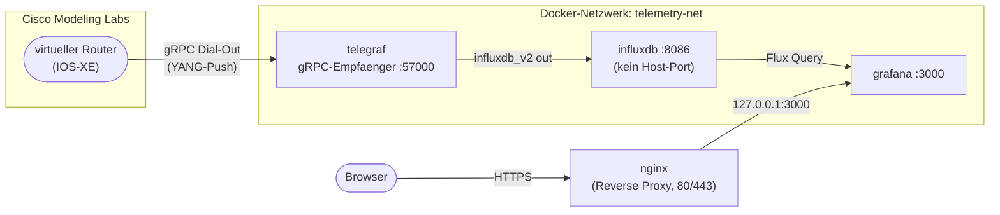

# Lab 10: Eigene Monitoring-Pipeline für Netzwerktelemetrie (Projekt-Anregung)


> **Hinweis zu diesem Dokument:** Anders als Lab 01–09 ist dieses Lab kein vollständig durchgetestetes Schritt-für-Schritt-Rezept, sondern eine **recherchierte Anregung** für eine eigene Projektarbeit – erarbeitet mit Unterstützung von Claude auf Basis der offiziellen Dokumentation von Cisco und InfluxData (Quellenangaben jeweils am Abschnittsende). Alle CLI-Befehle, Pfade und Konfigurationsausschnitte sind fachlich recherchiert, aber **nicht gegen eine konkrete CML-Topologie oder IOS-XE-Version getestet** – IP-Adressen, Node-Namen, Image-Version und ggf. abweichende YANG-Pfade müssen an die eigene Umgebung angepasst werden. Ziel ist, eine belastbare Route durch das Thema zu geben, nicht ein Copy-paste-Rezept.

## Berufliche Aufgabenstellung

Die bisherigen Labs haben die ISO/IEC-27001-Vorbereitung entlang konkreter Auditfeststellungen vorangetrieben: Netzsegmentierung (A.8.22, Lab 07), dokumentierter Betrieb (A.5.37, Lab 09) und Zugangsdatenverwaltung (A.5.17, Lab 09). Die nächste Feststellung des Auditors betrifft einen bisher unbeachteten Bereich: Es gibt **keinerlei kontinuierliche Überwachung** der Netzwerkinfrastruktur selbst. Weder die CPU-Auslastung der eingesetzten Router noch die Auslastung ihrer Schnittstellen wird irgendwo erfasst – ein Kapazitätsengpass oder eine ungewöhnliche Lastspitze (z. B. als Frühindikator eines Sicherheitsvorfalls) würde schlicht nicht bemerkt. Control **A.8.16 (Monitoring Activities)** verlangt jedoch, dass Netzwerke, Systeme und Anwendungen auf anomales Verhalten hin überwacht werden; Control **A.8.6 (Capacity Management)** verlangt die Beobachtung und Planung der Ressourcenauslastung kritischer Systeme.

Das Betriebsteam erhält den Auftrag, eine erste, exemplarische Monitoring-Pipeline für einen Netzwerk-Router aufzubauen – von der Datenquelle bis zum Dashboard. Als Datenquelle dient dabei ein virtueller Router in **Cisco Modeling Labs (CML)**, der seine Betriebsdaten – CPU-Auslastung und die Auslastung einer Ethernet-Schnittstelle – über **YANG-basierte Streaming Telemetry** bereitstellt. Anders als in den bisherigen Labs ist die Zielumgebung hier nicht der gemeinsame Kursserver mit vorgegebener Topologie, sondern **Ihre eigene CML-Instanz** – dieses Lab liefert deshalb die Architektur, die Begriffe und die Reihenfolge der Schritte, nicht aber exakt Ihre IP-Adressen oder Node-Namen.

---

## Einführung

Sie bauen in diesem Lab die vollständige Kette **Daten erheben → Daten sammeln → Daten speichern → Daten darstellen** exemplarisch nach – dieselbe Grundstruktur, die Sie in Lab 09 bereits mit MQTT/Node-RED/InfluxDB/Grafana für simulierte Sensordaten aufgebaut haben, jetzt aber mit einer **echten Netzwerk-Datenquelle**: einem virtuellen Cisco-Router in CML, der über sein YANG-Datenmodell laufend Kennzahlen wie CPU-Auslastung und Schnittstellenstatistik "pusht", statt klassisch per SNMP abgefragt zu werden.

Die Empfängerseite bauen Sie bewusst nach dem in Lab 06/09 gelernten Muster: **Telegraf** (Sammler/Agent), **InfluxDB** (Zeitreihendatenbank) und **Grafana** (Visualisierung) laufen gemeinsam als Container in einem eigenen, benutzerdefinierten Docker-Netzwerk auf Ihrem Server – zusammengehörige Dienste, bewusst gebündelt, mit nur einem nach außen sichtbaren Dienst (Grafana). Neu ist die Quelle davor: Statt eines simulierten `mosquitto_pub`-Aufrufs "spricht" hier ein echter Router über gRPC mit Telegraf.

## Lernziele

- Model-Driven Telemetry (MDT) als Alternative zu SNMP konzeptionell einordnen: YANG als Datenmodell, NETCONF/gRPC als Transportweg, "Push" statt "Pull"
- Den Unterschied zwischen **Dial-In**- und **Dial-Out**-Telemetrie erklären und begründen, welche Variante hier zum Einsatz kommt
- Auf einem virtuellen IOS-XE-Router in CML NETCONF/YANG-Dienste aktivieren und eine Dial-Out-Subscription für CPU- und Schnittstellendaten konfigurieren
- Telegraf mit dem Input-Plugin `cisco_telemetry_mdt` als gRPC-Empfänger konfigurieren
- Eine Telegraf-Grundkonfiguration über eine InfluxDB-Vorlage erzeugen und um ein plattformspezifisches Input-Plugin von Hand ergänzen
- InfluxDB und Grafana nach dem in Lab 09 gelernten Compose-Muster containerisiert betreiben
- Ein Grafana-Dashboard für CPU- und Schnittstellenauslastung aus Telemetriedaten aufbauen
- Die eigene Pipeline als zusammengehörige Dienste in einem eigenen Docker-Netzwerk bündeln – Anwendung des Prinzips aus Lab 07 auf einen neuen Anwendungsfall
- Die entstandene Lösung den ISO-27001-Controls A.8.16 und A.8.6 zuordnen

## Voraussetzungen

| Anforderung | Details |
|---|---|
| **CML-Zugang** | Eigene Cisco-Modeling-Labs-Instanz mit einem laufenden, IOS-XE-basierten Router-Node (z. B. CSR1000v/Cat8000v) – die CLI-Beispiele in diesem Lab gehen von IOS-XE aus; bei IOS-XR-Nodes weichen Befehle und YANG-Pfade ab |
| **Erreichbarkeit** | Der CML-Router muss den Empfänger-Server per gRPC (TCP) erreichen können – z. B. über einen External Connector / NAT der CML-Instanz. Ohne diese Konnektivität funktioniert nur der lokale Teil dieses Labs (Schritt 2) |
| **Server** | Debian stable, öffentliche IPv4-Adresse (aus Lab 03), Docker mit Compose-Plugin (aus Lab 05/09) |
| **nginx** | Mit ACME-Modul als Reverse Proxy aktiv (aus Lab 06) – für die Grafana-Veröffentlichung |
| **DNS** | Neuer A-Record `telemetry.<IHRE-DOMAIN>` für Grafana |
| **SSH-Zugriff** | Key-Authentifizierung, inklusive der Möglichkeit, einen SSH-Tunnel aufzubauen (für Schritt 2.3) |
| **Kenntnisse** | Grundkenntnisse zu YANG/NETCONF sind hilfreich, aber nicht zwingend – die relevanten Begriffe werden im Hintergrundwissen eingeführt |

---

## Inhalt

- [Hintergrundwissen](#hintergrundwissen)
  - [Von SNMP zu Model-Driven Telemetry](#von-snmp-zu-model-driven-telemetry)
  - [YANG, NETCONF und Streaming Telemetry: Grundbegriffe](#yang-netconf-und-streaming-telemetry-grundbegriffe)
  - [Dial-In vs. Dial-Out](#dial-in-vs-dial-out)
  - [Die Ziel-Architektur im Überblick](#die-ziel-architektur-im-überblick)
  - [ISO-27001-Bezug: A.8.16 und A.8.6](#iso-27001-bezug-a816-und-a86)
- [Aufgaben](#aufgaben)
  - [Schritt 1: Zielumgebung festlegen](#schritt-1-zielumgebung-festlegen)
  - [Schritt 2: InfluxDB und Telegraf als Container bereitstellen](#schritt-2-influxdb-und-telegraf-als-container-bereitstellen)
    - [2.1 Projektverzeichnis und Docker-Netz anlegen](#21-projektverzeichnis-und-docker-netz-anlegen)
    - [2.2 InfluxDB-Dienst starten](#22-influxdb-dienst-starten)
    - [2.3 Telegraf-Konfiguration über eine InfluxDB-Vorlage erzeugen](#23-telegraf-konfiguration-über-eine-influxdb-vorlage-erzeugen)
    - [2.4 Telegraf-Konfiguration bearbeiten und Dienst starten](#24-telegraf-konfiguration-bearbeiten-und-dienst-starten)
  - [Schritt 3: YANG-Telemetrie auf dem Router aktivieren](#schritt-3-yang-telemetrie-auf-dem-router-aktivieren)
    - [3.1 YANG-Dienste aktivieren](#31-yang-dienste-aktivieren)
    - [3.2 Abonnements für CPU-Auslastung und Schnittstellenstatistik konfigurieren](#32-abonnements-für-cpu-auslastung-und-schnittstellenstatistik-konfigurieren)
  - [Schritt 4: Dashboards in Grafana erstellen](#schritt-4-dashboards-in-grafana-erstellen)
- [Reflexion und weiterführende Fragen](#reflexion-und-weiterführende-fragen)
- [Rückblick und Zusammenfassung](#rückblick-und-zusammenfassung)
- [Aufräumarbeiten](#aufräumarbeiten)
- [Autoren und Urheberrecht](#autoren-und-urheberrecht)

---

## Hintergrundwissen

### Von SNMP zu Model-Driven Telemetry

Klassisches Netzwerk-Monitoring beruht meist auf **SNMP**: Ein Management-System **fragt** in festen Intervallen einzelne Werte ("OIDs") bei einem Gerät ab ("Pull"). Das funktioniert, skaliert aber schlecht – jede zusätzliche Kennzahl bedeutet zusätzliche Abfragen, und die Aktualität der Daten ist durch das Abfrageintervall begrenzt.

**Model-Driven Telemetry (MDT)** dreht dieses Prinzip um: Der Router **sendet** ("pusht") Daten selbstständig und laufend an einen oder mehrere Empfänger – ohne dass dieser ständig nachfragen muss. Welche Daten dabei übertragen werden, beschreibt nicht mehr eine herstellerspezifische OID-Liste, sondern ein **YANG-Datenmodell**: eine strukturierte, hierarchische Beschreibung der auf dem Gerät verfügbaren Konfigurations- und Betriebsdaten – vergleichbar mit einem Schema, das genau festlegt, welche Felder mit welchem Datentyp an welcher Stelle im Baum existieren.

### YANG, NETCONF und Streaming Telemetry: Grundbegriffe

| Begriff | Bedeutung |
|---|---|
| **YANG** | Modellierungssprache für strukturierte Netzwerk-Konfigurations- und Betriebsdaten (RFC 7950). Definiert *welche* Daten in welcher Baumstruktur existieren – nicht, *wie* sie übertragen werden |
| **Xpath** | Ein Pfadausdruck, der eine bestimmte Stelle im YANG-Baum adressiert, z. B. `/Cisco-IOS-XE-process-cpu-oper:cpu-usage/cpu-utilization` – das Äquivalent zur OID bei SNMP |
| **NETCONF** | Protokoll zur Konfiguration und zum Abruf von YANG-modellierten Daten (RFC 6241) – die "klassische", anfragebasierte Nutzung von YANG |
| **YANG-Push (RFC 8641)** | Der IETF-Standard, der laufende, ereignis- oder zeitgesteuerte *Push*-Übertragung von YANG-Daten definiert – die eigentliche "Streaming Telemetry" |
| **gRPC** | Das Transportprotokoll, über das Cisco-Geräte YANG-Push-Daten in diesem Lab übertragen – ein von Google entwickeltes RPC-Framework auf Basis von HTTP/2 |
| **GPB-KV** | *Google Protocol Buffers, Key-Value-codiert* – das binäre Encoding, in dem die Telemetriedaten typischerweise übertragen werden (Alternative: reines JSON, je nach Plattform) |

### Dial-In vs. Dial-Out

Bei Streaming Telemetry gibt es zwei grundsätzliche Verbindungsrichtungen:

- **Dial-In:** Der Empfänger (Telegraf) baut die Verbindung zum Router auf und "holt" sich den Stream ab. Der Router muss dafür seinerseits einen gRPC-Server-Port öffnen.
- **Dial-Out:** Der Router baut die Verbindung selbstständig zu einem konfigurierten Empfänger auf. Der Empfänger (hier: Telegraf) muss dafür einen gRPC-Server bereitstellen, auf den der Router zugreifen kann.

Für dieses Lab ist **Dial-Out** die naheliegende Wahl: Der CML-Router befindet sich in einem separaten, unter Umständen NAT-behafteten Labornetz und "weiß" nicht zwangsläufig, wie er von außen erreichbar wäre – umgekehrt kann er aber selbst eine ausgehende Verbindung zu Ihrem öffentlich erreichbaren Server aufbauen. Telegraf übernimmt dabei die Rolle des Empfängers (`cisco_telemetry_mdt`-Plugin als gRPC-Server).

### Die Ziel-Architektur im Überblick



Wie in Lab 07 gilt: Nur, was zwingend von außen erreichbar sein muss, bekommt einen Host-Port. Bei `influxdb` ist das – wie in Lab 09 – **kein** Port. Bei `telegraf` liegt der Fall anders als bei den bisherigen internen Diensten: Der gRPC-Empfänger **muss** von außerhalb des Docker-Netzes erreichbar sein, weil die Datenquelle (der CML-Router) sich außerhalb Ihres Servers befindet – ein Sonderfall, der bewusst von der "immer intern halten"-Regel aus Lab 07 abweicht und diese Abweichung auch begründen muss (siehe Reflexionsfragen).

### ISO-27001-Bezug: A.8.16 und A.8.6

Control A.8.16 (Monitoring Activities) verlangt eine Überwachung von Netzwerken, Systemen und Anwendungen auf anomales Verhalten – Voraussetzung dafür ist eine kontinuierliche, automatisierte Datenerhebung wie die in diesem Lab aufgebaute. Control A.8.6 (Capacity Management) verlangt die Beobachtung und vorausschauende Planung der Ressourcenauslastung kritischer Systeme – CPU- und Schnittstellenauslastung sind die naheliegendsten Kennzahlen dafür. Eine Grafana-Dashboard-Historie ist dabei zugleich der Nachweis, dass diese Beobachtung tatsächlich stattfindet, nicht nur behauptet wird.

> **Quellen:** [Cisco: Enterprise Streaming Telemetry and You – Getting Started with Model Driven Telemetry](https://blogs.cisco.com/developer/getting-started-with-model-driven-telemetry) · [Cisco IOS XE Programmability Configuration Guide – Model-Driven Telemetry](https://www.cisco.com/c/en/us/td/docs/ios-xml/ios/prog/configuration/1713/b_1713_programmability_cg/m_1712_prog_ietf_telemetry.html)

[↑ Zum Inhaltsverzeichnis](#inhalt)

---

## Aufgaben

### Schritt 1: Zielumgebung festlegen

Bevor Sie etwas konfigurieren, klären Sie zwei Punkte für Ihre eigene Umgebung:

1. **Empfänger-Server:** Nutzen Sie Ihren bestehenden Server aus Lab 03 weiter (empfohlen – er ist bereits öffentlich erreichbar und hat Docker installiert) oder stellen Sie eine dedizierte virtuelle Maschine bereit, falls Sie die Telemetrie-Pipeline bewusst von Ihrer übrigen Infrastruktur trennen möchten. In beiden Fällen gilt dieselbe Anforderung: eine öffentliche IPv4-Adresse, die der CML-Router per Dial-Out erreichen kann.
2. **Konnektivität CML → Server:** Prüfen Sie, wie Ihr CML-Router den Server erreichen kann – typischerweise über einen in CML konfigurierten External Connector mit NAT. Notieren Sie sich, welche Absender-Adresse der Router dabei tatsächlich verwendet; Sie benötigen sie später ggf. für eine Firewall-Regel (siehe Reflexion).

[↑ Zum Inhaltsverzeichnis](#inhalt)

---

### Schritt 2: InfluxDB und Telegraf als Container bereitstellen

Diese Übung überträgt das aus Lab 09 bekannte Compose-Muster – Dienste, die zusammengehören, leben gemeinsam in einem eigenen Docker-Netzwerk.

#### 2.1 Projektverzeichnis und Docker-Netz anlegen

```bash
mkdir -p /srv/telemetry/telegraf
cd /srv/telemetry
nano .env
```

```ini
INFLUX_PASSWORD=<SICHERES-PASSWORT>
INFLUX_TOKEN=<TOKEN-SELBST-ERZEUGEN-z.B.-openssl-rand--hex-32>
GRAFANA_ADMIN_PASSWORD=<SICHERES-PASSWORT>
```

```bash
chmod 600 .env
nano compose.yaml
```

```yaml
services:
  influxdb:
    image: influxdb:2
    restart: unless-stopped
    environment:
      DOCKER_INFLUXDB_INIT_MODE: setup
      DOCKER_INFLUXDB_INIT_USERNAME: admin
      DOCKER_INFLUXDB_INIT_PASSWORD: ${INFLUX_PASSWORD}
      DOCKER_INFLUXDB_INIT_ORG: alp
      DOCKER_INFLUXDB_INIT_BUCKET: telemetry
      DOCKER_INFLUXDB_INIT_ADMIN_TOKEN: ${INFLUX_TOKEN}
    volumes:
      - influxdb-data:/var/lib/influxdb2
      - influxdb-config:/etc/influxdb2
    networks:
      - telemetry-net

networks:
  telemetry-net:

volumes:
  influxdb-data:
  influxdb-config:
```

> **Was passiert hier?** Exakt das Muster aus Lab 09, Schritt 3 – Bucket und Token per `.env`, kein `ports:`-Eintrag für InfluxDB. Nur der Bucket-Name (`telemetry` statt `iot`) ist neu.

#### 2.2 InfluxDB-Dienst starten

```bash
docker compose up -d
docker compose exec influxdb influx ping
```

#### 2.3 Telegraf-Konfiguration über eine InfluxDB-Vorlage erzeugen

InfluxDB OSS 2.x bringt einen eigenen Assistenten mit, der eine passende Telegraf-Grundkonfiguration erzeugt – inklusive korrekt ausgefülltem `[[outputs.influxdb_v2]]`-Block (URL, Organisation, Bucket, Token). Ein fertiges Plugin-Bundle für Cisco-Telemetrie enthält dieser Katalog nicht; das Ergebnis dient hier als **Ausgangspunkt**, den Sie in Schritt 2.4 von Hand um das benötigte Input-Plugin ergänzen.

Da InfluxDB bewusst ohne Host-Port läuft (siehe 2.1), öffnen Sie die Oberfläche über einen temporären, ausschließlich lokal gebundenen SSH-Tunnel:

```bash
# Auf Ihrem lokalen Rechner:
ssh -L 8086:127.0.0.1:8086 <benutzer>@<server-ip>
```

> **Achtung:** Dieser Tunnel setzt voraus, dass Sie `influxdb` temporär mit `-p 127.0.0.1:8086:8086` starten (nur für diesen einen Schritt) oder den Tunnel stattdessen auf den Container selbst richten. Setzen Sie den Host-Port nach diesem Schritt konsequent wieder zurück – dauerhaft offen widerspräche dem Prinzip aus Lab 07/09.

Rufen Sie anschließend `http://localhost:8086` in Ihrem lokalen Browser auf und melden Sie sich mit `admin` und dem Passwort aus Ihrer `.env` an. Navigieren Sie zu **Data → Telegraf → Create Configuration**, wählen Sie den Ziel-Bucket (`telemetry`) sowie ein beliebiges Basis-Plugin (z. B. „System“ – der Inhalt wird gleich ohnehin ersetzt), vergeben Sie einen Namen und speichern Sie mit **Save and Test**. Notieren Sie sich die angezeigte Konfigurations-ID bzw. URL (`http://localhost:8086/api/v2/telegrafs/<ID>`) sowie Ihr API-Token aus **Load Data → API Tokens**.

> **Quelle:** [InfluxDB OSS v2 Documentation – Automatically configure Telegraf for InfluxDB](https://docs.influxdata.com/influxdb/v2/write-data/no-code/use-telegraf/auto-config/)

#### 2.4 Telegraf-Konfiguration bearbeiten und Dienst starten

Laden Sie die generierte Konfiguration herunter und ergänzen Sie sie von Hand:

```bash
curl -H "Authorization: Token ${INFLUX_TOKEN}" \
  http://127.0.0.1:8086/api/v2/telegrafs/<ID> \
  -o /srv/telemetry/telegraf/telegraf.conf
nano /srv/telemetry/telegraf/telegraf.conf
```

Ergänzen Sie den Input-Block für Cisco Model-Driven Telemetry (der `[[outputs.influxdb_v2]]`-Block aus der Vorlage bleibt unverändert stehen):

```toml
[[inputs.cisco_telemetry_mdt]]
  transport = "grpc"
  service_address = "0.0.0.0:57000"

  [inputs.cisco_telemetry_mdt.aliases]
    cpu       = "Cisco-IOS-XE-process-cpu-oper:cpu-usage/cpu-utilization"
    ifstats   = "ietf-interfaces:interfaces-state/interface/statistics"
```

| Zeile | Bedeutung |
|---|---|
| `transport = "grpc"` | Telegraf agiert als gRPC-**Server** – passend zum Dial-Out-Ansatz aus dem Hintergrundwissen |
| `service_address = "0.0.0.0:57000"` | Telegraf lauscht innerhalb des Containers auf allen Adressen, Port 57000 – die eigentliche Zugriffsbeschränkung übernimmt wie gewohnt das Port-Mapping beim Container-Start |
| `aliases` | Ordnet den langen YANG-Xpaths kurze, sprechende Feldnamen zu, die später in InfluxDB/Grafana erscheinen |

Ergänzen Sie den Telegraf-Dienst in der `compose.yaml`:

```yaml
  telegraf:
    image: telegraf:latest
    restart: unless-stopped
    ports:
      - "57000:57000"        # muss von aussen (CML) erreichbar sein - bewusste Ausnahme, siehe Hintergrundwissen
    volumes:
      - ./telegraf/telegraf.conf:/etc/telegraf/telegraf.conf:ro
    networks:
      - telemetry-net
    depends_on:
      - influxdb
```

```bash
docker compose up -d
docker compose logs -f telegraf      # mit Strg+C beenden
```

In den Logs sollte Telegraf melden, dass der `cisco_telemetry_mdt`-Input gestartet ist und auf Port 57000 lauscht.

> **Quellen:** [InfluxData – Cisco Model-Driven Telemetry (MDT) Input Plugin](https://docs.influxdata.com/telegraf/v1/input-plugins/cisco_telemetry_mdt/) · [GitHub – telegraf/plugins/inputs/cisco_telemetry_mdt](https://github.com/influxdata/telegraf/tree/master/plugins/inputs/cisco_telemetry_mdt)

[↑ Zum Inhaltsverzeichnis](#inhalt)

---

### Schritt 3: YANG-Telemetrie auf dem Router aktivieren

Die folgenden Befehle laufen auf dem virtuellen IOS-XE-Router in CML, nicht auf Ihrem Server.

#### 3.1 YANG-Dienste aktivieren

```
configure terminal
 netconf-yang
end
show platform software yang-management process
```

`show platform software yang-management process` sollte die relevanten YANG-Infrastrukturprozesse als laufend anzeigen. Ohne aktiviertes `netconf-yang` bleibt jede nachfolgende Subscription wirkungslos.

#### 3.2 Abonnements für CPU-Auslastung und Schnittstellenstatistik konfigurieren

Ersetzen Sie `<SERVER-IP>` durch die öffentliche Adresse Ihres Servers aus Schritt 1 – der Port `57000` muss zum `service_address`-Wert aus Schritt 2.4 passen:

```
configure terminal
telemetry ietf subscription 101
  encoding encode-kvgpb
  filter xpath /Cisco-IOS-XE-process-cpu-oper:cpu-usage/cpu-utilization
  stream yang-push
  update-policy periodic 3000
  receiver ip address <SERVER-IP> 57000 protocol grpc-tcp
end

telemetry ietf subscription 102
  encoding encode-kvgpb
  filter xpath /ietf-interfaces:interfaces-state/interface
  stream yang-push
  update-policy periodic 3000
  receiver ip address <SERVER-IP> 57000 protocol grpc-tcp
end
```

| Element | Bedeutung |
|---|---|
| `encoding encode-kvgpb` | Übertragungsformat: Key-Value-codierte Protocol Buffers – das Format, das `cisco_telemetry_mdt` erwartet |
| `filter xpath ...` | Der YANG-Teilbaum, der übertragen werden soll – hier einmal CPU-Auslastung, einmal alle Schnittstellenstatistiken (u. a. `in-octets`/`out-octets` je Schnittstelle) |
| `update-policy periodic 3000` | Sendeintervall in Centisekunden – `3000` entspricht 30 Sekunden |
| `receiver ip address ... protocol grpc-tcp` | Ziel der Dial-Out-Verbindung: Ihr Telegraf-Container |

Prüfen Sie den Status der Subscriptions:

```
show telemetry ietf subscription all
show telemetry ietf subscription 101 detail
```

Bricht die Subscription mit einem Verbindungsfehler ab, prüfen Sie zuerst die Erreichbarkeit auf Netzwerkebene (External Connector/NAT aus Schritt 1), dann den Zustand des `telegraf`-Containers (`docker compose logs telegraf`).

> **Hinweis zur Schnittstellenauswahl:** Der Filter oben umfasst zunächst alle Schnittstellen. Möchten Sie sich auf eine einzelne Ethernet-Schnittstelle beschränken, ergänzen Sie den Xpath um einen Schlüsselwert, z. B. `/ietf-interfaces:interfaces-state/interface[name='GigabitEthernet1']/statistics` – der genaue Schnittstellenname hängt von Ihrer CML-Topologie ab.

> **Quelle:** [Cisco IOS XE 17.13 Programmability Configuration Guide – Model-Driven Telemetry](https://www.cisco.com/c/en/us/td/docs/ios-xml/ios/prog/configuration/1713/b_1713_programmability_cg/m_1712_prog_ietf_telemetry.html)

[↑ Zum Inhaltsverzeichnis](#inhalt)

---

### Schritt 4: Dashboards in Grafana erstellen

Ergänzen Sie Grafana nach demselben Muster wie in Lab 09, Schritt 5 – Dienst, `.env`-Passwort, nginx-vhost:

```yaml
  grafana:
    image: grafana/grafana-oss
    restart: unless-stopped
    ports:
      - "127.0.0.1:3000:3000"
    environment:
      GF_SECURITY_ADMIN_USER: admin
      GF_SECURITY_ADMIN_PASSWORD: ${GRAFANA_ADMIN_PASSWORD}
      GF_SERVER_ROOT_URL: https://telemetry.<IHRE-DOMAIN>
    volumes:
      - grafana-data:/var/lib/grafana
    networks:
      - telemetry-net
    depends_on:
      - influxdb
```

Ergänzen Sie `grafana-data:` im Top-Level-`volumes:`-Block, starten Sie den Stack und richten Sie den nginx-vhost für `telemetry.<IHRE-DOMAIN>` exakt nach dem Muster von Lab 09, Schritt 5 ein (Datei kopieren, `server_name` und `proxy_pass`-Port anpassen).

Legen Sie die Datenquelle an: **Connections → Data sources → Add data source → InfluxDB**, Query Language **Flux**, URL `http://influxdb:8086`, Organisation `alp`, Token aus Ihrer `.env`, Default Bucket `telemetry`.

Erstellen Sie ein Dashboard mit zwei Visualisierungen:

```
from(bucket: "telemetry")
  |> range(start: v.timeRangeStart, stop: v.timeRangeStop)
  |> filter(fn: (r) => r._measurement =~ /cisco_telemetry_mdt.*cpu.*/)
```

```
from(bucket: "telemetry")
  |> range(start: v.timeRangeStart, stop: v.timeRangeStop)
  |> filter(fn: (r) => r._measurement =~ /cisco_telemetry_mdt.*ifstats.*/)
  |> filter(fn: (r) => r._field == "in-octets" or r._field == "out-octets")
```

> **Hinweis:** Die tatsächlichen Measurement- und Feldnamen hängen davon ab, wie `cisco_telemetry_mdt` die empfangenen GPB-KV-Daten benennt (u. a. beeinflusst durch die `aliases` aus Schritt 2.4). Prüfen Sie in der InfluxDB-Oberfläche (**Explore**) zunächst, welche Measurements und Felder tatsächlich ankommen, bevor Sie die Flux-Abfrage final anpassen – ein typischer, gewollter Rechercheschritt in diesem offen gehaltenen Lab.

[↑ Zum Inhaltsverzeichnis](#inhalt)

---

## Reflexion und weiterführende Fragen

**Zu Architektur und Sicherheit:**

- Warum widerspricht der offene Host-Port bei `telegraf` (Schritt 2.4) auf den ersten Blick dem Prinzip aus Lab 07 ("nur was nötig ist, bekommt einen Host-Port") – und warum ist er hier trotzdem gerechtfertigt? Welche Härtungsmaßnahme (Stichwort: `ufw`, Quell-IP-Beschränkung auf die CML-External-Connector-Adresse) würden Sie ergänzen?
- Der SSH-Tunnel in Schritt 2.3 öffnet InfluxDBs Oberfläche nur temporär und nur lokal gebunden. Was wäre das konkrete Risiko, `-p 8086:8086` stattdessen dauerhaft im Compose-File zu belassen?

**Zu Dial-In vs. Dial-Out:**

- Welche Voraussetzung müsste erfüllt sein, damit stattdessen **Dial-In**-Telemetrie (Telegraf holt sich die Daten aktiv beim Router ab) funktionieren würde? Wann wäre dieser Ansatz vorzugswürdig?

**Zur Datenpipeline:**

- Was würde sich ändern, wenn Sie statt eines einzelnen Routers drei oder vier CML-Nodes gleichzeitig überwachen wollten? Welche der in Lab 07 diskutierten Überlegungen (mehrere zusammenspielende Dienste in einem Netzwerk) lässt sich direkt übertragen?
- `update-policy periodic 3000` erzeugt alle 30 Sekunden einen Messpunkt. Welche Kompromisse ergeben sich bei einem deutlich kürzeren bzw. deutlich längeren Intervall (Detailgrad vs. Datenvolumen vs. Last auf dem Router)?

**Zum Audit-Bezug:**

- Ein fertiges Grafana-Dashboard zeigt, *dass* Daten ankommen. Was zusätzlich müsste dokumentiert sein, damit ein Auditor daraus auch den Nachweis einer *aktiven* Überwachung (A.8.16) ableiten kann, statt nur eine technische Machbarkeitsstudie zu sehen?

---

## Rückblick und Zusammenfassung

### Was diese Anregung enthält

- Die Grundbegriffe von Model-Driven Telemetry (YANG, NETCONF, YANG-Push, gRPC, Dial-In/Dial-Out) im Kontrast zu klassischem SNMP-Polling
- Eine containerisierte Telegraf/InfluxDB/Grafana-Pipeline nach dem in Lab 07/09 etablierten Docker-Netz-Muster
- Die Erzeugung einer Telegraf-Grundkonfiguration über die InfluxDB-Weboberfläche und ihre manuelle Erweiterung um das `cisco_telemetry_mdt`-Plugin
- Eine Dial-Out-Subscription auf einem IOS-XE-Router in CML für CPU-Auslastung und Schnittstellenstatistik
- Den Aufbau eines ersten Grafana-Dashboards auf Basis dieser Telemetriedaten
- Die Einordnung der Gesamtlösung in die ISO-27001-Controls A.8.16 und A.8.6

### Zentrale Befehle/Begriffe dieser Anregung

| Befehl/Begriff | Bedeutung |
|---|---|
| `netconf-yang` (IOS-XE) | Aktiviert die YANG-Infrastruktur auf dem Router |
| `telemetry ietf subscription <id>` | Definiert eine YANG-Push-Subscription (Filter, Intervall, Empfänger) |
| `show telemetry ietf subscription all` | Zeigt Status aller konfigurierten Subscriptions |
| `[[inputs.cisco_telemetry_mdt]]` | Telegraf-Plugin, das als gRPC-Empfänger für Cisco-MDT-Daten fungiert |
| `influx telegrafs` / Data → Telegraf (InfluxDB-UI) | Erzeugt eine Telegraf-Grundkonfiguration inkl. Output-Block |

### Wie geht es weiter?

Dieses Dokument ist als Ausgangspunkt gedacht, nicht als Endpunkt: Sinnvolle nächste Schritte sind u. a. die Erweiterung auf mehrere Router, ein `docker compose`-`healthcheck:` für Telegraf (vgl. die entsprechende Reflexionsfrage aus Lab 09), sowie – nach erfolgreicher eigener Erprobung – die Überarbeitung dieses Dokuments zu einem vollständig getesteten Lab nach dem Muster von Lab 01–09.

[↑ Zum Inhaltsverzeichnis](#inhalt)

---

## Aufräumarbeiten

```bash
cd /srv/telemetry
docker compose down            # Container + Netzwerk telemetry-net entfernen
docker compose down -v         # zusaetzlich: alle Volumes entfernen (Messdaten gehen verloren)
rm /etc/nginx/conf.d/telemetry.conf
nginx -t
systemctl reload nginx
rm -rf /srv/telemetry
```

Auf dem CML-Router:

```
configure terminal
no telemetry ietf subscription 101
no telemetry ietf subscription 102
end
```

[↑ Zum Inhaltsverzeichnis](#inhalt)

## Autoren und Urheberrecht

- Erstellt von: Michael Lotter, Florian Reichl (Anregung recherchiert und entworfen mit Unterstützung von Claude, Quellen siehe Abschnitte oben)
- Datum: 09/2026
- Version: v0.1 (Entwurf – ungetestet gegen eine reale CML-Instanz)


<p align="center">
<a href="Lab_09.md"></a>
</p>