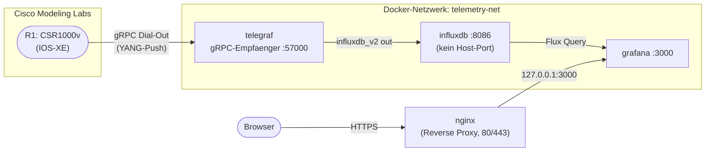

# Lab 10: Eigene Monitoring-Pipeline für Netzwerktelemetrie


## Berufliche Aufgabenstellung

Das Netzwerk-Team betreibt inzwischen mehrere Router und Dienste, hat aber keinerlei laufenden Überblick über deren tatsächliche Auslastung. Störungen und Kapazitätsengpässe fallen bislang erst auf, wenn Nutzer sich beschweren oder ein Gerät bereits spürbar überlastet ist – reaktiv statt vorausschauend. Die bisherigen Werkzeuge helfen dabei nur bedingt: **SNMP**-Polling ist zu träge für einen laufenden Überblick, **Syslog** liefert nur Ereignisse, keine kontinuierlichen Messreihen, und CLI-Befehle wie `show dmvpn detail` sind gerätespezifisch und nicht automatisiert auswertbar. Die Geschäftsführung erteilt daher den Auftrag, für die Netzwerkinfrastruktur eine **eigene Monitoring-Pipeline** aufzubauen: Betriebsdaten wie CPU-Auslastung und Schnittstellenauslastung sollen laufend erhoben, zentral gesammelt, dauerhaft gespeichert und für das Team sichtbar dargestellt werden – die Grundlage für Kapazitätsplanung und frühzeitige Störungserkennung.

Als erste Datenquelle dient ein virtueller Router in **Cisco Modeling Labs (CML)**, der seine Betriebsdaten über **YANG-basierte Streaming Telemetry** laufend selbst an einen Empfänger sendet. Sie bauen die vollständige Kette **Daten erheben → Daten sammeln → Daten speichern → Daten darstellen** dafür auf – mit Telegraf, InfluxDB und Grafana als containerisierten Diensten auf Ihrem eigenen Linux-Server bei Hetzner (aus Lab 03).

---

## Einführung

Sie kennen die Grundstruktur **Erheben → Sammeln → Speichern → Darstellen** bereits aus Lab 09, dort mit simulierten Sensordaten über MQTT. In diesem Lab ersetzen Sie die Datenquelle durch eine echte Netzwerkkomponente: einen virtuellen Cisco-Router, der seine Kennzahlen über sein YANG-Datenmodell aktiv an einen Empfänger "pusht", statt klassisch abgefragt zu werden. Empfängerseitig bauen Sie **Telegraf** (Sammler), **InfluxDB** (Zeitreihendatenbank) und **Grafana** (Darstellung) nach demselben Muster wie in Lab 06/09 als containerisierte, zusammengehörige Dienste in einem eigenen Docker-Netzwerk auf.

Dieses Lab ist an eine erste, im Januar 2023 mit CML und einer AWS-EC2-Instanz erprobte Fassung angelehnt. Die Zielumgebung ist hier bewusst anders: Statt einer AWS-VM verwenden Sie Ihren eigenen, bereits vorhandenen Linux-Server bei Hetzner (aus Lab 03) und betreiben InfluxDB und Telegraf – abweichend vom ursprünglichen Versuch mit nativen `yum`/`systemctl`-Paketen – konsequent als Container, wie es dem in diesem Kurs etablierten Muster entspricht.

## Lernziele

- Model-Driven Telemetry (MDT) als Alternative zu SNMP-Polling, Syslog und gerätespezifischen CLI-Abfragen konzeptionell einordnen
- Den Unterschied zwischen **Dial-In**- und **Dial-Out**-Telemetrie erklären und begründen, welche Variante hier zum Einsatz kommt
- InfluxDB und Telegraf als Container installieren und in Betrieb nehmen
- Eine Telegraf-Konfiguration über die InfluxDB-Oberfläche erzeugen und um das plattformspezifische Input-Plugin `cisco_telemetry_mdt` ergänzen
- Auf einem virtuellen CSR1000v-Router in CML YANG-Dienste aktivieren und Dial-Out-Abonnements für CPU- und Schnittstellendaten konfigurieren
- Einen konkreten YANG-Xpath anhand von Modul, Container und Leaf selbst herleiten und typische Stolperfallen (z. B. Groß-/Kleinschreibung von Schnittstellennamen) vermeiden
- Ein Grafana-Dashboard für CPU- und Schnittstellenauslastung aus den gesammelten Telemetriedaten aufbauen
- Die eigene Pipeline als zusammengehörige Dienste in einem eigenen Docker-Netzwerk bündeln – Anwendung des Prinzips aus Lab 07 auf einen neuen Anwendungsfall

## Voraussetzungen

| Anforderung | Details |
|---|---|
| **CML-Zugang** | Eigene Cisco-Modeling-Labs-Instanz mit einem laufenden Router-Node vom Typ **CSR1000v**. Wichtig: Cisco IOS-XE unterstützt YANG/NETCONF grundsätzlich – nur bringen die schlanken CML-Referenz-Images **IOSv und IOSvL2 die dafür nötigen YANG-Management-Prozesse gar nicht erst mit** (sie sind bewusst auf einfache Routing-/Switching-Labs zugeschnitten, ohne dieses Subsystem). Für dieses Lab kommt daher nur ein vollständiges IOS-XE-Image wie **CSR1000v** (bzw. neuer: Cat8000v) infrage |
| **Erreichbarkeit** | Der CML-Router muss den Empfänger-Server per gRPC (TCP) erreichen können – z. B. über einen External Connector/NAT der CML-Instanz |
| **Server** | Ihr Linux-Server bei Hetzner (aus Lab 03), öffentliche IPv4-Adresse, Docker mit Compose-Plugin (aus Lab 05/09) |
| **nginx** | Mit ACME-Modul als Reverse Proxy aktiv (aus Lab 06) – für die Grafana-Veröffentlichung |
| **DNS** | Neuer A-Record `telemetry.<IHRE-DOMAIN>` für Grafana |
| **SSH-Zugriff** | Key-Authentifizierung, inklusive der Möglichkeit, einen SSH-Tunnel aufzubauen (Schritt 4) |

---

## Inhalt

- [Hintergrundwissen](#hintergrundwissen)
  - [Von SNMP zu Model-Driven Telemetry](#von-snmp-zu-model-driven-telemetry)
  - [YANG, NETCONF und Streaming Telemetry: Grundbegriffe](#yang-netconf-und-streaming-telemetry-grundbegriffe)
  - [Dial-In vs. Dial-Out](#dial-in-vs-dial-out)
  - [Die Ziel-Architektur im Überblick](#die-ziel-architektur-im-überblick)
- [Aufgaben](#aufgaben)
  - [Schritt 1: Virtuelle Maschine für die Pipeline bereitstellen](#schritt-1-virtuelle-maschine-für-die-pipeline-bereitstellen)
  - [Schritt 2: InfluxDB und Telegraf installieren](#schritt-2-influxdb-und-telegraf-installieren)
  - [Schritt 3: InfluxDB-Dienst starten](#schritt-3-influxdb-dienst-starten)
  - [Schritt 4: Telegraf-Konfiguration über die InfluxDB-Oberfläche erzeugen](#schritt-4-telegraf-konfiguration-über-die-influxdb-oberfläche-erzeugen)
  - [Schritt 5: Telegraf-Konfiguration bearbeiten und Dienst starten](#schritt-5-telegraf-konfiguration-bearbeiten-und-dienst-starten)
  - [Schritt 6: YANG-Dienste auf dem Router aktivieren](#schritt-6-yang-dienste-auf-dem-router-aktivieren)
  - [Schritt 7: Abonnements für CPU-Auslastung und Schnittstellenstatistik konfigurieren](#schritt-7-abonnements-für-cpu-auslastung-und-schnittstellenstatistik-konfigurieren)
  - [Schritt 8: Dashboards in Grafana erstellen](#schritt-8-dashboards-in-grafana-erstellen)
- [Reflexion und weiterführende Fragen](#reflexion-und-weiterführende-fragen)
- [Rückblick und Zusammenfassung](#rückblick-und-zusammenfassung)
- [Aufräumarbeiten](#aufräumarbeiten)
- [Autoren und Urheberrecht](#autoren-und-urheberrecht)

---

## Hintergrundwissen

### Von SNMP zu Model-Driven Telemetry

Die bisher naheliegenden Monitoring-Werkzeuge haben für einen laufenden Überblick über Netzwerkgeräte alle einen strukturellen Nachteil: **SNMP**-Polling fragt in festen Intervallen einzelne Werte ab und ist damit für viele Kennzahlen oder kurze Intervalle zu träge ("too slow"). **Syslog** liefert nur Ereignisse und Meldungen, aber keine kontinuierliche Messreihe ("incomplete"). CLI-Befehle wie `show dmvpn detail` sind zwar informativ, aber gerätespezifisch formatiert und für automatisierte Auswertung ungeeignet.

**Model-Driven Telemetry (MDT)** dreht das Grundprinzip um: Der Router **sendet** ("pusht") Daten selbstständig und laufend an einen oder mehrere Empfänger – ohne dass dieser ständig nachfragen muss. Welche Daten dabei übertragen werden, beschreibt nicht mehr eine herstellerspezifische OID-Liste oder ein CLI-Ausgabeformat, sondern ein **YANG-Datenmodell**: eine strukturierte, hierarchische Beschreibung der auf dem Gerät verfügbaren Betriebsdaten.

### YANG, NETCONF und Streaming Telemetry: Grundbegriffe

Ein YANG-Modell gliedert sich hierarchisch in **Modul → Container → Liste → Leaf** – vergleichbar mit einem Verzeichnisbaum, an dessen Blättern (Leafs) die eigentlichen Werte stehen:

| Begriff | Bedeutung |
|---|---|
| **Modul** | Die oberste Ebene eines YANG-Modells, z. B. `process-cpu-ios-xe-oper` – vergleichbar mit einem Namensraum |
| **Container** | Eine gruppierende Ebene innerhalb eines Moduls, z. B. `cpu-usage` |
| **Liste** | Eine Menge gleichartiger Einträge, die über einen Schlüssel adressiert werden, z. B. `interface[name='GigabitEthernet1']` |
| **Leaf** | Der eigentliche Wert am Ende des Pfades, z. B. `five-seconds` (die CPU-Auslastung der letzten 5 Sekunden) |
| **Xpath** | Der vollständige Pfadausdruck durch diese Hierarchie, z. B. `/process-cpu-ios-xe-oper:cpu-usage/cpu-utilization/five-seconds` – das Äquivalent zur OID bei SNMP |
| **NETCONF** | Protokoll zur Konfiguration und zum Abruf von YANG-modellierten Daten – die klassische, anfragebasierte Nutzung von YANG |
| **YANG-Push** | Laufende, ereignis- oder zeitgesteuerte *Push*-Übertragung von YANG-Daten – die eigentliche "Streaming Telemetry" |
| **gRPC** | Das Transportprotokoll, über das der Router die Telemetriedaten in diesem Lab überträgt |
| **GPB-KV** | *Google Protocol Buffers, Key-Value-codiert* – das Encoding, in dem die Telemetriedaten übertragen werden |

> **Woher bekomme ich einen Xpath?** Eine gute Anlaufstelle für die auf Cisco-IOS-XE-Geräten verfügbaren YANG-Module ist [github.com/YangModels/yang – vendor/cisco/xe](https://github.com/YangModels/yang/tree/main/vendor/cisco/xe). Alternativ zeigt `show platform software yang-management process` auf dem Router, welche Dienste laufen, und die einzelnen `.yang`-Dateien lassen sich nach den gewünschten Containern/Leafs durchsuchen.

### Dial-In vs. Dial-Out

Bei Streaming Telemetry gibt es zwei Verbindungsrichtungen:

- **Dial-In:** Der Empfänger (Telegraf) baut die Verbindung zum Router auf und holt sich den Stream ab. Der Router muss dafür seinerseits einen gRPC-Server-Port öffnen.
- **Dial-Out:** Der Router baut die Verbindung selbstständig zu einem konfigurierten Empfänger auf. Der Empfänger stellt dafür einen gRPC-Server bereit.

In diesem Lab kommt **Dial-Out** zum Einsatz: Der CML-Router sitzt in einem eigenen, per NAT angebundenen Labornetz und kann selbst eine ausgehende Verbindung zu Ihrem öffentlich erreichbaren Server aufbauen. Telegraf übernimmt dabei die Rolle des Empfängers.

### Die Ziel-Architektur im Überblick



Wie in Lab 07 gilt: Nur, was zwingend von außen erreichbar sein muss, bekommt einen Host-Port. `influxdb` bekommt – wie in Lab 09 – **keinen**. Bei `telegraf` liegt der Fall anders als bei den bisherigen internen Diensten: Der gRPC-Empfänger **muss** von außerhalb des Docker-Netzes erreichbar sein, weil die Datenquelle (der CML-Router) außerhalb Ihres Servers liegt.

[↑ Zum Inhaltsverzeichnis](#inhalt)

---

## Aufgaben

### Schritt 1: Virtuelle Maschine für die Pipeline bereitstellen

Nutzen Sie Ihren bestehenden Linux-Server bei Hetzner aus Lab 03 weiter – er ist bereits öffentlich erreichbar und hat Docker installiert (Lab 05/09). Eine eigene AWS-EC2-Instanz wie im ursprünglichen Versuch ist nicht nötig. Klären Sie zusätzlich, wie Ihr CML-Router diesen Server per Dial-Out erreichen kann: typischerweise über einen in CML konfigurierten External Connector mit NAT. Notieren Sie sich die Absender-Adresse, mit der der Router dabei tatsächlich nach außen auftritt – Sie brauchen sie später sowohl als `source-address` in der Router-Konfiguration als auch ggf. für eine Firewall-Regel (siehe Reflexion).

[↑ Zum Inhaltsverzeichnis](#inhalt)

---

### Schritt 2: InfluxDB und Telegraf installieren

Wie in Lab 09 werden die Dienste nicht einzeln als native Pakete (`yum install`/`systemctl`), sondern deklarativ über eine `compose.yaml` "installiert" und betrieben – zusammengehörige Dienste in einem eigenen Docker-Netzwerk. Das hat einen angenehmen Nebeneffekt: Die bei einer nativen Paketinstallation zeitweise fehlerhaften RPM-Repository-URLs von InfluxData entfallen komplett, da Sie ausschließlich fertige, offizielle Container-Images verwenden.

```bash
mkdir -p /srv/telemetry/telegraf
cd /srv/telemetry
nano .env
```

```ini
INFLUX_PASSWORD=<SICHERES-PASSWORT>
INFLUX_TOKEN=<TOKEN-z.B.-mit-openssl-rand--hex-32-erzeugen>
GRAFANA_ADMIN_PASSWORD=<SICHERES-PASSWORT>
```

```bash
chmod 600 .env
nano compose.yaml
```

```yaml
services:
  influxdb:
    image: influxdb:2
    restart: unless-stopped
    environment:
      DOCKER_INFLUXDB_INIT_MODE: setup
      DOCKER_INFLUXDB_INIT_USERNAME: admin
      DOCKER_INFLUXDB_INIT_PASSWORD: ${INFLUX_PASSWORD}
      DOCKER_INFLUXDB_INIT_ORG: alp
      DOCKER_INFLUXDB_INIT_BUCKET: telemetry
      DOCKER_INFLUXDB_INIT_ADMIN_TOKEN: ${INFLUX_TOKEN}
    volumes:
      - influxdb-data:/var/lib/influxdb2
      - influxdb-config:/etc/influxdb2
    networks:
      - telemetry-net

networks:
  telemetry-net:

volumes:
  influxdb-data:
  influxdb-config:
```

> **Was passiert hier?** Dasselbe Muster wie in Lab 09, Schritt 3 – Bucket und Token kommen aus der `.env`-Datei, InfluxDB bekommt bewusst keinen `ports:`-Eintrag. Nur der Bucket-Name (`telemetry` statt `iot`) ist neu. Den `telegraf`-Dienst ergänzen Sie in Schritt 5, sobald seine Konfigurationsdatei vorliegt.

[↑ Zum Inhaltsverzeichnis](#inhalt)

---

### Schritt 3: InfluxDB-Dienst starten

```bash
docker compose up -d
docker compose ps
docker compose exec influxdb influx ping
```

`influx ping` antwortet mit `OK`, sobald InfluxDB betriebsbereit ist.

[↑ Zum Inhaltsverzeichnis](#inhalt)

---

### Schritt 4: Telegraf-Konfiguration über die InfluxDB-Oberfläche erzeugen

InfluxDB OSS 2.x zeigt Ihnen in der Weboberfläche einen fertigen `[[outputs.influxdb_v2]]`-Block mit bereits eingetragener URL, Organisation und Bucket – Sie müssen nur noch Ihr Token ergänzen.

Da InfluxDB bewusst ohne Host-Port läuft, öffnen Sie die Oberfläche für diesen einen Schritt über einen lokal gebundenen SSH-Tunnel:

```bash
# Auf Ihrem lokalen Rechner:
ssh -L 8086:127.0.0.1:8086 <benutzer>@<server-ip>
```

Binden Sie dafür `influxdb` kurzzeitig an `127.0.0.1:8086:8086`, rufen Sie `http://localhost:8086` in Ihrem lokalen Browser auf und melden Sie sich mit `admin` und dem Passwort aus Ihrer `.env` an.

1. Legen Sie unter **Load Data → API Tokens** ein Custom-Token mit Lese- und Schreibrecht auf den Bucket `telemetry` an und notieren Sie es sich.
2. Wechseln Sie zum Reiter **Load Data → Telegraf**, klicken Sie auf **Influx Output Plugin** und kopieren Sie den angezeigten Block.

Entfernen Sie den temporären Host-Port danach wieder aus der `compose.yaml` und starten Sie den Stack neu:

```bash
docker compose up -d
```

[↑ Zum Inhaltsverzeichnis](#inhalt)

---

### Schritt 5: Telegraf-Konfiguration bearbeiten und Dienst starten

```bash
nano /srv/telemetry/telegraf/telegraf.conf
```

Fügen Sie zunächst den in Schritt 4 kopierten Output-Block ein und tragen Sie Ihr Token ein:

```toml
[[outputs.influxdb_v2]]
  urls = ["http://influxdb:8086"]
  token = "${INFLUX_TOKEN}"
  organization = "alp"
  bucket = "telemetry"
```

> **Unterschied zum ursprünglichen Versuch:** Dort stand in `urls` die öffentliche IP der AWS-Instanz (`http://3.16.109.146:8086`), weil Telegraf dort als eigener systemd-Dienst *neben* InfluxDB lief. Hier laufen beide Dienste im selben Docker-Netzwerk `telemetry-net` – Telegraf erreicht InfluxDB deshalb einfach über den Servicenamen `influxdb`, genau wie in Lab 06/09 gelernt.

Ergänzen Sie darunter den Input-Block für Cisco Model-Driven Telemetry unverändert, wie er im offiziellen Telegraf-Plugin dokumentiert ist:

```toml
# Cisco model-driven telemetry (MDT) input plugin for IOS XR, IOS XE and NX-OS platforms
[[inputs.cisco_telemetry_mdt]]
  ## Telemetry transport can be "tcp" or "grpc". TLS is only supported when
  ## using the grpc transport.
  transport = "grpc"
  ## Address and port to host telemetry listener
  service_address = ":57000"
  ## Grpc Maximum Message Size, default is 4MB, increase the size.
  max_msg_size = 4000000

  ## Define aliases to map telemetry encoding paths to simple measurement names
  [inputs.cisco_telemetry_mdt.aliases]
    cpu     = "process-cpu-ios-xe-oper:cpu-usage/cpu-utilization"
    ifstats = "interfaces-ios-xe-oper:interfaces/interface/statistics"
```

| Zeile | Bedeutung |
|---|---|
| `transport = "grpc"` | Telegraf agiert als gRPC-**Server** – passend zum Dial-Out-Ansatz |
| `service_address = ":57000"` | Telegraf lauscht im Container auf allen Adressen, Port 57000 – die eigentliche Zugriffsbeschränkung übernimmt das Port-Mapping beim Container-Start |
| `max_msg_size` | Erhöht das gRPC-Nachrichtenlimit über den Standardwert von 4 MB hinaus |
| `aliases` | Ordnet den langen YANG-Xpaths kurze, sprechende Feldnamen zu, die später in InfluxDB/Grafana erscheinen |

Ergänzen Sie den `telegraf`-Dienst in der `compose.yaml`:

```yaml
  telegraf:
    image: telegraf:latest
    restart: unless-stopped
    ports:
      - "57000:57000"        # muss von aussen (CML) erreichbar sein - bewusste Ausnahme, siehe Reflexion
    volumes:
      - ./telegraf/telegraf.conf:/etc/telegraf/telegraf.conf:ro
    networks:
      - telemetry-net
    depends_on:
      - influxdb
```

```bash
docker compose up -d
docker compose logs -f telegraf      # mit Strg+C beenden
```

In den Logs meldet Telegraf, dass die Plugins `cisco_telemetry_mdt` (Input) und `influxdb_v2` (Output) geladen sind und der Listener auf Port 57000 lauscht.

[↑ Zum Inhaltsverzeichnis](#inhalt)

---

### Schritt 6: YANG-Dienste auf dem Router aktivieren

Die folgenden Befehle laufen auf dem virtuellen CSR1000v-Routers `R1` in CML, nicht auf Ihrem Server.

```
R1#show platform software yang-management process
```

Vor der Aktivierung zeigt die Ausgabe die meisten Prozesse als `Not Running` – nur `nginx` und `pubd` laufen bereits:

```
confd            : Not Running
nesd              : Not Running
syncfd            : Not Running
ncsshd            : Not Running
dmiauthd          : Not Running
nginx             : Running
ndbmand           : Not Running
pubd              : Running
```

Aktivieren Sie YANG/NETCONF:

```
R1#configure terminal
R1(config)#netconf-yang
R1(config)#end
```

```
*Jan  5 09:57:31.297: %PSD_MOD-5-DMI_NOTIFY_NETCONF_START: R0/0: psd: PSD/DMI: netconf-yang server has been notified to start
```

Prüfen Sie erneut – jetzt sollten **alle** Prozesse laufen:

```
R1#show platform software yang-management process
confd             : Running
nesd              : Running
syncfd            : Running
ncsshd            : Running
dmiauthd          : Running
nginx             : Running
ndbmand           : Running
pubd              : Running
```

[↑ Zum Inhaltsverzeichnis](#inhalt)

---

### Schritt 7: Abonnements für CPU-Auslastung und Schnittstellenstatistik konfigurieren

Ersetzen Sie `<SERVER-IP>` durch die öffentliche Adresse Ihres Hetzner-Servers und `<ROUTER-OUTSIDE-IP>` durch die dem Internet zugewandte Adresse des Routers (bei `R1` z. B. die Adresse von GigabitEthernet1). Der Port `57000` muss zum `service_address`-Wert aus Schritt 5 passen:

```
R1#configure terminal
R1(config)#telemetry ietf subscription 101
R1(config-mdt-subs)#encoding encode-kvgpb
R1(config-mdt-subs)#source-address <ROUTER-OUTSIDE-IP>
R1(config-mdt-subs)#filter xpath /process-cpu-ios-xe-oper:cpu-usage/cpu-utilization/five-seconds
R1(config-mdt-subs)#update-policy periodic 500
R1(config-mdt-subs)#stream yang-push
R1(config-mdt-subs)#receiver ip address <SERVER-IP> 57000 protocol grpc-tcp
R1(config-mdt-subs)#exit

R1(config)#telemetry ietf subscription 102
R1(config-mdt-subs)#encoding encode-kvgpb
R1(config-mdt-subs)#source-address <ROUTER-OUTSIDE-IP>
R1(config-mdt-subs)#filter xpath /interfaces-ios-xe-oper:interfaces/interface[name='GigabitEthernet1']/statistics
R1(config-mdt-subs)#update-policy periodic 500
R1(config-mdt-subs)#stream yang-push
R1(config-mdt-subs)#receiver ip address <SERVER-IP> 57000 protocol grpc-tcp
R1(config-mdt-subs)#end
```

| Element | Bedeutung |
|---|---|
| `encoding encode-kvgpb` | Übertragungsformat: Key-Value-codierte Protocol Buffers – das Format, das `cisco_telemetry_mdt` erwartet |
| `source-address` | Die lokale Adresse, von der aus der Router die Dial-Out-Verbindung aufbaut – bei `R1` die dem Internet zugewandte Adresse von GigabitEthernet1 |
| `filter xpath ...` | Der YANG-Pfad, der übertragen werden soll – einmal die 5-Sekunden-CPU-Auslastung, einmal die Statistik einer konkreten Schnittstelle |
| `update-policy periodic 500` | Sendeintervall in Centisekunden – `500` entspricht 5 Sekunden |
| `receiver ip address ... protocol grpc-tcp` | Ziel der Dial-Out-Verbindung: Ihr Telegraf-Container |

> **⚠️ Stolperfalle Groß-/Kleinschreibung:** Der Schnittstellenname im Filter ist case-sensitiv. `interface[name='gigabitethernet1']` liefert **keine** Daten – korrekt ist `interface[name='GigabitEthernet1']`, exakt wie der Router die Schnittstelle selbst benennt (`show ip interface brief`). Ein still bleibendes Interface-Abonnement bei gleichzeitig funktionierender CPU-Auslastung ist ein starkes Indiz genau für diesen Fehler.

Prüfen Sie den Status:

```
R1#show telemetry ietf subscription all detail
```

Bei korrekter Konfiguration erscheint je Subscription ein Block wie dieser:

```
  Subscription ID: 101
  Type: Configured
  State: Valid
  Stream: yang-push
  Filter:
    Filter type: xpath
    XPath: /process-cpu-ios-xe-oper:cpu-usage/cpu-utilization/five-seconds
  Update policy:
    Update Trigger: periodic
    Period: 500
  Encoding: encode-kvgpb
  Source Address: <ROUTER-OUTSIDE-IP>
  Receivers:
    Address                Port     Protocol         Protocol Profile
    -----------------------------------------------------------------
    <SERVER-IP>             57000    grpc-tcp
```

Der Zustand `State: Valid` bestätigt, dass die Subscription korrekt angenommen wurde. Ob tatsächlich Daten ankommen, sehen Sie an den Telegraf-Logs (`docker compose logs -f telegraf`) und spätestens beim Durchstöbern der Daten in InfluxDB (**Explore**).

[↑ Zum Inhaltsverzeichnis](#inhalt)

---

### Schritt 8: Dashboards in Grafana erstellen

Ergänzen Sie Grafana nach demselben Muster wie in Lab 09, Schritt 5:

```yaml
  grafana:
    image: grafana/grafana-oss
    restart: unless-stopped
    ports:
      - "127.0.0.1:3000:3000"
    environment:
      GF_SECURITY_ADMIN_USER: admin
      GF_SECURITY_ADMIN_PASSWORD: ${GRAFANA_ADMIN_PASSWORD}
      GF_SERVER_ROOT_URL: https://telemetry.<IHRE-DOMAIN>
    volumes:
      - grafana-data:/var/lib/grafana
    networks:
      - telemetry-net
    depends_on:
      - influxdb
```

Ergänzen Sie `grafana-data:` im Top-Level-`volumes:`-Block, starten Sie den Stack und richten Sie den nginx-vhost für `telemetry.<IHRE-DOMAIN>` nach dem Muster von Lab 09, Schritt 5 ein (Datei kopieren, `server_name` und `proxy_pass`-Port anpassen).

```bash
docker compose up -d
nginx -t
systemctl reload nginx
```

Legen Sie die Datenquelle an: **Connections → Data sources → Add data source → InfluxDB**, Query Language **Flux**, URL `http://influxdb:8086`, Organisation `alp`, Token aus Ihrer `.env`, Default Bucket `telemetry`.

Erstellen Sie ein Dashboard mit zwei Visualisierungen:

```
from(bucket: "telemetry")
  |> range(start: v.timeRangeStart, stop: v.timeRangeStop)
  |> filter(fn: (r) => r._measurement =~ /cisco_telemetry_mdt.*cpu.*/)
```

```
from(bucket: "telemetry")
  |> range(start: v.timeRangeStart, stop: v.timeRangeStop)
  |> filter(fn: (r) => r._measurement =~ /cisco_telemetry_mdt.*ifstats.*/)
  |> filter(fn: (r) => r._field == "in-octets" or r._field == "out-octets")
```

> **Hinweis:** Die tatsächlichen Measurement- und Feldnamen hängen davon ab, wie `cisco_telemetry_mdt` die empfangenen GPB-KV-Daten benennt (u. a. beeinflusst durch die `aliases` aus Schritt 5). Prüfen Sie in der InfluxDB-Oberfläche (**Explore**), welche Measurements und Felder tatsächlich ankommen, bevor Sie die Flux-Abfrage final anpassen – InfluxDBs eigene Explore-Ansicht eignet sich gut als schneller Zwischencheck, bevor Sie das eigentliche Grafana-Dashboard bauen.

Speichern Sie das Dashboard. Nach dem ersten periodischen Update (Schritt 7: alle 5 Sekunden) füllen sich beide Visualisierungen mit den Live-Werten Ihres Routers. Machen Sie die Probe aufs Exempel: Erzeugen Sie auf dem Router testweise Last (z. B. mit `debug all` kurzzeitig oder einem Dauer-Ping mit großer Paketgröße) und beobachten Sie, wie sich CPU- bzw. Schnittstellenkurve im Dashboard bewegen.

[↑ Zum Inhaltsverzeichnis](#inhalt)

---

## Reflexion und weiterführende Fragen

**Zu Architektur und Sicherheit:**

- Warum widerspricht der offene Host-Port bei `telegraf` (Schritt 5) auf den ersten Blick dem Prinzip aus Lab 07 ("nur was nötig ist, bekommt einen Host-Port") – und warum ist er hier trotzdem gerechtfertigt? Welche Härtungsmaßnahme (Stichwort: `ufw`, Quell-IP-Beschränkung auf die CML-External-Connector-Adresse) würden Sie ergänzen?
- Der SSH-Tunnel in Schritt 4 öffnet InfluxDBs Oberfläche nur temporär und nur lokal gebunden. Was wäre das konkrete Risiko, den Host-Port stattdessen dauerhaft im Compose-File zu belassen?

**Zu Dial-In vs. Dial-Out:**

- Welche Voraussetzung müsste erfüllt sein, damit stattdessen **Dial-In**-Telemetrie (Telegraf holt sich die Daten aktiv beim Router ab) funktionieren würde? Wann wäre dieser Ansatz vorzugswürdig?

**Zur Datenpipeline:**

- Was würde sich ändern, wenn Sie statt eines einzelnen Routers drei oder vier CML-Nodes gleichzeitig überwachen wollten?
- `update-policy periodic 500` erzeugt alle 5 Sekunden einen Messpunkt. Welche Kompromisse ergeben sich bei einem deutlich kürzeren bzw. deutlich längeren Intervall (Detailgrad vs. Datenvolumen vs. Last auf dem Router)?
- Wie könnten Sie in Grafana eine Schwellwert-Warnung einrichten, die auffällt, sobald die CPU-Auslastung über einen längeren Zeitraum einen kritischen Wert überschreitet?

---

## Rückblick und Zusammenfassung

### Was Sie erreicht haben

- Model-Driven Telemetry als Push-basierte Alternative zu SNMP-Polling, Syslog und CLI-Abfragen verstanden (YANG, NETCONF, YANG-Push, gRPC, Dial-In/Dial-Out)
- InfluxDB und Telegraf als containerisierte, zusammengehörige Dienste in einem eigenen Docker-Netzwerk installiert und in Betrieb genommen
- Eine Telegraf-Grundkonfiguration über die InfluxDB-Oberfläche erzeugt und manuell um das `cisco_telemetry_mdt`-Plugin ergänzt
- Auf einem CSR1000v-Router in CML YANG-Dienste aktiviert und Dial-Out-Abonnements für CPU-Auslastung und Schnittstellenstatistik eingerichtet – inklusive der typischen Groß-/Kleinschreibungs-Stolperfalle bei Schnittstellennamen
- Ein Grafana-Dashboard aufgebaut, das die Live-Telemetriedaten des Routers darstellt

### Zentrale Befehle/Begriffe dieser Übung

| Befehl/Begriff | Bedeutung |
|---|---|
| `netconf-yang` (IOS-XE) | Aktiviert die YANG-Infrastruktur auf dem Router |
| `telemetry ietf subscription <id>` | Definiert eine YANG-Push-Subscription (Filter, Intervall, Empfänger) |
| `show telemetry ietf subscription all detail` | Zeigt Status und Details aller konfigurierten Subscriptions |
| `[[inputs.cisco_telemetry_mdt]]` | Telegraf-Plugin, das als gRPC-Empfänger für Cisco-MDT-Daten fungiert |
| Load Data → Telegraf → Influx Output Plugin (InfluxDB-UI) | Liefert den fertigen `[[outputs.influxdb_v2]]`-Block für die Telegraf-Konfiguration |

[↑ Zum Inhaltsverzeichnis](#inhalt)

---

## Aufräumarbeiten

```bash
cd /srv/telemetry
docker compose down            # Container + Netzwerk telemetry-net entfernen
docker compose down -v         # zusaetzlich: alle Volumes entfernen (Messdaten gehen verloren)
rm /etc/nginx/conf.d/telemetry.conf
nginx -t
systemctl reload nginx
rm -rf /srv/telemetry
```

Auf dem CML-Router:

```
R1#configure terminal
R1(config)#no telemetry ietf subscription 101
R1(config)#no telemetry ietf subscription 102
R1(config)#end
```

[↑ Zum Inhaltsverzeichnis](#inhalt)

## Autoren und Urheberrecht

- Erstellt von: Michael Lotter, Florian Reichl
- Datum: 09/2026
- Version: v1.0


<p align="center">
<a href="Lab_09.md"></a>
</p>