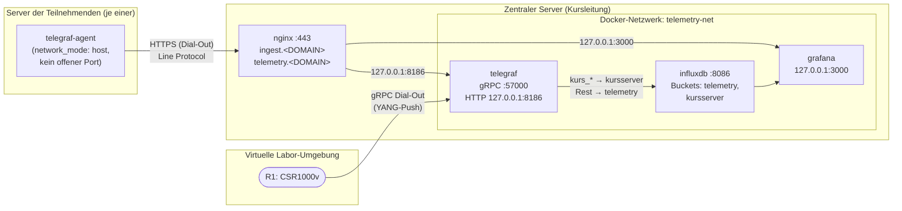

# Lab 11: Server-Telemetrie an eine zentrale Monitoring-Pipeline anbinden


## Berufliche Aufgabenstellung

Der Prototyp aus Lab 10 hat überzeugt: Der virtuelle Router liefert seine Betriebsdaten laufend per Streaming Telemetry, und das Netzwerk-Team sieht CPU- und Schnittstellenauslastung erstmals live in Grafana. Die Geschäftsführung möchte diesen Ansatz nun auf die **Linux-Server** des Unternehmens ausweiten. Jede Abteilung betreibt einen eigenen Server (in diesem Kurs: Ihren Server aus Lab 03). Diese Server sollen ihre Betriebsdaten an **eine zentrale Monitoring-Pipeline** melden, statt dass jede Abteilung eine eigene, isolierte Lösung pflegt.

Den Rahmen setzt die laufende Vorbereitung auf die Zertifizierung nach **ISO/IEC 27001**. Control **A.8.16 „Monitoring activities"** verlangt, dass Netzwerke, Systeme und Anwendungen auf auffälliges Verhalten überwacht werden. Im Audit wurden für die Anbindung der Server zusätzlich folgende Vorgaben festgelegt:

| Vorgabe | Bezug | Umsetzung in diesem Lab |
|---|---|---|
| Telemetriedaten dürfen nicht im Klartext über das Internet laufen. Die unverschlüsselte gRPC-Übertragung aus Lab 10 wurde als Feststellung dokumentiert. | A.8.24 Use of cryptography | Übertragung per HTTPS, TLS terminiert am nginx der Zentrale |
| Auf den überwachten Servern darf **kein zusätzlicher Port** geöffnet werden. | A.8.20 Networks security | Die Server melden sich selbst bei der Zentrale (Push), sie werden nicht abgefragt |
| Die Zentrale nimmt nur Daten von berechtigten Absendern an. | A.8.5 Secure authentication | Gemeinsames Token, optional zusätzlich IP-Freigabeliste |
| Server-Daten dürfen die Netzwerk-Telemetrie des Routers nicht verfälschen oder überschreiben. | A.8.22 Segregation (logisch) | Eigener Bucket, Trennung wird von der Zentrale erzwungen, nicht vom Absender |

Sie binden Ihren Server als **Datenquelle** an die zentrale Pipeline an, die von der Kursleitung betrieben wird.

---

## Einführung

In Lab 10 hat der Router die Verbindung zu Telegraf selbst aufgebaut (**Dial-Out**) und seine YANG-Daten per gRPC gesendet. Genau dieses Prinzip übertragen Sie jetzt auf Ihren Linux-Server: Auf Ihrem Server läuft ein kleiner **Telegraf-Agent**, der Systemdaten erhebt (CPU, Arbeitsspeicher, Festplatte, Netzwerk, Systemlast) und sie selbstständig an den zentralen Telegraf schickt. Der zentrale Telegraf ist derselbe, der auch die Router-Daten empfängt. Er bekommt lediglich einen **zweiten Eingang**.

Damit arbeiten in diesem Lab **zwei Rollen** zusammen:

| Teil | Wer | Was |
|---|---|---|
| **Teil A: Zentrale** | Kursleitung (bzw. das zentrale Monitoring-Team) | Zentralen Telegraf um einen HTTPS-Eingang erweitern, Bucket und Dashboard anlegen |
| **Teil B: Datenquelle** | Teilnehmende, jeweils auf dem eigenen Server | Telegraf-Agent als Container einrichten und an die Zentrale anbinden |

Teil A muss abgeschlossen sein, bevor Teil B getestet werden kann. Die Kursleitung gibt Ihnen danach drei Werte: die **Ingest-URL**, das **Ingest-Token** und Ihre **Teilnehmer-Kennung**.

## Lernziele

- Das Dial-Out-Prinzip aus Lab 10 auf eine zweite, andersartige Datenquelle übertragen und Gemeinsamkeiten sowie Unterschiede benennen
- Einen Telegraf-Agenten als Container betreiben, der Daten des **Hosts** (nicht des Containers) erhebt
- Telemetriedaten verschlüsselt über einen nginx-Reverse-Proxy an einen zentralen Empfänger senden
- Mehrere Datenquellen in **einem** Telegraf annehmen und gezielt auf verschiedene Buckets verteilen
- Eine Trennung so gestalten, dass sie vom Empfänger erzwungen wird und nicht vom guten Willen des Absenders abhängt
- Ein Grafana-Dashboard mit einer Variablen aufbauen, das viele Server gleichzeitig oder einzeln darstellt

## Voraussetzungen

| Anforderung | Details |
|---|---|
| **Teil A: Zentrale** | Lauffähige Pipeline aus Lab 10 (`/srv/telemetry`, Telegraf, InfluxDB, Grafana, nginx mit ACME-Modul) |
| **Teil A: DNS** | Neuer A-Record `ingest.<IHRE-DOMAIN>` auf den zentralen Server, wenn nicht über Wildcard gelöst |
| **Teil B: Server** | Ihr Debian-Server (aus Lab 03) mit Docker und Compose-Plugin (aus Lab 05/09) |
| **Teil B: Zugangsdaten** | Ingest-URL, Ingest-Token und Teilnehmer-Kennung von der Kursleitung |
| **Ausgehende Verbindung** | Ihr Server muss die Zentrale über TCP 443 erreichen können. Eingehend wird **nichts** benötigt |

---

## Inhalt

- [Hintergrundwissen](#hintergrundwissen)
  - [Router und Server im Vergleich](#router-und-server-im-vergleich)
  - [Warum die Zentrale die Trennung erzwingen muss](#warum-die-zentrale-die-trennung-erzwingen-muss)
  - [Telegraf im Container: Host-Daten statt Container-Daten](#telegraf-im-container-host-daten-statt-container-daten)
  - [Die Ziel-Architektur im Überblick](#die-ziel-architektur-im-überblick)
- [Teil A: Zentrale vorbereiten (Kursleitung)](#teil-a-zentrale-vorbereiten-kursleitung)
  - [Schritt A1: Bucket und Token anlegen](#schritt-a1-bucket-und-token-anlegen)
  - [Schritt A2: Zentralen Telegraf um den HTTPS-Eingang erweitern](#schritt-a2-zentralen-telegraf-um-den-https-eingang-erweitern)
  - [Schritt A3: nginx als TLS-Endpunkt für den Eingang](#schritt-a3-nginx-als-tls-endpunkt-für-den-eingang)
  - [Schritt A4: Eingang testen](#schritt-a4-eingang-testen)
- [Teil B: Eigenen Server anbinden (Teilnehmende)](#teil-b-eigenen-server-anbinden-teilnehmende)
  - [Schritt B1: Verbindung zur Zentrale prüfen](#schritt-b1-verbindung-zur-zentrale-prüfen)
  - [Schritt B2: Telegraf-Agent konfigurieren](#schritt-b2-telegraf-agent-konfigurieren)
  - [Schritt B3: Agent als Container starten](#schritt-b3-agent-als-container-starten)
  - [Schritt B4: Ankunft der Daten prüfen](#schritt-b4-ankunft-der-daten-prüfen)
- [Teil C: Gemeinsames Dashboard (Kursleitung)](#teil-c-gemeinsames-dashboard-kursleitung)
- [Zusatzaufgabe: Parallel in die eigene Pipeline schreiben](#zusatzaufgabe-parallel-in-die-eigene-pipeline-schreiben)
- [Rückblick und Zusammenfassung](#rückblick-und-zusammenfassung)
- [Autoren und Urheberrecht](#autoren-und-urheberrecht)

---

## Hintergrundwissen

### Router und Server im Vergleich

Router und Server melden sich beide **selbst** beim zentralen Telegraf. Das Grundprinzip Dial-Out ist also identisch. Unterschiedlich sind Datenmodell, Protokoll und das zuständige Input-Plugin:

| | Router (Lab 10) | Server (Lab 11) |
|---|---|---|
| **Wer baut die Verbindung auf?** | Router → Telegraf | Telegraf-Agent auf dem Server → zentraler Telegraf |
| **Wer erhebt die Daten?** | Das Betriebssystem des Routers (IOS-XE) | Ein zusätzlicher Agent (Telegraf) auf dem Server |
| **Datenmodell** | YANG (herstellerdefinierte Module, Xpath) | Telegraf-Measurements (`cpu`, `mem`, `disk` …), kein YANG |
| **Protokoll** | gRPC, Encoding GPB-KV | HTTP(S), InfluxDB Line Protocol |
| **Verschlüsselung** | Keine (`grpc-tcp`) | TLS über nginx |
| **Input-Plugin der Zentrale** | `cisco_telemetry_mdt` | `influxdb_v2_listener` |
| **Port der Zentrale** | 57000, direkt veröffentlicht | 443 über nginx, Telegraf selbst nur an `127.0.0.1:8186` |

> **Warum kein YANG auf dem Server?** Ein Debian-Server bringt von Haus aus keinen YANG-Dienst mit. Man könnte einen nachrüsten (z. B. einen NETCONF-Server), das wäre aber ein erheblicher Zusatzaufwand ohne Mehrwert für das Monitoring. Genau hier zeigt Telegraf seine Stärke: Er nimmt Daten aus **verschiedenen** Quellen und Protokollen an und schreibt sie in **ein** einheitliches Format in die Datenbank.

### Warum die Zentrale die Trennung erzwingen muss

Der zentrale Telegraf schreibt bisher alles in den Bucket `telemetry`. Würde man die Server-Daten einfach dazuschreiben, gäbe es zwei Probleme:

1. **Namenskonflikt:** Der Router liefert ein Measurement `cpu` (Alias aus Lab 10). Das Telegraf-Plugin `inputs.cpu` auf dem Server erzeugt ebenfalls ein Measurement `cpu`, mit ganz anderen Feldern. Beides würde im selben Bucket vermischt.
2. **Vertrauen:** Der Absender bestimmt selbst, welche Tags und welchen Bucket-Namen er mitschickt. Eine Trennung, die sich auf Angaben des Absenders verlässt, kann der Absender versehentlich oder absichtlich unterlaufen.

Die Lösung: Der zentrale Telegraf versieht **alles, was über den neuen Eingang ankommt**, mit dem Präfix `kurs_` im Measurement-Namen (`kurs_cpu`, `kurs_mem` …). Dieses Präfix setzt die Zentrale, der Absender kann es nicht verhindern. Anschließend verteilen zwei Outputs die Daten anhand des Präfixes auf zwei Buckets:

| Measurement beginnt mit | Output | Bucket |
|---|---|---|
| `kurs_` | neuer Output | `kursserver` |
| alles andere | bestehender Output aus Lab 10 | `telemetry` |

### Telegraf im Container: Host-Daten statt Container-Daten

Ein Container sieht standardmäßig nur sich selbst: seine eigenen Prozesse, sein eigenes Dateisystem, sein eigenes Netzwerk-Interface. Ein Telegraf, der so gestartet wird, würde also die Werte des **Containers** melden, nicht die Ihres Servers. Damit der Agent den Host misst, braucht er drei Dinge:

| Maßnahme | Wirkung |
|---|---|
| Wurzelverzeichnis des Hosts **nur lesend** unter `/hostfs` einbinden | Der Agent kann `/proc`, `/sys` und die Dateisysteme des Hosts lesen |
| Umgebungsvariablen `HOST_PROC`, `HOST_SYS`, `HOST_ETC` … | Telegraf liest seine Werte dann unter `/hostfs/...` statt im eigenen Container |
| `network_mode: host` | Der Agent nutzt den Netzwerk-Stack des Hosts und sieht dessen Interface `eth0` statt eines virtuellen Container-Interfaces |

> **Ist `network_mode: host` nicht ein Widerspruch zu Lab 07?** Nein. Dort ging es darum, keine unnötigen Ports **eingehend** zu veröffentlichen. Der Agent öffnet keinen einzigen Port, er baut nur eine **ausgehende** Verbindung zur Zentrale auf. Das prüfen Sie in Schritt B3 ausdrücklich nach.

### Die Ziel-Architektur im Überblick



[↑ Zum Inhaltsverzeichnis](#inhalt)

---

## Teil A: Zentrale vorbereiten (Kursleitung)

Alle Schritte in Teil A laufen auf dem **zentralen Server** im Verzeichnis `/srv/telemetry` aus Lab 10.

### Schritt A1: Bucket und Token anlegen

Legen Sie einen eigenen Bucket für die Server-Daten an. Die Aufbewahrungsdauer (`--retention`) begrenzt, wie lange InfluxDB die Daten hält. Für einen Kurs genügen 14 Tage:

```bash
cd /srv/telemetry
docker compose exec influxdb influx bucket create --name kursserver --org alp --retention 14d
docker compose exec influxdb influx bucket list --org alp
```

Notieren Sie aus der Ausgabe von `bucket list` die **ID** des Buckets `kursserver`. Erzeugen Sie damit ein Token, das ausschließlich in diesen Bucket schreiben darf:

```bash
docker compose exec influxdb influx auth create --org alp \
  --description "telegraf-kursserver" \
  --write-bucket <ID-KURSSERVER>
```

Erzeugen Sie zusätzlich das **Ingest-Token**, mit dem sich die Server der Teilnehmenden beim zentralen Telegraf ausweisen:

```bash
openssl rand -hex 32
```

Ergänzen Sie beide Werte in der `.env`:

```ini
TELEGRAF_KURS_TOKEN=<Token-aus-influx-auth-create>
KURS_INGEST_TOKEN=<Ergebnis-von-openssl-rand>
```

| Token | Wer kennt es? | Was darf es? |
|---|---|---|
| `TELEGRAF_TOKEN` (Lab 10) | Nur der zentrale Telegraf | In Bucket `telemetry` schreiben |
| `TELEGRAF_KURS_TOKEN` | Nur der zentrale Telegraf | In Bucket `kursserver` schreiben |
| `KURS_INGEST_TOKEN` | Zentraler Telegraf **und** alle Teilnehmenden | Daten beim zentralen Telegraf abgeben. Es ist **kein** InfluxDB-Token und gewährt keinerlei Zugriff auf die Datenbank |

> **Warum ein eigenes Token und nicht `TELEGRAF_TOKEN` erweitern?** In InfluxDB 2 lassen sich die Rechte eines bestehenden Tokens nicht nachträglich ändern. Außerdem bleibt so jede Berechtigung für sich nachvollziehbar und einzeln widerrufbar.

[↑ Zum Inhaltsverzeichnis](#inhalt)

---

### Schritt A2: Zentralen Telegraf um den HTTPS-Eingang erweitern

```bash
nano /srv/telemetry/telegraf/telegraf.conf
```

**A2.1 Bestehenden Output einschränken.** Ergänzen Sie im bestehenden Output-Block aus Lab 10 die Zeile `namedrop`. Damit landen Server-Daten nie im Router-Bucket:

```toml
[[outputs.influxdb_v2]]
  urls = ["http://influxdb:8086"]
  token = "${TELEGRAF_TOKEN}"
  organization = "alp"
  bucket = "telemetry"
  namedrop = ["kurs_*"]
```

**A2.2 Zweiten Output ergänzen.** Darunter folgt ein neuer Output, der ausschließlich die Server-Daten in `kursserver` schreibt:

```toml
[[outputs.influxdb_v2]]
  urls = ["http://influxdb:8086"]
  token = "${TELEGRAF_KURS_TOKEN}"
  organization = "alp"
  bucket = "kursserver"
  namepass = ["kurs_*"]
```

**A2.3 Neuen Eingang ergänzen.** Fügen Sie unterhalb des `cisco_telemetry_mdt`-Blocks den HTTP-Eingang hinzu:

```toml
[[inputs.influxdb_v2_listener]]
  service_address = ":8186"
  token = "${KURS_INGEST_TOKEN}"
  max_body_size = "32MiB"
  name_prefix = "kurs_"
```

| Zeile | Bedeutung |
|---|---|
| `inputs.influxdb_v2_listener` | Telegraf gibt sich gegenüber den Absendern als InfluxDB-2-Schreibschnittstelle aus (`/api/v2/write`). Jeder Telegraf kann deshalb ohne Sonderkonfiguration dorthin senden |
| `service_address = ":8186"` | Port im Container. Bewusst nicht `8086`, um Verwechslungen mit dem echten InfluxDB-Port zu vermeiden |
| `token` | Nur Anfragen mit `Authorization: Token <KURS_INGEST_TOKEN>` werden angenommen, alle anderen erhalten `401 Unauthorized` |
| `name_prefix = "kurs_"` | Wird von der **Zentrale** an jedes ankommende Measurement angehängt. Der Absender hat darauf keinen Einfluss |
| `namedrop` / `namepass` | Filter in den Outputs: `kurs_*` geht nur nach `kursserver`, alles andere nur nach `telemetry` |

> **Reihenfolge in TOML beachten:** `namepass`, `namedrop` und `name_prefix` sind normale Einträge des jeweiligen Plugins. Sie müssen **innerhalb** des Blocks stehen, also vor dem nächsten `[[...]]` und vor eventuellen Unterabschnitten wie `[inputs.cisco_telemetry_mdt.aliases]`. Steht `namedrop` versehentlich unter dem `aliases`-Abschnitt, hält Telegraf es für einen Alias.

**A2.4 Compose-Datei anpassen.** Ergänzen Sie beim Dienst `telegraf` die neuen Variablen und den zweiten Port:

```yaml
  telegraf:
    image: telegraf:latest
    restart: unless-stopped
    hostname: telegraf
    environment:
      TELEGRAF_TOKEN: ${TELEGRAF_TOKEN}
      TELEGRAF_KURS_TOKEN: ${TELEGRAF_KURS_TOKEN}
      KURS_INGEST_TOKEN: ${KURS_INGEST_TOKEN}
    ports:
      - "57000:57000"
      - "127.0.0.1:8186:8186"
    volumes:
      - ./telegraf/telegraf.conf:/etc/telegraf/telegraf.conf:ro
    networks:
      - telemetry-net
    depends_on:
      - influxdb
```

Der neue Port ist wie Grafana nur an `127.0.0.1` gebunden. Von außen erreichbar wird er ausschließlich über nginx (Schritt A3), das die TLS-Verschlüsselung übernimmt.

```bash
docker compose config --quiet
docker compose up -d
docker compose logs --tail 20 telegraf
ss -tlnp | grep 8186
```

Im Log müssen jetzt die Inputs `cisco_telemetry_mdt` **und** `influxdb_v2_listener` sowie zwei Outputs `influxdb_v2` erscheinen. `ss` zeigt `127.0.0.1:8186`.

[↑ Zum Inhaltsverzeichnis](#inhalt)

---

### Schritt A3: nginx als TLS-Endpunkt für den Eingang

Legen Sie `/etc/nginx/conf.d/ingest.conf` an:

```nginx
server {
    listen 443 ssl;
    server_name ingest.<IHRE-DOMAIN>;

    acme_certificate letsencrypt;
    ssl_certificate $acme_certificate;
    ssl_certificate_key $acme_certificate_key;
    ssl_certificate_cache max=2;

    client_max_body_size 32m;

    location = /api/v2/write {
        proxy_pass http://127.0.0.1:8186;
        proxy_set_header Host $host;
        proxy_set_header X-Real-IP $remote_addr;
        proxy_set_header X-Forwarded-For $proxy_add_x_forwarded_for;
    }

    location / {
        return 404;
    }
}
```

| Element | Bedeutung |
|---|---|
| `acme_certificate letsencrypt` | Zertifikat über das native ACME-Modul aus Lab 06, wie bei Grafana in Lab 10 |
| `client_max_body_size 32m` | nginx lässt standardmäßig nur 1 MB pro Anfrage zu. Telegraf sendet Daten gebündelt, nach einer Unterbrechung auch größere Rückstände |
| `location = /api/v2/write` | Es wird **genau eine** Adresse weitergereicht, die Schreibschnittstelle. Alles andere beantwortet nginx selbst mit `404` |

```bash
nginx -t
systemctl reload nginx
```

> **Optional: Zugriff auf bekannte Server begrenzen.** Da nginx nativ auf dem Host läuft (nicht im Container), wirken Freigabelisten hier zuverlässig. Ergänzen Sie innerhalb von `location = /api/v2/write` je Server eine Zeile `allow <IP>;` und abschließend `deny all;`. Noch strenger wäre ein Hetzner Private Network zwischen allen Servern. Dann verlässt die Telemetrie das Rechenzentrumsnetz gar nicht.

[↑ Zum Inhaltsverzeichnis](#inhalt)

---

### Schritt A4: Eingang testen

Testen Sie den Eingang von einem beliebigen Rechner aus mit einem einzelnen, von Hand geschriebenen Messwert im Line Protocol:

```bash
curl -i -X POST "https://ingest.<IHRE-DOMAIN>/api/v2/write?org=alp&bucket=kursserver" \
  -H "Authorization: Token <KURS_INGEST_TOKEN>" \
  --data-binary "test,teilnehmer=kursleitung wert=1"
```

Erwartet wird `HTTP/1.1 204 No Content`. Machen Sie die Gegenprobe mit einem falschen Token: Jetzt muss `401` zurückkommen. Prüfen Sie, wo der Testwert gelandet ist:

```bash
docker compose exec influxdb influx query \
  'from(bucket:"kursserver") |> range(start:-5m) |> filter(fn: (r) => r._measurement == "kurs_test")'
```

Der Wert erscheint als `kurs_test` im Bucket `kursserver`, obwohl Sie ihn als `test` gesendet haben. Das Präfix aus Schritt A2 wirkt.

Geben Sie den Teilnehmenden nun weiter:

| Wert | Beispiel |
|---|---|
| Ingest-URL | `https://ingest.<IHRE-DOMAIN>` |
| Ingest-Token | Inhalt von `KURS_INGEST_TOKEN` |
| Teilnehmer-Kennung | `tn01`, `tn02`, … (eindeutig je Person) |

[↑ Zum Inhaltsverzeichnis](#inhalt)

---

## Teil B: Eigenen Server anbinden (Teilnehmende)

Alle Schritte in Teil B laufen auf **Ihrem eigenen Server** aus Lab 03.

### Schritt B1: Verbindung zur Zentrale prüfen

Prüfen Sie zuerst, ob Ihr Server die Zentrale erreicht und Ihr Token angenommen wird. Senden Sie dazu einen einzelnen Testwert mit Ihrer Kennung:

```bash
curl -i -X POST "<INGEST-URL>/api/v2/write?org=alp&bucket=kursserver" \
  -H "Authorization: Token <INGEST-TOKEN>" \
  --data-binary "test,teilnehmer=<IHRE-KENNUNG> wert=1"
```

| Antwort | Bedeutung |
|---|---|
| `204 No Content` | Alles in Ordnung, der Wert wurde angenommen |
| `401 Unauthorized` | Token falsch oder unvollständig kopiert |
| `404 Not Found` | Pfad falsch, z. B. Tippfehler in `/api/v2/write` |
| `502 Bad Gateway` | nginx erreicht den zentralen Telegraf nicht. Melden Sie das der Kursleitung |
| Zeitüberschreitung | DNS-Name falsch oder Port 443 ausgehend blockiert |

Ermitteln Sie außerdem den Namen Ihrer Netzwerkschnittstelle. Bei Hetzner-Cloud-Servern ist das in der Regel `eth0`:

```bash
ip -br link
```

[↑ Zum Inhaltsverzeichnis](#inhalt)

---

### Schritt B2: Telegraf-Agent konfigurieren

Der Agent bekommt ein eigenes Verzeichnis und ein eigenes Compose-Projekt. Er ist ein eigenständiger Dienst und gehört nicht zu Ihrer Pipeline aus Lab 10.

```bash
mkdir -p /srv/hostagent
cd /srv/hostagent
nano .env
```

```ini
KURS_INGEST_TOKEN=<INGEST-TOKEN>
TN_KENNUNG=<IHRE-KENNUNG>
```

```bash
chmod 600 .env
nano telegraf.conf
```

```toml
[global_tags]
  teilnehmer = "${TN_KENNUNG}"

[agent]
  interval = "10s"
  flush_interval = "10s"

[[inputs.cpu]]
  percpu = false
  totalcpu = true

[[inputs.mem]]

[[inputs.disk]]
  mount_points = ["/"]

[[inputs.net]]
  interfaces = ["eth0"]

[[inputs.system]]

[[outputs.influxdb_v2]]
  urls = ["<INGEST-URL>"]
  token = "${KURS_INGEST_TOKEN}"
  organization = "alp"
  bucket = "kursserver"
```

| Abschnitt | Bedeutung |
|---|---|
| `[global_tags] teilnehmer` | Hängt an **jeden** Messwert das Tag `teilnehmer=<IHRE-KENNUNG>`. Daran erkennt die Zentrale, von welchem Server ein Wert stammt |
| `interval = "10s"` | Alle 10 Sekunden werden Werte erhoben |
| `inputs.cpu` | CPU-Auslastung. `percpu = false` liefert nur den Gesamtwert (`cpu-total`) statt einer Reihe je Kern |
| `inputs.mem` | Arbeitsspeicher, u. a. `used_percent` |
| `inputs.disk` | Belegung des Wurzeldateisystems `/` |
| `inputs.net` | Übertragene Bytes und Pakete auf `eth0` (ggf. an Ihr Ergebnis aus B1 anpassen) |
| `inputs.system` | Systemlast (`load1`, `load5`, `load15`), Laufzeit, Anzahl CPUs |
| `outputs.influxdb_v2` | Ziel ist der **zentrale Telegraf**, nicht direkt eine InfluxDB. `organization` und `bucket` müssen gesetzt sein, werden von der Zentrale aber nicht ausgewertet. Sie entscheidet selbst, wohin die Daten gehen |

> **Vergleich mit Lab 10:** Dort kam der Output-Block aus der InfluxDB-Oberfläche und zeigte auf `http://influxdb:8086` im selben Docker-Netzwerk. Hier zeigt er per HTTPS auf einen fremden Server. Für den Agenten macht das keinen Unterschied: Er „glaubt", in eine InfluxDB zu schreiben.

[↑ Zum Inhaltsverzeichnis](#inhalt)

---

### Schritt B3: Agent als Container starten

```bash
nano compose.yaml
```

```yaml
services:
  telegraf-agent:
    image: telegraf:latest
    restart: unless-stopped
    network_mode: host
    environment:
      KURS_INGEST_TOKEN: ${KURS_INGEST_TOKEN}
      TN_KENNUNG: ${TN_KENNUNG}
      HOST_ETC: /hostfs/etc
      HOST_PROC: /hostfs/proc
      HOST_SYS: /hostfs/sys
      HOST_VAR: /hostfs/var
      HOST_RUN: /hostfs/run
      HOST_MOUNT_PREFIX: /hostfs
    volumes:
      - ./telegraf.conf:/etc/telegraf/telegraf.conf:ro
      - /:/hostfs:ro
```

| Element | Bedeutung |
|---|---|
| `network_mode: host` | Der Agent nutzt das Netzwerk des Hosts und misst damit dessen `eth0`. Ein `ports:`-Eintrag entfällt, es wird nichts veröffentlicht |
| `/:/hostfs:ro` | Das gesamte Dateisystem des Hosts, **nur lesend** eingebunden. Der Agent kann nichts verändern |
| `HOST_PROC`, `HOST_SYS` … | Lenken Telegraf beim Lesen von `/proc`, `/sys` usw. auf die Host-Verzeichnisse unter `/hostfs` um |
| `HOST_MOUNT_PREFIX` | Entfernt `/hostfs` wieder aus den gemeldeten Pfaden. Im Dashboard erscheint `/` statt `/hostfs` |

```bash
docker compose config --quiet
docker compose up -d
docker compose logs --tail 20 telegraf-agent
```

Im Log erscheinen die geladenen Inputs (`cpu`, `disk`, `mem`, `net`, `system`) und der Output `influxdb_v2`. Wie in Lab 10 gilt: Im Normalbetrieb bleibt das Log still. Fehler erkennen Sie an Zeilen mit `E!`.

Prüfen Sie nun die Vorgabe aus dem Audit, dass auf Ihrem Server **kein** neuer Port geöffnet wurde:

```bash
ss -tlnp | grep telegraf
ss -tnp | grep telegraf
```

Der erste Befehl (lauschende Ports) liefert **keine** Ausgabe. Der zweite (bestehende Verbindungen) zeigt eine ausgehende Verbindung zur Zentrale auf Port `443`.

[↑ Zum Inhaltsverzeichnis](#inhalt)

---

### Schritt B4: Ankunft der Daten prüfen

Zum Mitverfolgen können Sie unter `[agent]` vorübergehend `debug = true` setzen und den Agenten neu starten:

```bash
docker compose restart telegraf-agent
docker compose logs -f telegraf-agent
```

Alle 10 Sekunden erscheint `Wrote batch of … metrics`. Damit ist die Übergabe an die Zentrale erfolgreich. Setzen Sie `debug` danach wieder auf `false`.

Erzeugen Sie zum Abschluss eine Minute lang Last auf einem CPU-Kern und beobachten Sie die Kurve im gemeinsamen Dashboard (Teil C):

```bash
timeout 60 sh -c 'while :; do :; done'
```

**Typische Fehlerbilder**

| Log-Meldung im Agenten | Ursache |
|---|---|
| `401 Unauthorized` | Token in der `.env` falsch, oder `environment:` in der `compose.yaml` fehlt |
| `no such host` | Ingest-URL falsch geschrieben |
| `413 Request Entity Too Large` | `client_max_body_size` auf der Zentrale fehlt (Schritt A3) |
| Keine Netzwerkwerte im Dashboard | Name der Schnittstelle in `inputs.net` passt nicht zu `ip -br link` |
| Werte wirken wie die eines winzigen Rechners | `/hostfs`-Einbindung oder `HOST_*`-Variablen fehlen. Telegraf misst dann den Container |

[↑ Zum Inhaltsverzeichnis](#inhalt)

---

## Teil C: Gemeinsames Dashboard (Kursleitung)

Prüfen Sie zuerst auf der Zentrale, welche Server bereits melden:

```bash
cd /srv/telemetry
docker compose exec influxdb influx query \
  'import "influxdata/influxdb/schema" schema.tagValues(bucket: "kursserver", tag: "teilnehmer")'
```

Kontrollieren Sie außerdem, dass im Router-Bucket **keine** Server-Daten gelandet sind:

```bash
docker compose exec influxdb influx query \
  'import "influxdata/influxdb/schema" schema.measurements(bucket: "telemetry")'
```

Hier dürfen weiterhin nur `cpu` und `ifstats` erscheinen.

**C1 Dashboard und Variable anlegen.** Legen Sie in Grafana ein neues Dashboard „Kursserver" an. Unter **Dashboard settings → Variables → New variable**:

| Feld | Wert |
|---|---|
| Variable type | Query |
| Name | `teilnehmer` |
| Data source | InfluxDB (aus Lab 10) |
| Query | siehe unten |
| Multi-value | aktiviert |
| Include All option | aktiviert |

```
import "influxdata/influxdb/schema"
schema.tagValues(bucket: "kursserver", tag: "teilnehmer")
```

Oben im Dashboard erscheint nun eine Auswahlliste. Man kann einen, mehrere oder alle Server gleichzeitig anzeigen.

**C2 Panels anlegen.** Alle Panels sind vom Typ **Time series**, Query-Editor im Modus **Code**. Die Zeile mit `contains(...)` übernimmt die Auswahl aus der Variablen, `keep(...)` sorgt dafür, dass jede Kurve schlicht mit der Teilnehmer-Kennung beschriftet wird.

CPU-Auslastung (Einheit: Percent 0-100):

```
from(bucket: "kursserver")
  |> range(start: v.timeRangeStart, stop: v.timeRangeStop)
  |> filter(fn: (r) => r._measurement == "kurs_cpu" and r._field == "usage_idle" and r.cpu == "cpu-total")
  |> filter(fn: (r) => contains(value: r.teilnehmer, set: ${teilnehmer:json}))
  |> map(fn: (r) => ({ r with _value: 100.0 - r._value }))
  |> keep(columns: ["_time", "_value", "teilnehmer"])
```

> **Warum `100 - usage_idle`?** Telegraf meldet die CPU-Zeit aufgeteilt in viele Anteile (`usage_user`, `usage_system`, `usage_iowait` …). Der Leerlaufanteil `usage_idle` ist der einzige, der alles Übrige eindeutig ergänzt. 100 minus Leerlauf ergibt die gesamte Auslastung.

Arbeitsspeicher (Einheit: Percent 0-100):

```
from(bucket: "kursserver")
  |> range(start: v.timeRangeStart, stop: v.timeRangeStop)
  |> filter(fn: (r) => r._measurement == "kurs_mem" and r._field == "used_percent")
  |> filter(fn: (r) => contains(value: r.teilnehmer, set: ${teilnehmer:json}))
  |> keep(columns: ["_time", "_value", "teilnehmer"])
```

Festplattenbelegung `/` (Einheit: Percent 0-100):

```
from(bucket: "kursserver")
  |> range(start: v.timeRangeStart, stop: v.timeRangeStop)
  |> filter(fn: (r) => r._measurement == "kurs_disk" and r._field == "used_percent" and r.path == "/")
  |> filter(fn: (r) => contains(value: r.teilnehmer, set: ${teilnehmer:json}))
  |> keep(columns: ["_time", "_value", "teilnehmer"])
```

Eingehender Netzwerkverkehr (Einheit: bits/sec (SI)):

```
from(bucket: "kursserver")
  |> range(start: v.timeRangeStart, stop: v.timeRangeStop)
  |> filter(fn: (r) => r._measurement == "kurs_net" and r._field == "bytes_recv")
  |> filter(fn: (r) => contains(value: r.teilnehmer, set: ${teilnehmer:json}))
  |> derivative(unit: 1s, nonNegative: true)
  |> map(fn: (r) => ({ r with _value: r._value * 8.0 }))
  |> keep(columns: ["_time", "_value", "teilnehmer"])
```

Für ausgehenden Verkehr duplizieren Sie das Panel und ersetzen `bytes_recv` durch `bytes_sent`. Wie bei `in_octets` in Lab 10 sind die Zähler fortlaufend, deshalb `derivative` und die Umrechnung von Byte in Bit.

Systemlast (Einheit: none):

```
from(bucket: "kursserver")
  |> range(start: v.timeRangeStart, stop: v.timeRangeStop)
  |> filter(fn: (r) => r._measurement == "kurs_system" and r._field == "load1")
  |> filter(fn: (r) => contains(value: r.teilnehmer, set: ${teilnehmer:json}))
  |> keep(columns: ["_time", "_value", "teilnehmer"])
```

Speichern Sie das Dashboard. Damit die Teilnehmenden es ansehen können, nutzen Sie einen der beiden Wege aus Lab 10, Schritt 8.5 (Viewer-Benutzer oder anonymer Lesezugriff).

[↑ Zum Inhaltsverzeichnis](#inhalt)

---

## Zusatzaufgabe: Parallel in die eigene Pipeline schreiben

Ein Telegraf-Agent kann beliebig viele Outputs gleichzeitig bedienen. Senden Sie Ihre Server-Daten zusätzlich in **Ihre eigene** Pipeline aus Lab 10. So können Sie Ihr eigenes Dashboard jederzeit mit dem zentralen vergleichen.

1. Legen Sie in Ihrer eigenen InfluxDB einen Bucket `server` und ein Token mit Schreibrecht nur auf diesen Bucket an, wie in Schritt A1.
2. Ihr Agent läuft im Netzwerk des Hosts und kann den Dienstnamen `influxdb` daher nicht auflösen. Geben Sie Ihrer InfluxDB deshalb einen Host-Port, der nur an `127.0.0.1` gebunden ist (wie in Lab 10, Schritt 4.1, diesmal dauerhaft):

   ```yaml
     influxdb:
       ports:
         - "127.0.0.1:8086:8086"
   ```

3. Ergänzen Sie in `/srv/hostagent/.env` die Variable `EIGENER_TOKEN=<Token-aus-Punkt-1>`, in der `compose.yaml` des Agenten unter `environment:` den Eintrag `EIGENER_TOKEN: ${EIGENER_TOKEN}` und in der `telegraf.conf` einen zweiten Output:

   ```toml
   [[outputs.influxdb_v2]]
     urls = ["http://127.0.0.1:8086"]
     token = "${EIGENER_TOKEN}"
     organization = "alp"
     bucket = "server"
   ```

4. Starten Sie den Agenten neu und bauen Sie in Ihrem eigenen Grafana ein CPU-Panel auf. Achtung: In Ihrer eigenen Datenbank heißt das Measurement `cpu`, nicht `kurs_cpu`.

**Überlegen Sie:** Warum hat das Measurement in Ihrer Datenbank kein Präfix, in der zentralen aber schon? Und warum entsteht in Ihrer Datenbank trotzdem kein Konflikt mit dem `cpu` Ihres Routers aus Lab 10?

[↑ Zum Inhaltsverzeichnis](#inhalt)

---

## Rückblick und Zusammenfassung

### Was Sie erreicht haben

- Das Dial-Out-Prinzip aus Lab 10 auf eine zweite Datenquelle übertragen: Nicht nur der Router, auch Ihr Server meldet sich selbst bei der Zentrale
- Einen Telegraf-Agenten als Container betrieben, der über `/hostfs`, die `HOST_*`-Variablen und `network_mode: host` die Werte des Hosts misst
- Die Telemetrie verschlüsselt per HTTPS übertragen und nachgewiesen, dass auf dem Server kein Port geöffnet wurde
- Auf der Zentrale zwei Datenquellen in einem Telegraf angenommen und per `name_prefix`, `namepass` und `namedrop` auf getrennte Buckets verteilt
- Ein Dashboard mit Variable aufgebaut, das beliebig viele Server gemeinsam oder einzeln darstellt

### Reflexionsfragen

1. Router und Server senden beide per Dial-Out. Was wäre beim Dial-In-Verfahren (die Zentrale holt die Daten ab) auf jedem einzelnen Server zusätzlich nötig gewesen, und welche Audit-Vorgabe wäre dadurch verletzt worden?
2. Alle Teilnehmenden nutzen dasselbe Ingest-Token. Welche Schwäche hat das? Was müsste sich ändern, damit ein Server nicht unter der Kennung eines anderen Servers senden kann?
3. Warum genügt es nicht, die Server einfach mit `bucket = "kursserver"` senden zu lassen, um die Trennung vom Router-Bucket sicherzustellen?
4. Der Agent liest das gesamte Dateisystem des Hosts, wenn auch nur lesend. Ist das aus Sicht der Informationssicherheit vertretbar? Welche Daten könnte ein manipulierter Agent trotzdem preisgeben?
5. Der gRPC-Stream des Routers läuft weiterhin unverschlüsselt. Welche Möglichkeiten gäbe es, auch ihn abzusichern?

[↑ Zum Inhaltsverzeichnis](#inhalt)

---

## Autoren und Urheberrecht

- Erstellt von: Michael Lotter, Florian Reichl
- Datum: 10/2026
- Version: v1.0


<p align="center">
<a href="Lab_10.md"></a>
</p>
