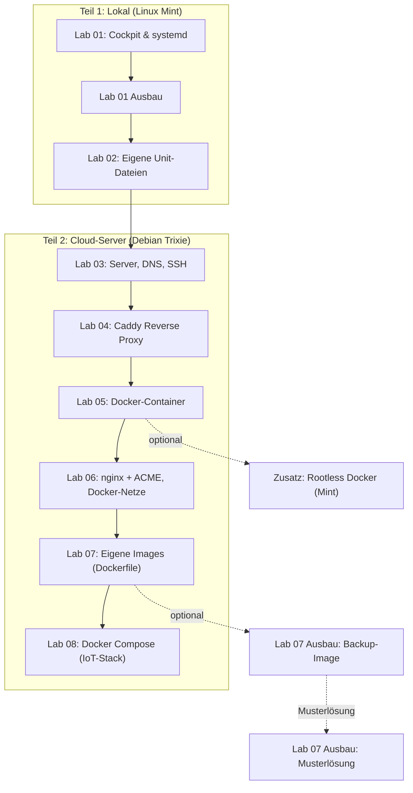

# ALP 2026: Linux-Administration

Praktischer Lehrgang zur Linux-Systemadministration (ALP – Jahrgang 2026). Der Kurs besteht aus zwei Teilen: **Teil 1** läuft lokal auf einem Linux-Mint-Rechner (Cockpit, systemd, eigene Unit-Dateien). **Teil 2** baut darauf auf und läuft gegen einen gemieteten Cloud-Server mit **Debian stable (aktuell Trixie)** – von der Erstinbetriebnahme über Reverse Proxy und Docker bis zu einer vollständigen Docker-Compose-Anwendung.

## Aufbau des Lehrgangs

## Labs

1. [Lab 01: Lokale Bereitstellung eines webbasierten Dienstes](Lab_01.md) – Cockpit per `apt install` und systemd betreiben
2. [Lab 01: Ausbaustufe](Lab_01_ausbau.md) – Socket-Aktivierung, ufw, automatischer Neustart, journalctl
3. [Lab 02: systemd Unit-Dateien erstellen und verstehen](Lab_02.md) – eigene Unit-Datei für ein Skript ohne mitgelieferte Unit
4. [Lab 03: Linux-Server in der Cloud bereitstellen und sicher erreichbar machen](Lab_03.md) – Server, Domain, DNS, SSH-Key-Authentifizierung
5. [Lab 04: Dienste sicher veröffentlichen mit Caddy als Reverse Proxy](Lab_04.md) – ufw, Caddy, automatisches HTTPS, Basic Auth
6. [Lab 05: Webdienste als Docker-Container bereitstellen](Lab_05.md) – Docker-Installation, Bind Mounts vs. benannte Volumes
7. [Lab 06: Reverse Proxy ablösen und Docker-Netzwerke segmentieren](Lab_06.md) – nginx mit nativem ACME-Modul, Docker-Netzwerke
8. [Lab 07: Eigene Docker-Images mit Dockerfile bauen](Lab_07.md) – Dockerfile, Layer, Build-Cache, Best Practices
9. [Lab 08: Multi-Container-Anwendungen mit Docker Compose verwalten](Lab_08.md) – deklarativer IoT-Stack (MQTT, Node-RED, InfluxDB, Grafana)

### Zusatz-Labs

- [Docker-Zusatz: Rootless Docker mit Docker Compose](Lab_Docker_Rootless.md) – Rootless-Betrieb auf Linux Mint
- [Lab 07: Erweiterung – Weitere eigene Images auf Basis von debian:trixie-slim](Lab_07_ausbau.md) – offene Übungsaufgabe (Backup-Image), dazu [Musterlösung](Lab_07_ausbau_musterloesung.md)

---

## Autoren und Urheberrecht

- Erstellt von: Michael Lotter, Florian Reichl
- Datum: 07/2026
- Version: v1.0
