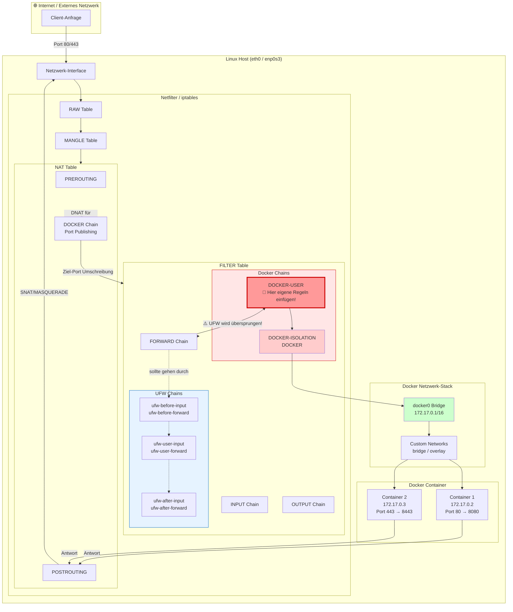

# UFW und Docker: Netzwerkstruktur und Firewall-Interaktion

## Übersicht

Dieses Diagramm zeigt, wie UFW (Uncomplicated Firewall) und Docker auf Netzwerk- und iptables-Ebene interagieren.



## Wichtige Erkenntnisse

### Problem: Docker umgeht UFW

1. **UFW arbeitet mit iptables**, fügt Regeln in INPUT, FORWARD und OUTPUT Chains ein
2. **Docker manipuliert iptables direkt** und erstellt eigene Chains
3. **Docker-Regeln haben Vorrang**: Die DOCKER Chain wird VOR den UFW-Regeln in der FORWARD Chain ausgewertet
4. **Port Publishing (`-p 80:80`)** erstellt NAT-Regeln, die externe Verbindungen direkt an Container weiterleiten

### Lösung: DOCKER-USER Chain verwenden

Die **DOCKER-USER** Chain ist der offizielle Einstiegspunkt für eigene Firewall-Regeln:

```bash
# Beispiel: Nur Zugriff von bestimmtem Netzwerk erlauben
iptables -I DOCKER-USER -i eth0 ! -s 192.168.1.0/24 -j DROP
iptables -I DOCKER-USER -i eth0 -s 192.168.1.0/24 -j RETURN

# Oder: Zugriff auf bestimmten Container-Port einschränken
iptables -I DOCKER-USER -p tcp --dport 8080 ! -s 10.0.0.0/8 -j DROP
```

### Netzwerk-Flow für Published Ports

1. **Eingehende Anfrage** → Host-Interface (z.B. eth0)
2. **PREROUTING (NAT)** → DOCKER Chain macht DNAT (Port 80 → 172.17.0.2:8080)
3. **FORWARD** → DOCKER-USER Chain (hier können eigene Regeln greifen)
4. **DOCKER-ISOLATION / DOCKER** → Isolation zwischen Netzwerken prüfen
5. **docker0 Bridge** → Weiterleitung an Container
6. **Container** → Verarbeitung der Anfrage
7. **Rückweg**: POSTROUTING → MASQUERADE → zurück zum Client

### Alternativen zur Absicherung

1. **Ports nicht publishen** → `-p 127.0.0.1:80:80` (nur localhost)
2. **Reverse Proxy verwenden** → Caddy/nginx als Gateway, Container nicht direkt exponiert
3. **Docker-eigene Firewall** → In DOCKER-USER Chain arbeiten
4. **UFW deaktivieren** → Nur iptables-Regeln verwenden (nicht empfohlen für Anfänger)

## Weiterführende Konfiguration

### UFW so konfigurieren, dass Docker-Traffic gefiltert wird

In `/etc/ufw/after.rules` können zusätzliche Regeln eingefügt werden, die auch Docker-Traffic betreffen. Allerdings ist die DOCKER-USER Chain die sauberere Lösung.

### Docker mit iptables=false starten

In `/etc/docker/daemon.json`:
```json
{
  "iptables": false
}
```

**⚠️ Warnung**: Dann funktioniert Port-Publishing nicht mehr automatisch!

---

**Autoren**: Florian Reichl  
**Version**: 1.0  
**Datum**: September 2026
