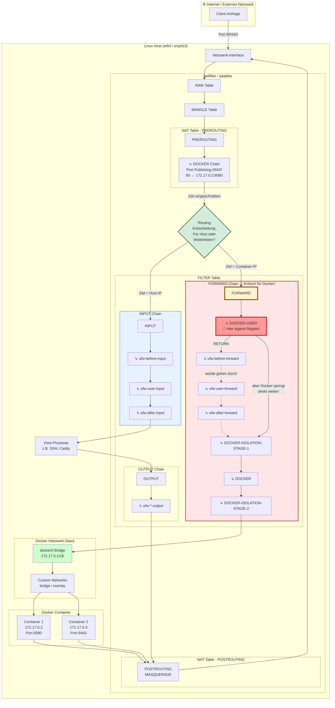

# UFW und Docker: Netzwerkstruktur und Firewall-Interaktion

## Übersicht

Dieses Diagramm zeigt, wie UFW (Uncomplicated Firewall) und Docker auf Netzwerk- und iptables-Ebene interagieren.



## Wichtige Erkenntnisse

### Problem: Docker umgeht UFW

1. **UFW arbeitet mit iptables**, fügt Regeln in INPUT, FORWARD und OUTPUT Chains ein
2. **Docker manipuliert iptables direkt** und erstellt eigene Chains
3. **Docker-Regeln haben Vorrang**: Die DOCKER Chain wird VOR den UFW-Regeln in der FORWARD Chain ausgewertet
4. **Port Publishing (`-p 80:80`)** erstellt NAT-Regeln, die externe Verbindungen direkt an Container weiterleiten

### Lösung: DOCKER-USER Chain verwenden

Die **DOCKER-USER** Chain ist der offizielle Einstiegspunkt für eigene Firewall-Regeln:

```bash
# Beispiel: Nur Zugriff von bestimmtem Netzwerk erlauben
iptables -I DOCKER-USER -i eth0 ! -s 192.168.1.0/24 -j DROP
iptables -I DOCKER-USER -i eth0 -s 192.168.1.0/24 -j RETURN

# Oder: Zugriff auf bestimmten Container-Port einschränken
iptables -I DOCKER-USER -p tcp --dport 8080 ! -s 10.0.0.0/8 -j DROP
```

### Struktur der FILTER Table

Die **FILTER Table** hat drei Haupt-Chains, die parallel existieren:

1. **INPUT Chain**: Pakete, die für den Host selbst bestimmt sind (z.B. SSH auf Port 22)
2. **FORWARD Chain**: Pakete, die durch den Host weitergeleitet werden (z.B. an Docker-Container)
3. **OUTPUT Chain**: Pakete, die vom Host selbst ausgehen

Die **Routing-Entscheidung** nach PREROUTING bestimmt, welche Chain verwendet wird:
- Ziel-IP = Host-IP → INPUT Chain
- Ziel-IP = Container-IP (nach DNAT) → FORWARD Chain

### Aufbau der FORWARD Chain (Reihenfolge!)

Die FORWARD Chain wird bei Docker-Traffic in dieser **exakten Reihenfolge** durchlaufen:

1. **DOCKER-USER** (zuerst! Hier eigene Regeln einfügen)
   - Wenn Regel matched und RETURN sagt → weiter zu Schritt 2
   - Wenn Regel matched und DROP/REJECT sagt → Paket blockiert
   - Wenn keine Regel matched → weiter zu Schritt 2

2. **ufw-before-forward, ufw-user-forward, ufw-after-forward**
   - ⚠️ Werden in der Praxis übersprungen, weil Docker direkt zu Schritt 3 springt

3. **DOCKER-ISOLATION-STAGE-1** (verhindert unerwünschte Container-zu-Container-Kommunikation)
4. **DOCKER** (eigentliche Weiterleitung an Container-Netzwerke)
5. **DOCKER-ISOLATION-STAGE-2** (weitere Isolation-Checks)

### Netzwerk-Flow für Published Ports

**Eingehender Traffic (Client → Container):**
1. **Client-Anfrage** → Port 80 an Host-IP
2. **PREROUTING (NAT)** → DOCKER Chain macht DNAT: Port 80 → 172.17.0.2:8080
3. **Routing-Entscheidung** → Ziel ist jetzt Container-IP → FORWARD Chain
4. **FORWARD** → **DOCKER-USER** (hier können eigene Regeln greifen!)
5. **DOCKER-ISOLATION / DOCKER** → Isolation prüfen, an docker0 weiterleiten
6. **docker0 Bridge** → Routing an Container-Netzwerk
7. **Container** → Verarbeitung der Anfrage

**Ausgehender Traffic (Container → Client):**
1. **Container** → Antwort an ursprüngliche Client-IP
2. **POSTROUTING (NAT)** → MASQUERADE (Source-IP wird zu Host-IP)
3. **Host-Interface** → zurück zum Client

### Alternativen zur Absicherung

1. **Ports nicht publishen** → `-p 127.0.0.1:80:80` (nur localhost)
2. **Reverse Proxy verwenden** → Caddy/nginx als Gateway, Container nicht direkt exponiert
3. **Docker-eigene Firewall** → In DOCKER-USER Chain arbeiten
4. **UFW deaktivieren** → Nur iptables-Regeln verwenden (nicht empfohlen für Anfänger)

## Weiterführende Konfiguration

### UFW so konfigurieren, dass Docker-Traffic gefiltert wird

In `/etc/ufw/after.rules` können zusätzliche Regeln eingefügt werden, die auch Docker-Traffic betreffen. Allerdings ist die DOCKER-USER Chain die sauberere Lösung.

### Docker mit iptables=false starten

In `/etc/docker/daemon.json`:
```json
{
  "iptables": false
}
```

**⚠️ Warnung**: Dann funktioniert Port-Publishing nicht mehr automatisch!

## Beispiel: iptables-Regeln in der Praxis

Um die Reihenfolge und Struktur zu verdeutlichen, hier eine typische `iptables -L FORWARD -v -n` Ausgabe auf einem System mit Docker und UFW:

```bash
Chain FORWARD (policy DROP 0 packets, 0 bytes)
 pkts bytes target     prot opt in     out     source               destination         
    0     0 DOCKER-USER  all  --  *      *       0.0.0.0/0            0.0.0.0/0           
    0     0 DOCKER-ISOLATION-STAGE-1  all  --  *      *       0.0.0.0/0            0.0.0.0/0           
  12K 2048K ACCEPT     all  --  *      docker0  0.0.0.0/0            0.0.0.0/0            ctstate RELATED,ESTABLISHED
    0     0 DOCKER     all  --  *      docker0  0.0.0.0/0            0.0.0.0/0           
  456 27360 ACCEPT     all  --  docker0 !docker0  0.0.0.0/0            0.0.0.0/0           
    0     0 ACCEPT     all  --  docker0 docker0  0.0.0.0/0            0.0.0.0/0           
    0     0 ufw-before-logging-forward  all  --  *      *       0.0.0.0/0            0.0.0.0/0           
    0     0 ufw-before-forward  all  --  *      *       0.0.0.0/0            0.0.0.0/0           
    0     0 ufw-after-forward  all  --  *      *       0.0.0.0/0            0.0.0.0/0           
    0     0 ufw-after-logging-forward  all  --  *      *       0.0.0.0/0            0.0.0.0/0           
    0     0 ufw-reject-forward  all  --  *      *       0.0.0.0/0            0.0.0.0/0           
    0     0 ufw-track-forward  all  --  *      *       0.0.0.0/0            0.0.0.0/0           
```

### Analyse der Reihenfolge

1. **DOCKER-USER** (Zeile 1): Als **erstes** wird hier gesprungen → perfekter Einstiegspunkt für eigene Regeln!
2. **DOCKER-ISOLATION-STAGE-1** (Zeile 2): Docker's interne Isolation
3. **ACCEPT für RELATED,ESTABLISHED** (Zeile 3): Bestehende Verbindungen werden durchgelassen
4. **DOCKER** (Zeile 4): Jump zur DOCKER Chain für neue Verbindungen
5. **ACCEPT docker0 → extern** (Zeile 5): Container dürfen nach außen
6. **ACCEPT docker0 → docker0** (Zeile 6): Container untereinander
7. **ufw-before-forward** usw. (Zeilen 7-12): UFW-Regeln kommen **nach** Docker → zu spät!

### Die DOCKER-USER Chain (leer nach Installation)

```bash
Chain DOCKER-USER (1 references)
 pkts bytes target     prot opt in     out     source               destination         
 456K  567M RETURN     all  --  *      *       0.0.0.0/0            0.0.0.0/0           
```

Standardmäßig nur ein `RETURN` → keinerlei Filterung! Alle Pakete gehen weiter zur nächsten Chain.

### Die DOCKER Chain (Port Publishing Regeln)

```bash
Chain DOCKER (1 references)
 pkts bytes target     prot opt in     out     source               destination         
    0     0 ACCEPT     tcp  --  !docker0 docker0  0.0.0.0/0            172.17.0.2           tcp dpt:8080
    0     0 ACCEPT     tcp  --  !docker0 docker0  0.0.0.0/0            172.17.0.3           tcp dpt:8443
```

Hier sieht man die published Ports:
- Externe Anfragen (nicht von docker0) an 172.17.0.2:8080 → ACCEPT
- Externe Anfragen an 172.17.0.3:8443 → ACCEPT

### NAT-Regeln für Port Publishing

```bash
Chain DOCKER (2 references)
 pkts bytes target     prot opt in     out     source               destination         
    0     0 RETURN     all  --  docker0 *       0.0.0.0/0            0.0.0.0/0           
   42  2520 DNAT       tcp  --  !docker0 *       0.0.0.0/0            0.0.0.0/0            tcp dpt:80 to:172.17.0.2:8080
    8   480 DNAT       tcp  --  !docker0 *       0.0.0.0/0            0.0.0.0/0            tcp dpt:443 to:172.17.0.3:8443
```

In der NAT Table (PREROUTING):
- Port 80 → wird umgeschrieben zu 172.17.0.2:8080
- Port 443 → wird umgeschrieben zu 172.17.0.3:8443

### Eigene Regeln in DOCKER-USER einfügen

Um Docker-Container abzusichern, **vor** dem `RETURN` eigene Regeln einfügen:

```bash
# Beispiel: Nur Zugriff aus lokalem Netzwerk erlauben
iptables -I DOCKER-USER -i eth0 ! -s 192.168.1.0/24 -j DROP
iptables -I DOCKER-USER -i eth0 -s 192.168.1.0/24 -j RETURN

# Resultierende Chain:
Chain DOCKER-USER (1 references)
 pkts bytes target     prot opt in     out     source               destination
    0     0 RETURN     all  --  eth0   *       192.168.1.0/24       0.0.0.0/0
    0     0 DROP       all  --  eth0   *       0.0.0.0/0            0.0.0.0/0
  456K  567M RETURN     all  --  *      *       0.0.0.0/0            0.0.0.0/0
```

Jetzt werden Pakete von eth0:
1. Wenn Source = 192.168.1.0/24 → RETURN (weiter zu Docker)
2. Sonst → DROP (blockiert)
3. Pakete von anderen Interfaces → RETURN (Standard)

---

**Autoren**: Florian Reichl  
**Version**: 1.0  
**Datum**: September 2026
