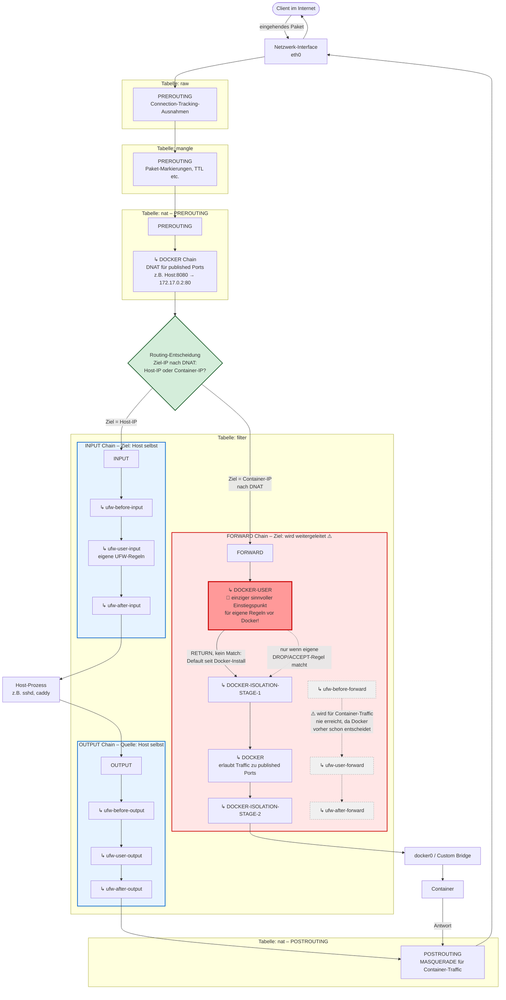

# iptables/Netfilter-Paketfluss: Debian Trixie mit UFW und Docker

## Zweck

Dieses Diagramm zeigt den vollständigen Weg eines IP-Pakets durch die Netfilter-Tabellen und -Ketten (`raw` → `mangle` → `nat` → `filter`) auf einem Debian-Trixie-Server, auf dem sowohl **UFW** als auch **Docker** aktiv sind. Wichtig ist vor allem die **Reihenfolge**: Docker fügt seine Chains früher in die Traversierung ein als UFW, wodurch UFW-Regeln für Container-Traffic praktisch wirkungslos werden, wenn man nicht gezielt in `DOCKER-USER` eingreift.

Es werden zwei Fälle unterschieden:
- **Ziel = Host-Prozess** (z.B. SSH auf Port 22, Caddy auf 443) → läuft durch `INPUT`, UFW greift normal.
- **Ziel = Container mit published Port** (z.B. `-p 8080:80`) → läuft durch `FORWARD`, Docker greift vor UFW.



## Wie das Diagramm zu lesen ist

### Tabellen-Reihenfolge (immer gleich, unabhängig von UFW/Docker)

Jedes Paket durchläuft die Tabellen in dieser festen Reihenfolge: `raw` → `mangle` → `nat (PREROUTING)` → Routing-Entscheidung → `filter` (INPUT *oder* FORWARD) → `nat (POSTROUTING)`. UFW und Docker klinken sich beide in `filter` und `nat` ein, verändern diese Grundreihenfolge aber nicht – sie fügen nur zusätzliche Chains **innerhalb** von INPUT/FORWARD/OUTPUT ein.

### Fall 1: Verbindung zu einem Host-Prozess (INPUT)

Ein Client verbindet sich direkt mit einem auf dem Host laufenden Dienst (SSH, ein nativer Caddy/nginx). Die Ziel-IP bleibt die Host-IP, also greift die **INPUT Chain**. Dort hat UFW volle Kontrolle: `ufw-before-input` → `ufw-user-input` (hier landen `ufw allow`-Regeln) → `ufw-after-input`. Das entspricht dem klassischen, erwarteten UFW-Verhalten.

### Fall 2: Verbindung zu einem Container mit published Port (FORWARD)

Sobald ein Container-Port mit `-p HOST:CONTAINER` veröffentlicht wird, trägt Docker beim Start eine DNAT-Regel in `nat PREROUTING` (Chain `DOCKER`) ein. Die Ziel-IP des Pakets wird **vor** der Routing-Entscheidung auf die Container-IP umgeschrieben – damit läuft das Paket durch **FORWARD**, nicht durch INPUT.

In FORWARD gilt folgende feste Reihenfolge (von Docker beim Start vorne in die Chain eingefügt):

1. **DOCKER-USER** – wird immer zuerst durchlaufen. Standardmäßig leer (nur ein `RETURN`). **Das ist der einzige Punkt, an dem eigene Regeln vor Docker greifen.**
2. **DOCKER-ISOLATION-STAGE-1/2** – verhindert unerwünschte Kommunikation zwischen verschiedenen Docker-Netzwerken.
3. **DOCKER** – lässt Traffic zu den konkret published Ports durch.
4. Erst danach kämen `ufw-before-forward`, `ufw-user-forward`, `ufw-after-forward` – **aber für Container-Traffic ist die Entscheidung (ACCEPT/DROP) da meist schon gefallen.** Deshalb sind diese Knoten im Diagramm gestrichelt/grau: UFW-Regeln zu `ufw allow` für Container-Ports greifen nicht wie erwartet, ein in `ufw` konfiguriertes `deny` schützt published Ports **nicht**.

### Konsequenz für die Praxis

Wer Docker-Container gezielt absichern will (z.B. nur aus einem bestimmten Netz erreichbar machen), muss das in **`DOCKER-USER`** tun – nicht in UFW:

```bash
iptables -I DOCKER-USER -i eth0 ! -s 192.168.1.0/24 -j DROP
iptables -I DOCKER-USER -i eth0 -s 192.168.1.0/24 -j RETURN
```

Alternativen, die man in Labs/Praxis ebenfalls nennen kann:
- Ports nicht öffentlich publishen: `-p 127.0.0.1:8080:80` statt `-p 8080:80`.
- Reverse Proxy (Caddy/nginx) als einzigen öffentlichen Eintrittspunkt nutzen, Container-Ports gar nicht erst binden.
- `ufw-docker`-Helferskript verwenden, das automatisch passende `DOCKER-USER`-Regeln aus UFW-Regeln generiert.

---

**Autoren**: Florian Reichl
**Version**: 1.0
**Datum**: September 2026
