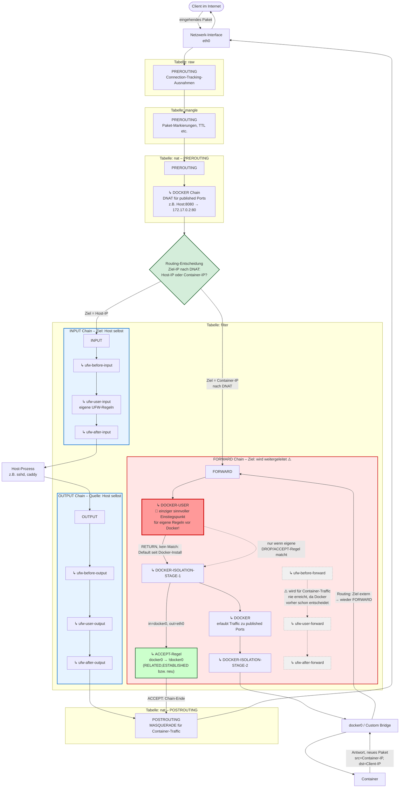
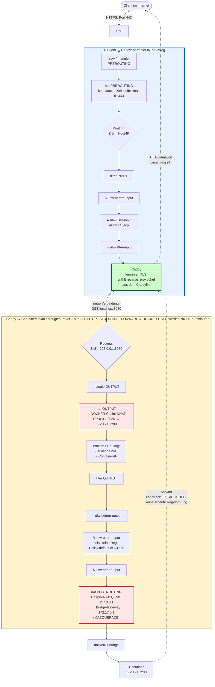

# iptables/Netfilter-Paketfluss: Debian Trixie mit UFW und Docker

## Zweck

Dieses Diagramm zeigt den vollständigen Weg eines IP-Pakets durch die Netfilter-Tabellen und -Ketten (`raw` → `mangle` → `nat` → `filter`) auf einem Debian-Trixie-Server, auf dem sowohl **UFW** als auch **Docker** aktiv sind. Wichtig ist vor allem die **Reihenfolge**: Docker fügt seine Chains früher in die Traversierung ein als UFW, wodurch UFW-Regeln für Container-Traffic praktisch wirkungslos werden, wenn man nicht gezielt in `DOCKER-USER` eingreift.

Es werden zwei Fälle unterschieden:
- **Ziel = Host-Prozess** (z.B. SSH auf Port 22, Caddy auf 443) → läuft durch `INPUT`, UFW greift normal.
- **Ziel = Container mit published Port** (z.B. `-p 8080:80`) → läuft durch `FORWARD`, Docker greift vor UFW.



## Wie das Diagramm zu lesen ist

### Tabellen-Reihenfolge (immer gleich, unabhängig von UFW/Docker)

Jedes Paket durchläuft die Tabellen in dieser festen Reihenfolge: `raw` → `mangle` → `nat (PREROUTING)` → Routing-Entscheidung → `filter` (INPUT *oder* FORWARD) → `nat (POSTROUTING)`. UFW und Docker klinken sich beide in `filter` und `nat` ein, verändern diese Grundreihenfolge aber nicht – sie fügen nur zusätzliche Chains **innerhalb** von INPUT/FORWARD/OUTPUT ein.

### Fall 1: Verbindung zu einem Host-Prozess (INPUT)

Ein Client verbindet sich direkt mit einem auf dem Host laufenden Dienst (SSH, ein nativer Caddy/nginx). Die Ziel-IP bleibt die Host-IP, also greift die **INPUT Chain**. Dort hat UFW volle Kontrolle: `ufw-before-input` → `ufw-user-input` (hier landen `ufw allow`-Regeln) → `ufw-after-input`. Das entspricht dem klassischen, erwarteten UFW-Verhalten.

### Fall 2: Verbindung zu einem Container mit published Port (FORWARD)

Sobald ein Container-Port mit `-p HOST:CONTAINER` veröffentlicht wird, trägt Docker beim Start eine DNAT-Regel in `nat PREROUTING` (Chain `DOCKER`) ein. Die Ziel-IP des Pakets wird **vor** der Routing-Entscheidung auf die Container-IP umgeschrieben – damit läuft das Paket durch **FORWARD**, nicht durch INPUT.

In FORWARD gilt folgende feste Reihenfolge (von Docker beim Start vorne in die Chain eingefügt):

1. **DOCKER-USER** – wird immer zuerst durchlaufen. Standardmäßig leer (nur ein `RETURN`). **Das ist der einzige Punkt, an dem eigene Regeln vor Docker greifen.**
2. **DOCKER-ISOLATION-STAGE-1/2** – verhindert unerwünschte Kommunikation zwischen verschiedenen Docker-Netzwerken.
3. **DOCKER** – lässt Traffic zu den konkret published Ports durch.
4. Erst danach kämen `ufw-before-forward`, `ufw-user-forward`, `ufw-after-forward` – **aber für Container-Traffic ist die Entscheidung (ACCEPT/DROP) da meist schon gefallen.** Deshalb sind diese Knoten im Diagramm gestrichelt/grau: UFW-Regeln zu `ufw allow` für Container-Ports greifen nicht wie erwartet, ein in `ufw` konfiguriertes `deny` schützt published Ports **nicht**.

### Fall 3: Antwort-Traffic, der den Container verlässt (FORWARD, erneut)

Die Antwort des Containers ist aus Sicht von Netfilter ein **komplett neues Paket**: Quelle = Container-IP, Ziel = Client-IP. Es tritt am virtuellen Interface `docker0` in den Netfilter-Stack ein und läuft die Tabellen erneut durch – `raw`/`mangle`/`nat PREROUTING` (hier greift keine Regel, da das Ziel nicht der Host ist), dann die Routing-Entscheidung: Ziel ist eine externe IP → wieder **FORWARD**.

In FORWARD wird dieselbe Chain wie beim Hinweg durchlaufen, aber `in=docker0, out=eth0` statt umgekehrt:

1. **DOCKER-USER** – erneut zuerst, Standard `RETURN`.
2. **DOCKER-ISOLATION-STAGE-1** – lässt Traffic von `docker0` nach außen durch.
3. Eine von Docker eingefügte **ACCEPT-Regel `docker0 → !docker0`** (für `RELATED,ESTABLISHED`- bzw. neue Verbindungen von Containern nach außen) matcht und beendet die Chain-Verarbeitung sofort mit `ACCEPT`. Die `DOCKER`-Chain (Schritt 3 vom Hinweg) und die UFW-Forward-Chains werden dabei **gar nicht mehr erreicht**, weil `ACCEPT` die Traversierung der Base-Chain beendet.
4. Danach nur noch `nat POSTROUTING`: Die **MASQUERADE-Regel** schreibt die Quelladresse von der internen Container-IP auf die öffentliche Host-IP um – sonst wüsste der Client nicht, wohin er antworten soll.
5. Das Paket verlässt den Host über `eth0` Richtung Client.

Kurz gesagt: **Ausgehender Container-Traffic ist von Haus aus offen** – Docker legt beim Start eine großzügige ACCEPT-Regel für `docker0 → !docker0` an, damit Container ohne weitere Konfiguration ins Internet können. UFW hat darauf ebenso wenig Einfluss wie beim Hinweg, es sei denn man ergänzt eigene, restriktivere Regeln in `DOCKER-USER` (die dann für **beide** Richtungen gelten, da diese Chain am Anfang von FORWARD sitzt).

### Policy vs. Regel: Warum `DEFAULT_FORWARD_POLICY="ACCEPT"` trotzdem oft nötig ist

Neben den Regeln, die in eine Chain eingefügt werden, hat jede Base-Chain (`INPUT`, `FORWARD`, `OUTPUT`) auch eine **Policy** – ein Standard-Verdikt, das nur dann greift, wenn das Paket die **gesamte** Chain (inklusive aller Sub-Chains, in die gesprungen wird) durchläuft, ohne dass irgendeine Regel unterwegs ein finales `ACCEPT`/`DROP`/`REJECT` ausspricht. `/etc/default/ufw` setzt über die Variable `DEFAULT_FORWARD_POLICY` genau diese Policy der `FORWARD`-Chain – sobald UFW aktiviert wird, standardmäßig auf `DROP`.

Die `ACCEPT`-Regeln, die Docker einträgt (siehe Fall 2 und Fall 3), greifen zwar meist **vor** dieser Policy und lassen die Fälle durch, die Docker beim Anlegen seiner Netzwerke/Container tatsächlich kennt (published Ports, Traffic über die bekannte Bridge). Das Problem: Diese Regeln decken nur genau diese Fälle ab. Alles, was **nicht** explizit erfasst wird – z.B. bestimmte Custom-Network-Konstellationen, IPv6-Forwarding (Docker pflegt `ip6tables` oft weniger vollständig als `iptables`), oder Traffic-Muster, die sich durch spätere `ufw reload`-Läufe anders zusammensetzen – fällt am Ende der Chain durch bis zur **Policy**. Und die steht bei aktivem UFW auf `DROP`.

Ergebnis: Container-Traffic, der eigentlich funktionieren sollte, wird plötzlich verworfen – nicht weil eine Regel ihn blockiert, sondern weil **keine** Regel überhaupt eine Entscheidung getroffen hat und die Chain am Ende auf `DROP` läuft. Der übliche Fix in Docker+UFW-Anleitungen:

```bash
# /etc/default/ufw
DEFAULT_FORWARD_POLICY="ACCEPT"
```

gefolgt von `ufw reload`. Damit bleibt UFW für **INPUT** (SSH, Host-Dienste) weiterhin restriktiv, aber die `FORWARD`-Chain "fällt sicher offen" statt "sicher geschlossen" – was in der Praxis ohnehin nur die Lücken betrifft, die sowieso schon primär von Docker selbst kontrolliert werden. Die eigentliche Zugriffskontrolle für Container-Traffic passiert weiterhin faktisch in Dockers eigenen Chains bzw. in `DOCKER-USER`, wenn man selbst gezielt eingreifen will – die Policy ist nur das Sicherheitsnetz für die Fälle dazwischen.

### Konsequenz für die Praxis

Wer Docker-Container gezielt absichern will (z.B. nur aus einem bestimmten Netz erreichbar machen), muss das in **`DOCKER-USER`** tun – nicht in UFW:

```bash
iptables -I DOCKER-USER -i eth0 ! -s 192.168.1.0/24 -j DROP
iptables -I DOCKER-USER -i eth0 -s 192.168.1.0/24 -j RETURN
```

Alternativen, die man in Labs/Praxis ebenfalls nennen kann:
- Ports nicht öffentlich publishen: `-p 127.0.0.1:8080:80` statt `-p 8080:80`.
- Reverse Proxy (Caddy/nginx) als einzigen öffentlichen Eintrittspunkt nutzen, Container-Ports gar nicht erst binden.
- `ufw-docker`-Helferskript verwenden, das automatisch passende `DOCKER-USER`-Regeln aus UFW-Regeln generiert.

## Diagramm 2: Externe Anfrage über Caddy zu einem Docker-Container

Im Kurs läuft Caddy als natives systemd-Programm auf dem Host (Lab 04) und leitet an Container weiter, deren Ports bewusst nur an `127.0.0.1` gebunden sind (Lab 05, z.B. `-p 127.0.0.1:8080:80`). Das ergibt zwei **völlig unterschiedliche** Netfilter-Wege für ein- und denselben Request, je nachdem, wer das Paket erzeugt:



### Warum das zweite Hop anders verläuft als alles bisher Gezeigte

Der entscheidende Unterschied zu Diagramm 1: In Stage 2 handelt es sich um ein **lokal vom Host selbst erzeugtes Paket** (Caddy verbindet sich zu `127.0.0.1:8080`), kein durchgereichtes Paket wie in Diagramm 1. Netfilter unterscheidet strikt danach, wie ein Paket entsteht:

- **Extern eintreffend, Ziel = anderer Host/Container** → `PREROUTING` → `FORWARD` → `POSTROUTING` (das war Fall 2/3 in Diagramm 1, dort greift `DOCKER-USER`).
- **Lokal erzeugt** (jeder Prozess auf dem Host, auch Caddy) → **immer** `OUTPUT` → `POSTROUTING`, egal welche Ziel-IP am Ende herauskommt. Die `FORWARD`-Chain – und damit `DOCKER-USER` – wird für diesen Pfad **grundsätzlich nie erreicht.**

Das heißt konkret: Wenn Caddys Verbindung zu `localhost:8080` durch Dockers `nat OUTPUT`-Regel auf die Container-IP umgeschrieben wird, bleibt der Netfilter-Pfad trotzdem OUTPUT/POSTROUTING. Weder eigene `DOCKER-USER`-Regeln noch ein restriktiver `ufw`-Forward-Regelsatz (siehe vorheriger Abschnitt) haben auf diesen Hop **irgendeinen** Einfluss – dort zählt ausschließlich die `filter OUTPUT`-Chain (`ufw-*-output`), deren UFW-Policy per Default `ACCEPT` ist und in der Praxis kaum verschärft wird.

Die tatsächliche Absicherung dieses Hops passiert also nicht über Firewall-Regeln, sondern genau über den in Lab 05 vermittelten Kniff: **Port-Bindung an `127.0.0.1`**. Dadurch ist der Container-Port für Prozesse *auf dem Host* (wie Caddy) erreichbar, aber für kein externes Interface – unabhängig davon, wie `DOCKER-USER`, `ufw` oder die `FORWARD`-Policy konfiguriert sind. Würde derselbe Port stattdessen ohne IP-Präfix veröffentlicht (`-p 8080:80`), wäre er zusätzlich über `0.0.0.0` direkt aus dem Internet erreichbar – dann griffe für diesen zweiten, externen Zugriffsweg wieder Diagramm 1 (PREROUTING → FORWARD → DOCKER-USER), komplett unabhängig vom Caddy-Hop.

### Die Hairpin-NAT-Regel in POSTROUTING

Ein Detail, das leicht übersehen wird: Nach dem DNAT in `nat OUTPUT` hat das Paket als Quelladresse weiterhin `127.0.0.1`. Der Container kann darauf aber nicht sinnvoll antworten – `127.0.0.1` bedeutet für den Container "ich selbst", nicht "der Host". Docker legt deshalb in `nat POSTROUTING` eine zusätzliche MASQUERADE-Regel an, die die Quelladresse auf die Bridge-Gateway-IP (z.B. `172.17.0.1`) umschreibt. Erst dadurch kann der Container die Antwort korrekt zurückrouten, und conntrack ordnet die Antwort auf dem Rückweg wieder Caddys ursprünglicher Verbindung zu.

---

**Autoren**: Florian Reichl
**Version**: 1.0
**Datum**: September 2026
