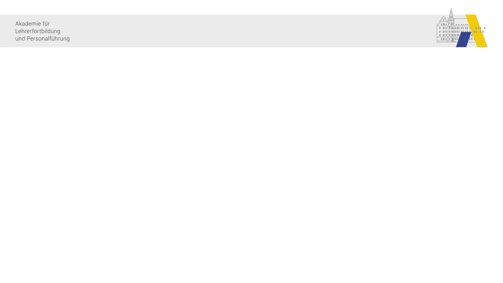

# Marp Präsentationen für Linux Administration

Dieses Verzeichnis enthält Marp-Präsentationen für den Linux-Administrationskurs.

## Installation

### Marp CLI installieren

```bash
# Node.js und npm installieren (falls noch nicht vorhanden)
sudo apt install -y nodejs npm

# Marp CLI global installieren
npm install -g @marp-team/marp-cli

# Version prüfen
marp --version
```

### VS Code Extension (optional)

Für Live-Preview während der Bearbeitung:

1. In VS Code: Extensions öffnen (Ctrl+Shift+X)
2. Nach "Marp for VS Code" suchen
3. Installieren
4. `.md`-Dateien öffnen → Live-Preview rechts

## Verwendung

### Präsentation bauen

```bash
# Einzelne Präsentation
cd presentations
./build-presentation.sh lab06-beispiel.md

# Mit eigenem Output-Verzeichnis
./build-presentation.sh lab06-beispiel.md ./output

# Manuell (ohne Skript)
marp lab06-beispiel.md -o lab06.html --theme-set ../themes/linux-theme.css
```

### Präsentation anzeigen

```bash
# HTML im Browser öffnen
xdg-open lab06-beispiel.html

# PDF öffnen
xdg-open lab06-beispiel.pdf

# PowerPoint öffnen
libreoffice lab06-beispiel.pptx
```

### Live-Server starten (optional)

```bash
# Mit Marp's eingebautem Server
marp -s lab06-beispiel.md --theme-set ../themes/linux-theme.css

# Oder mit Python's HTTP Server
python3 -m http.server 8000
# Dann öffne: http://localhost:8000/lab06-beispiel.html
```

## Präsentations-Struktur

### Frontmatter

Jede Präsentation beginnt mit Metadaten:

```markdown
---
marp: true
theme: linux-theme
paginate: true
header: ''
footer: 'Linux Administration 2026 | Lab XX | Florian Reichl'
---
```

### Folien-Trenner

Folien werden mit `---` getrennt:

```markdown
# Erste Folie

Inhalt...

---

# Zweite Folie

Mehr Inhalt...
```

### Spezielle Folien-Klassen

#### Titelfolie

```markdown
<!-- _class: title -->

# Haupttitel
## Untertitel

Autor-Information
```

## Custom Theme

Das Theme `linux-theme.css` basiert auf der PowerPoint-Vorlage:

### Farben

- **Primär dunkel:** #44546A (dunkelblau-grau)
- **Primär hell:** #E7E6E6 (hellgrau)
- **Akzent Blau:** #5B9BD5
- **Akzent Orange:** #ED7D31
- **Akzent Dunkelblau:** #4472C4
- **Akzent Grün:** #70AD47

### Schriftarten

- **Überschriften:** Roboto Flex
- **Hervorhebungen:** Roboto Slab  
- **Fließtext:** Roboto Serif
- **Code:** Source Code Pro

### Code-Blöcke

```bash
# Bash/Shell-Code wird automatisch mit Syntax-Highlighting dargestellt
nginx -t
systemctl reload nginx
```

```nginx
# nginx-Konfiguration
server {
    listen 443 ssl;
    server_name example.com;
}
```

### Hervorhebungen

**Fett** (orange) für wichtige Begriffe  
*Kursiv* (blau) für Betonung  
`Code` (inline) für Befehle und Pfade

### Listen

- Aufzählungen mit blauen Bullets
  - Verschachtelte Listen möglich
  - Mit eingerückten Sub-Items

1. Nummerierte Listen
2. Mit dunkelblauen Nummern
3. Für Schritt-für-Schritt Anleitungen

### Tabellen

| Spalte 1 | Spalte 2 | Spalte 3 |
|----------|----------|----------|
| Daten    | Mehr     | Noch mehr|
| Zeile 2  | Hover    | Effekt   |

### Blockquotes

> **Wichtig:** Blockquotes werden orange hervorgehoben und sind perfekt für Hinweise und Warnungen.

### Bilder

```markdown
# Normale Größe


# Mit Breite


# Mit Höhe

```

## Tipps & Tricks

### Zwei-Spalten Layout

```markdown
<div class="columns">
<div>

Linke Spalte

- Punkt 1
- Punkt 2

</div>
<div>

Rechte Spalte

- Punkt A
- Punkt B

</div>
</div>
```

### Hervorhebungsboxen

Füge in `linux-theme.css` folgendes hinzu für farbige Boxen:

```markdown
<div class="info">
ℹ️ Information: Dies ist eine Info-Box
</div>

<div class="success">
✅ Erfolg: Operation erfolgreich
</div>

<div class="warning">
⚠️ Warnung: Vorsicht geboten
</div>
```

### Nur auf aktueller Folie anwenden

```markdown
<!-- _paginate: false -->
<!-- _header: "" -->
<!-- _footer: "" -->

# Folie ohne Header/Footer/Seitenzahl
```

### Inkrementelle Anzeige

```markdown
* Erscheint zuerst
* <!-- .element: class="fragment" --> Erscheint dann
* <!-- .element: class="fragment" --> Und dann
```

## Export-Formate

### HTML (empfohlen für Präsentation)
- Volle Funktionalität
- Animationen und Übergänge
- Tastatur-Navigation (←/→)
- Responsive

### PDF (für Druck/Archiv)
- Eine Seite pro Folie
- Statisch
- Druckbar
- Archivierbar

### PPTX (für PowerPoint)
- Editierbar in PowerPoint/LibreOffice
- Kompatibel mit Office
- Theme wird approximiert

## Keyboard Shortcuts (HTML)

- **→ / Leertaste:** Nächste Folie
- **← / Shift+Leertaste:** Vorherige Folie
- **F:** Fullscreen
- **O:** Overview-Modus
- **P:** Presenter-Modus (mit Notizen)
- **Esc:** Modus verlassen

## Weitere Ressourcen

- [Marp Dokumentation](https://marpit.marp.app/)
- [Marp CLI](https://github.com/marp-team/marp-cli)
- [Marp VS Code Extension](https://marketplace.visualstudio.com/items?itemName=marp-team.marp-vscode)
- [Markdown Guide](https://www.markdownguide.org/)

## Beispiele

Siehe `lab06-beispiel.md` für eine vollständige Beispiel-Präsentation mit:
- Titelfolie
- Code-Beispielen
- Tabellen
- Listen
- Blockquotes
- Verschiedenen Folie-Typen
