<!-- _class: title -->

# Linux Administration
## Kursüberblick 2026

**Praxisorientierte Systemadministration**  
mit ISO 27001-Compliance

Florian Reichl, Michael Lotter

---

## Kursstruktur: 9 Labs in 3 Phasen

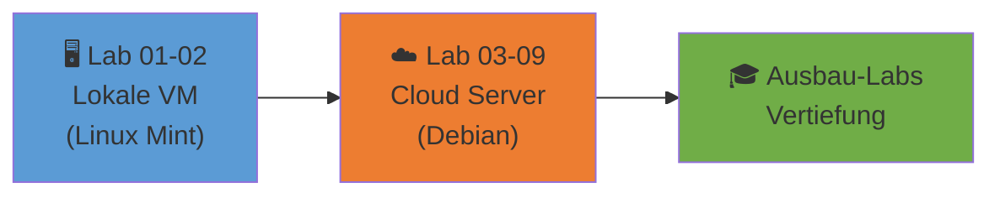

**Phase 1:** Linux Mint VM (lokal) - Labs 01-02  
**Phase 2:** Debian Cloud Server (remote) - Labs 03-09  
**Phase 3:** Spezialisierung & Vertiefung

---

## Technologie-Stack

<div class="columns">
<div>

**Basis**
- systemd
- SSH
- UFW Firewall

**Web**
- nginx + ACME
- Reverse Proxy
- TLS/HTTPS

</div>
<div>

**Container**
- Docker
- Docker Compose
- Netzwerke

**Monitoring**
- Cockpit
- journalctl
- Logs

</div>
</div>

---

<!-- _class: title -->

# Teil 1
## Lokale Umgebung

Labs 01-02 auf Linux Mint

---

<!-- _footer: 'Linux Administration 2026 | **Lab 01**: Cockpit & systemd' -->

## 🔧 Lab 01: Cockpit & systemd
### Lokale Systemverwaltung mit Web-UI

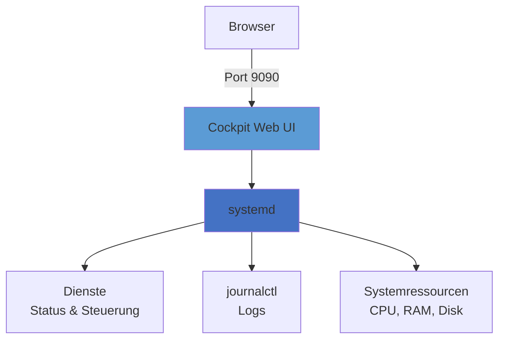

**Lernziel:** Web-basierte Systemverwaltung

---

<!-- _footer: 'Linux Administration 2026 | **Lab 02**: systemd Units' -->

## ⚙️ Lab 02: systemd Units
### Eigene Services definieren

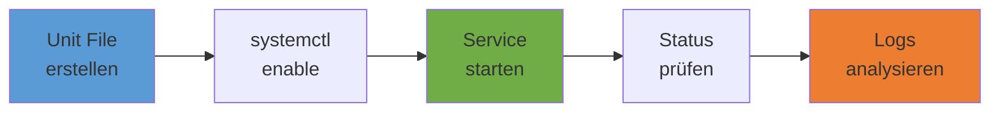

**Lernziel:** Eigene Services definieren und verwalten

---

<!-- _class: title -->

# Teil 2
## Cloud Server

Labs 03-09 auf Debian Trixie

---

<!-- _footer: 'Linux Administration 2026 | **Lab 03**: Cloud-Setup' -->

## ☁️ Lab 03: Cloud-Setup
### Server, DNS & SSH-Keys

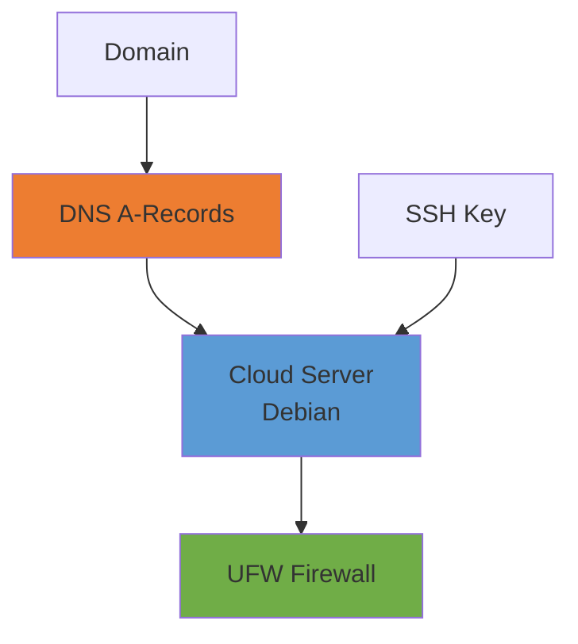

**Lernziel:** Server-Grundkonfiguration & DNS

---

<!-- _footer: 'Linux Administration 2026 | **Lab 04**: Reverse Proxy mit Caddy' -->

## 🔀 Lab 04: Reverse Proxy (Caddy)
### Ein Gateway, viele Dienste

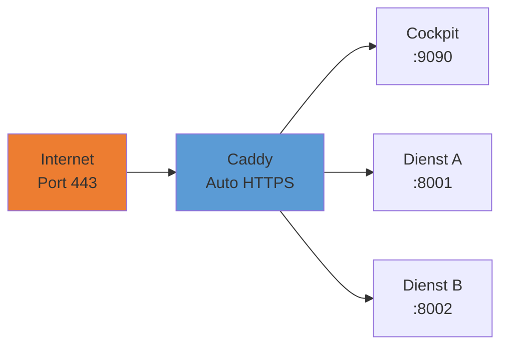

**Lernziel:** Ein Gateway für viele Dienste

---

<!-- _footer: 'Linux Administration 2026 | **Lab 05**: Docker Container' -->

## 📦 Lab 05: Docker Container
### Container-Grundlagen & Volumes

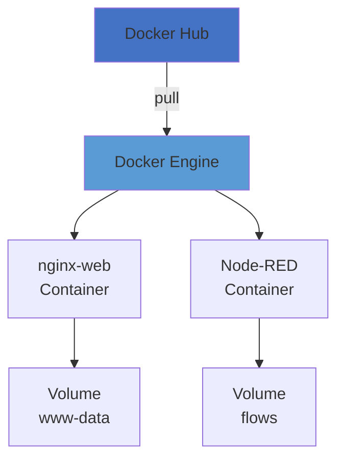

**Lernziel:** Container-Grundlagen & Volumes

---

<!-- _footer: 'Linux Administration 2026 | **Lab 06**: nginx + ACME | ISO 27001 A.8.24' -->

## 🔐 Lab 06: nginx + ACME
### Explizite Zertifikatsverwaltung

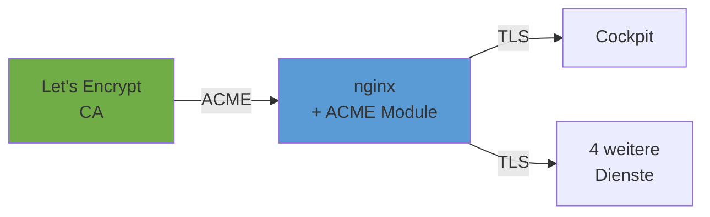

**Lernziel:** Explizite ACME-Konfiguration  
**ISO 27001:** Control A.8.24

---

<!-- _footer: 'Linux Administration 2026 | **Lab 07**: Docker-Netzwerke | ISO 27001 A.8.22' -->

## 🌐 Lab 07: Docker-Netzwerke
### Netzwerk-Segmentierung & Isolation

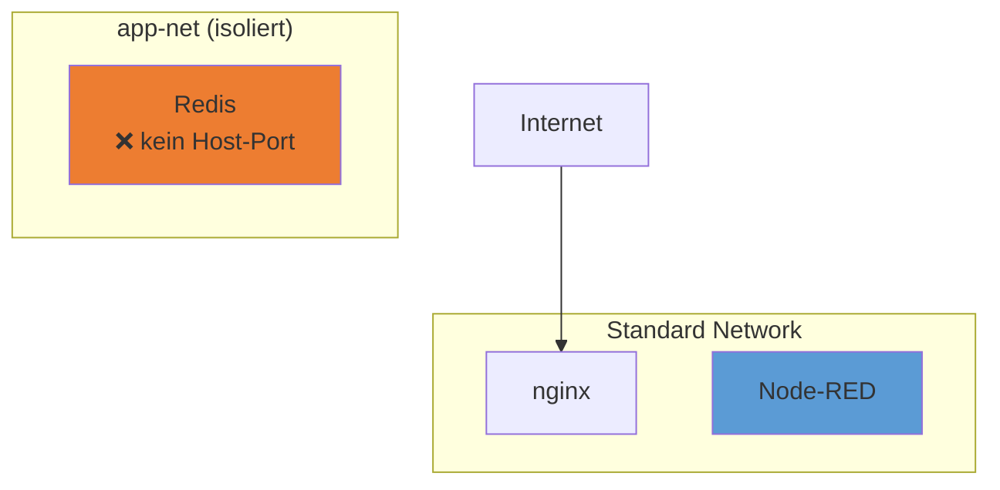

**Lernziel:** Netzwerk-Segmentierung  
**ISO 27001:** Control A.8.22

---

<!-- _footer: 'Linux Administration 2026 | **Lab 08**: Dockerfile | ISO 27001 A.8.9, A.8.32' -->

## 🏗️ Lab 08: Dockerfile
### Eigene Images bauen

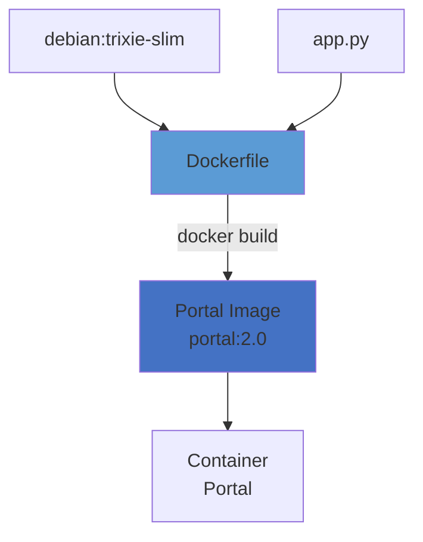

**Lernziel:** Eigene Images bauen  
**ISO 27001:** Control A.8.9, A.8.32

---

<!-- _footer: 'Linux Administration 2026 | **Lab 09**: Docker Compose | ISO 27001 A.5.37' -->

## 🎼 Lab 09: Docker Compose
### Multi-Container-Orchestrierung

```yaml
# compose.yaml
services:
  mosquitto:
    image: eclipse-mosquitto:2
  nodered:
    image: nodered/node-red
  influxdb:
    image: influxdb:2
  grafana:
    image: grafana/grafana
```

**Lernziel:** Multi-Container orchestrieren  
**ISO 27001:** Control A.5.37

---

<!-- _footer: 'Linux Administration 2026 | **Lab 09**: Docker Compose (Fortsetzung)' -->

## 🎼 Lab 09: IoT-Pipeline-Stack

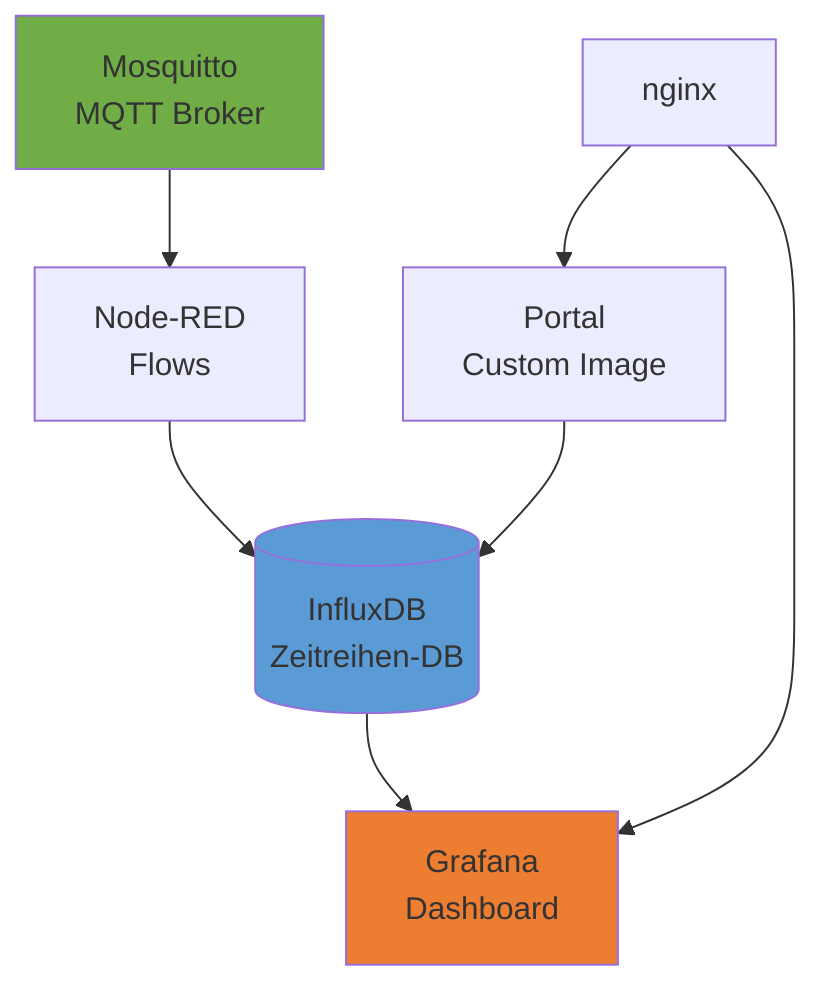

---

## Lab-Progression: Von Lokal zu Cloud

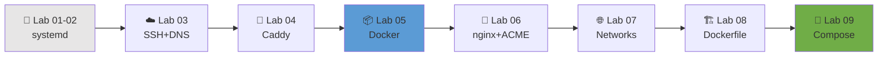

**Progression:** Vom lokalen Dienst zur Cloud-Infrastruktur

---

## ISO 27001 Controls im Kurs

| Lab | Icon | Control | Thema |
|-----|------|---------|-------|
| **Lab 06** | 🔐 | A.8.24 | Verwendung von Kryptographie |
| **Lab 07** | 🌐 | A.8.22 | Netzwerk-Segmentierung |
| **Lab 08** | 🏗️ | A.8.9, A.8.32 | Konfigurations- & Änderungsmanagement |
| **Lab 09** | 🎼 | A.5.37 | Dokumentierte Verfahren |

**Praxisnahe Zertifizierungsvorbereitung**

---

## Finale Architektur

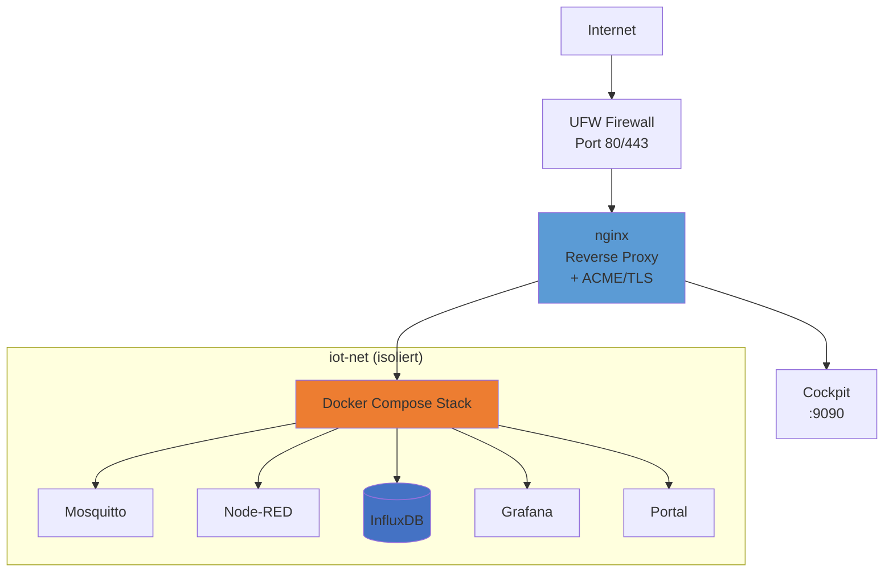

---

## Ausbau-Labs & Spezialisierung

**Lab 01 Ausbau**
- Socket Activation
- UFW Firewall Details
- Drop-in Files
- journalctl Deep-Dive

**Lab 08 Ausbau**
- Backup-Image mit Cron
- Pattern-Verallgemeinerung

**Lab Docker Rootless**
- Rootless Docker auf Linux Mint
- Sicherheits-Härtung

---

## Lernmethodik

<div class="columns">
<div>

**Praxisnah**
- Jedes Lab = Praxis
- Reale Server
- Produktionsnahe Szenarien

**Dokumentiert**
- Markdown-Anleitungen
- Schritt-für-Schritt
- Mit Erklärungen

</div>
<div>

**ISO-konform**
- Controls integriert
- Audit-Vorbereitung
- Best Practices

**Wiederholbar**
- Git-versioniert
- Reproduzierbar
- Nachvollziehbar

</div>
</div>

---

## Voraussetzungen

**Hardware**
- Laptop/PC für VirtualBox (Labs 1-2)
- Cloud Server (Labs 3-9)

**Vorkenntnisse**
- Linux-Grundlagen
- Kommandozeile
- Text-Editor (nano/vim)

**Software**
- Linux Mint 21/22 VM
- SSH-Client
- Webbrowser

---

## Ressourcen & Tools

**Dokumentation**
- Lab-Markdown-Dateien
- CLAUDE.md (Repository-Kontext)
- Inline-Erklärungen

**Tools**
- systemd / systemctl
- Docker / Docker Compose
- nginx / Caddy
- SSH / UFW
- Cockpit

---

## Kurs-Zeitplan

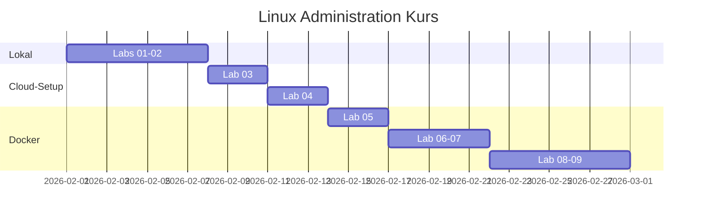

**Flexibel anpassbar an Gruppe**

---

## Best Practices aus dem Kurs

✅ **Niemals** Root-Passwort-Login über SSH  
✅ **Immer** SSH-Key-Authentifizierung  
✅ **Immer** Firewall (UFW) aktiv  
✅ **Immer** TLS/HTTPS für Web-Services  
✅ **Container** ohne Root laufen lassen  
✅ **Secrets** in `.env`-Dateien, nie in Git  
✅ **Netzwerke** segmentieren  
✅ **Logs** zentral sammeln (journalctl)

---

## Häufige Stolpersteine

**SSH**
- Firewall-Regel vor SSH-Config!
- Key-Permissions: 600

**Docker**
- Ports nur lokal binden: `-p 127.0.0.1:8080:80`
- UFW vs. Docker: DOCKER-USER Chain

**nginx**
- `load_module` muss VOR `events {}`
- ACME braucht Port 80 offen

**systemd**
- `daemon-reload` nach Unit-Änderungen
- `--now` = enable + start gleichzeitig

---

## Erfolgs-Checkpoints

Nach dem Kurs können Sie:

✓ Eigene Cloud-Server aufsetzen & sichern  
✓ Web-Services mit TLS veröffentlichen  
✓ Docker-Container produktiv betreiben  
✓ Dienste mit systemd verwalten  
✓ Logs analysieren & Fehler beheben  
✓ ISO 27001-Anforderungen umsetzen  
✓ Infrastructure as Code (Compose)

---

<!-- _class: title -->

# Lab-Materialien

**Alle Markdown-Dateien verfügbar**

- Detaillierte Schritt-für-Schritt Anleitungen
- Code-Beispiele zum Copy & Paste
- Erklärungen & Hintergrundwissen
- Reflexionsfragen
- Zusammenfassungen

📁 Siehe Repository: `Lab_01.md` bis `Lab_09.md`

---

<!-- _class: title -->

# Viel Erfolg!

## Fragen vor dem Start?

**Weiter:** Lab 01 – Cockpit installieren

